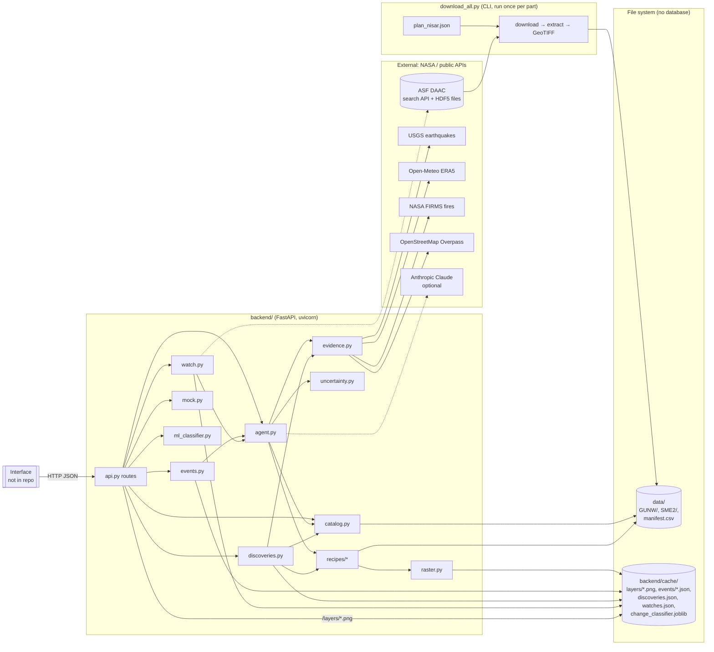
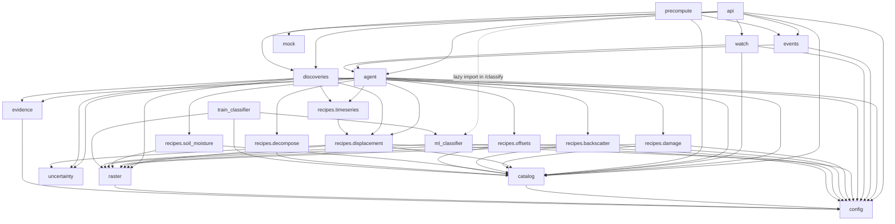
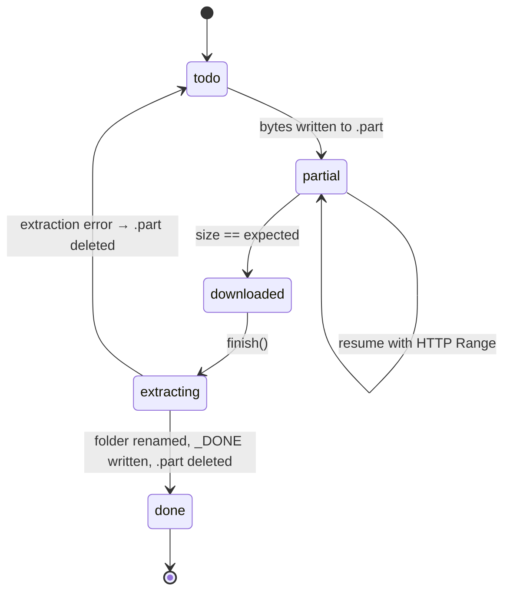
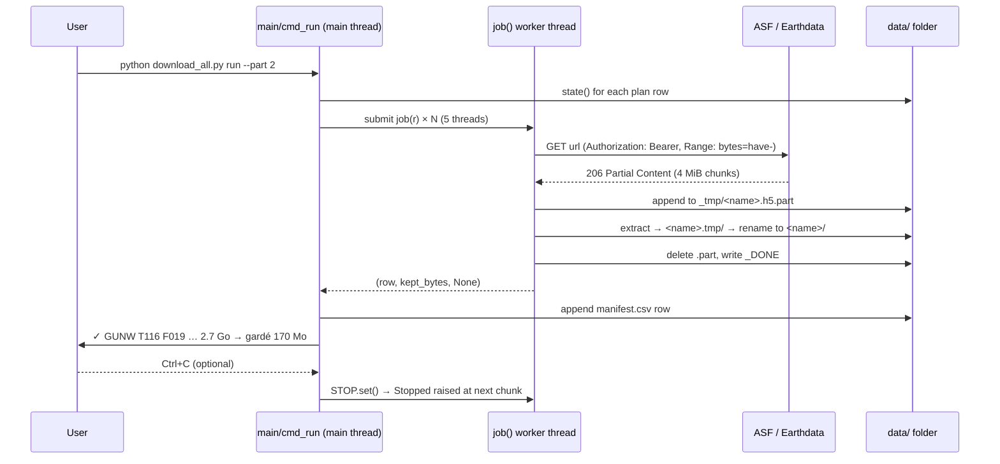
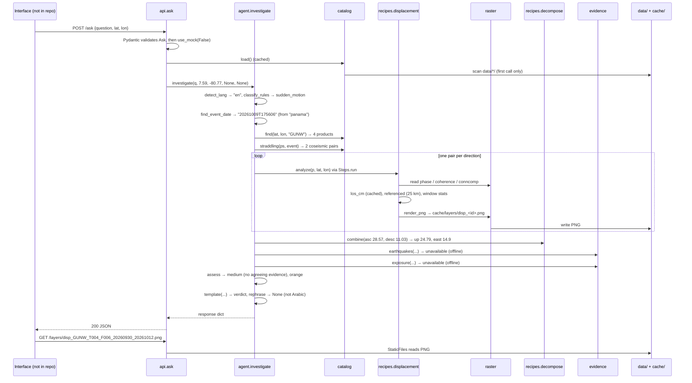
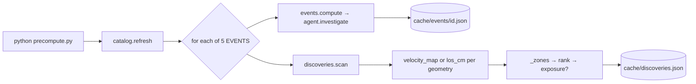
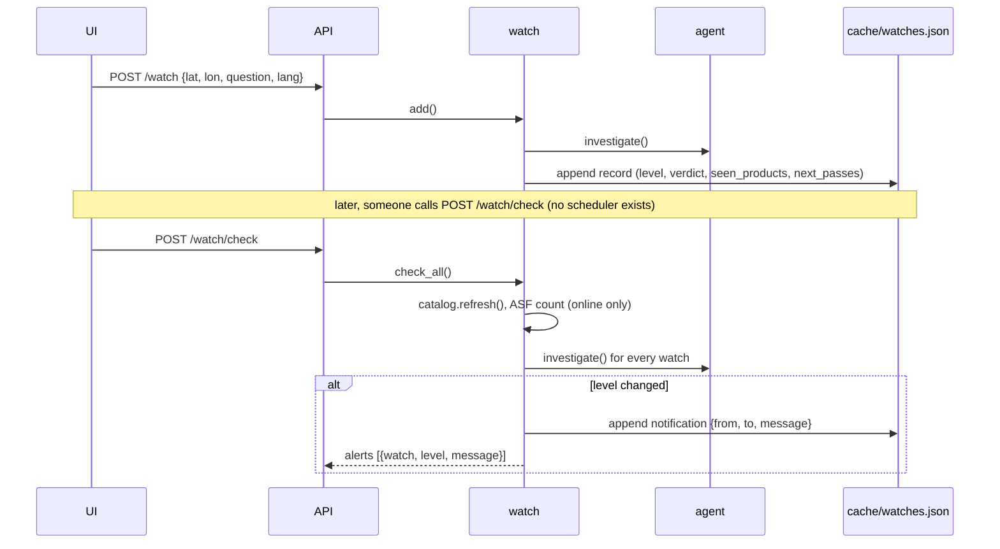
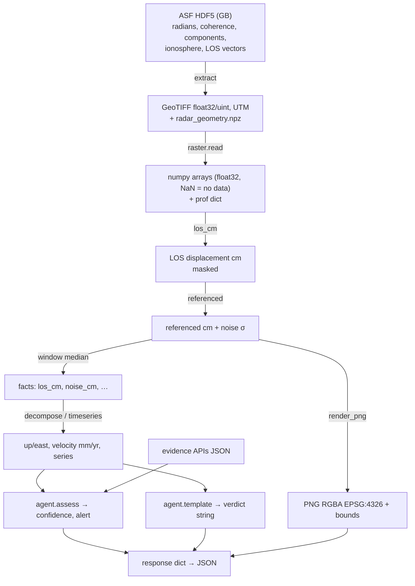
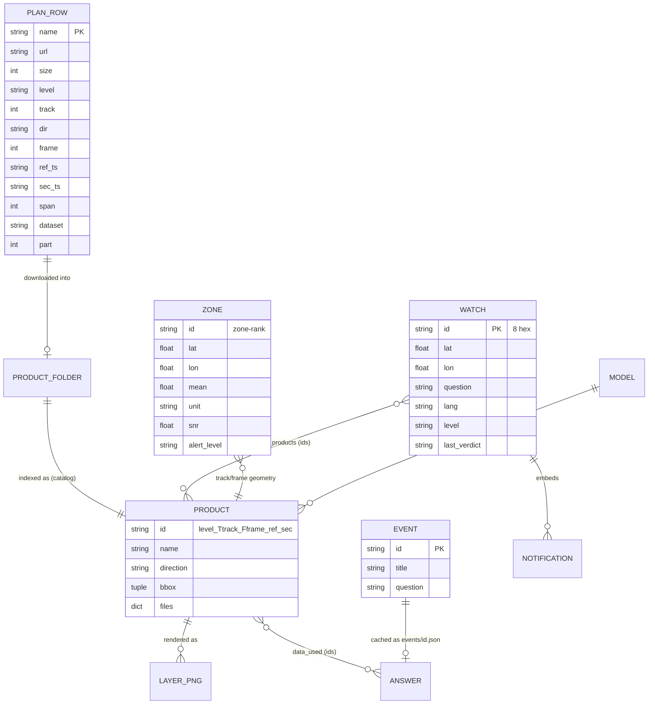

# NISAR Pulse — Project Deep Dive

> A maintainer's guide to the whole repository, written from the code itself.
> Generated on 2026-11-12 from commit `eda84ef` (branch `main`).
> Everything here was checked against the source. Where something could not be determined from
> the code, the text says so. Line numbers point at the current files.

**How to read this document**

| If you want to… | Read |
|---|---|
| understand what the project is in 5 minutes | §1 |
| find your way around the folders | §2 |
| see how the pieces fit together | §3, §5 |
| understand a specific file or function | §4 (per-file chapters) |
| run, test or debug | §10, §12 |
| know what is broken or risky | §13 |
| start changing things | §14, §15 |
| check that you really understand it | §16 |

**Labels used throughout**

- ✅ **Verified**: read in the code, and for behaviour marked "probed", also run on this machine.
- 🟡 **Inference**: a reasonable deduction that the code does not state.
- ❓ **Open question**: not determinable from the available code.

---

## 0. Source-file inventory and coverage checklist

Phase 1 found 34 tracked files. All of them were read. The table maps each file to the place where
it is documented.

| # | File | Lines | Kind | Documented in |
|---|---|---|---|---|
| 1 | `download_all.py` | 553 | Python, standalone CLI | §4.1 |
| 2 | `plan_nisar.json` | 5225 | data (download plan) | §4.30 |
| 3 | `backend/config.py` | 36 | Python, settings | §4.2 |
| 4 | `backend/catalog.py` | 165 | Python, product index | §4.3 |
| 5 | `backend/raster.py` | 104 | Python, raster helpers | §4.4 |
| 6 | `backend/uncertainty.py` | 32 | Python, confidence rules | §4.5 |
| 7 | `backend/recipes/__init__.py` | 1 | Python package marker | §4.6 |
| 8 | `backend/recipes/displacement.py` | 74 | recipe | §4.7 |
| 9 | `backend/recipes/timeseries.py` | 119 | recipe | §4.8 |
| 10 | `backend/recipes/decompose.py` | 52 | recipe helper | §4.9 |
| 11 | `backend/recipes/damage.py` | 43 | recipe | §4.10 |
| 12 | `backend/recipes/backscatter.py` | 72 | recipe | §4.11 |
| 13 | `backend/recipes/soil_moisture.py` | 73 | recipe | §4.12 |
| 14 | `backend/recipes/offsets.py` | 29 | recipe | §4.13 |
| 15 | `backend/agent.py` | 465 | Python, the "investigator" | §4.14 |
| 16 | `backend/evidence.py` | 124 | Python, external APIs | §4.15 |
| 17 | `backend/discoveries.py` | 98 | Python, automatic scan | §4.16 |
| 18 | `backend/events.py` | 54 | Python, event library | §4.17 |
| 19 | `backend/precompute.py` | 22 | Python script | §4.18 |
| 20 | `backend/watch.py` | 115 | Python, watches and alerts | §4.19 |
| 21 | `backend/mock.py` | 42 | Python, fake responses | §4.20 |
| 22 | `backend/api.py` | 163 | Python, FastAPI app | §4.21 |
| 23 | `backend/ml_classifier.py` | 125 | Python, ML | §4.22 |
| 24 | `backend/train_classifier.py` | 48 | Python script | §4.23 |
| 25 | `backend/tests/make_synthetic.py` | 130 | test data generator | §4.24 |
| 26 | `backend/tests/test_all.py` | 110 | end-to-end test | §4.25 |
| 27 | `tools/make_data_zip.py` | 37 | Python script | §4.26 |
| 28 | `backend/requirements.txt` | 15 | dependencies | §4.27, §9 |
| 29 | `.gitignore` | 16 | git config | §4.28 |
| 30 | `README.md` | 159 | docs | §4.29 |
| 31 | `backend/README.md` | 91 | docs | §4.29 |
| 32 | `docs/API_CONTRACT.md` | 61 | docs | §4.29, §8 |
| 33 | `docs/inventaire_GUNW_Maroc.csv` | 430 | data (reference only) | §4.30 |
| 34 | `docs/NISAR_Pulse_v2_project.docx` | binary | project vision (French) | §4.29 |

Not in git, but created at run time and described in §6 and §7: `data/` (downloaded products),
`backend/cache/` (PNG layers, cached answers, watches, the trained model).

**There is no frontend in this repository.** `docs/API_CONTRACT.md` and the project document describe an
interface (React + MapLibre or Leaflet are mentioned) that the backend serves, but no interface code is
committed. ❓ Whether it exists elsewhere is not determinable from the available code.

**Git history.** Two commits, both on 11 Nov 2026, about 3 minutes apart:

| Commit | What changed |
|---|---|
| `d85ffaa` "NISAR Pulse: downloader, analysis backend, API and documentation" | the whole project, 34 files, 8,826 lines, in one commit |
| `eda84ef` "Add the team Earthdata key to the downloader and a detailed download guide in the README" | hard-coded the Earthdata token in `download_all.py` and rewrote `README.md` |

🟡 The project was built elsewhere and committed in one piece, so the history does not show how it
evolved. The project document (dated 11 Nov 2026) and the `.docx` are the best record of intent. The
code comments say the layer names were "checked on real part-1 files (11 Nov 2026)", which suggests the
author had the first real data when the code was committed.

---

## 1. Project overview

### 1.1 In simple words

NISAR is a radar satellite built by NASA and the Indian space agency ISRO. Every 12 days it passes over
the same place and measures the ground with radar. Comparing two passes shows whether the ground
moved by a few millimetres or centimetres, whether a field flooded, or whether a forest was cut. Reading
these measurements normally takes a specialist.

**NISAR Pulse** is a hackathon project (team "The SAR", NASA Space Apps Challenge 2026, challenge
"Dancing with the SARs"). It lets a non-specialist:

1. **Ask.** Point at a place and ask a question in French, English or Arabic, for example *"Is the Al
   Wahda dam deforming since June?"*.
2. **Prove.** The app picks the right NISAR product, computes the answer from the real radar data, and
   checks it against independent public sources (USGS earthquakes, rainfall, NASA fire detections,
   OpenStreetMap buildings). It returns a map, a curve, a one-sentence verdict, a confidence level, and a
   sentence saying what the radar *cannot* tell.
3. **Watch.** Save the place. At every new pass, the question is asked again and an alert is raised if
   the alert level changes.

It also includes a **downloader** that gets the radar files from NASA's archive and shrinks them, an
**automatic discovery** that scans all downloaded data for zones that move, a small **library of
precomputed events** for a reliable demo, and an experimental **machine-learning classifier** that
labels changes as flood, burn or vegetation loss.

### 1.2 Intended users

From `docs/NISAR_Pulse_v2_project.docx` (✅ stated there, not in code): civil-protection agents ("which
villages were hit?"), dam and mine engineers ("is this dyke moving, is it accelerating?"), farmers and
agricultural insurers ("was my field flooded?"), town planners ("is this neighbourhood sinking?"),
journalists and NGOs ("was this forest cut since June?"). The demo focuses on the first two.
Morocco is the demonstration area, plus two earthquakes (Panama, 9 Oct 2026; Venezuela, 24 Jun 2026).

### 1.3 Core features and where they live

| Feature | Main code | Status |
|---|---|---|
| Download NISAR files from ASF, keep only useful layers, resume after interruption | `download_all.py` | ✅ working; part 1 reported downloaded by the team |
| Index of downloaded products | `backend/catalog.py` | ✅ working |
| Question → type → analysis → verdict (FR/EN/AR) | `backend/agent.py` | ✅ working on synthetic data |
| 7 analysis "recipes" | `backend/recipes/*.py` | ✅ 5 tested on real-shaped data; GCOV/GOFF recipes need data that is not in the download plan |
| Confidence and alert levels | `backend/uncertainty.py`, `agent.assess` | ✅ fixed rules |
| Independent evidence (USGS, Open-Meteo, FIRMS, OSM) | `backend/evidence.py` | ✅ code present; not covered by tests (tests run offline) |
| Automatic discovery of moving zones | `backend/discoveries.py` | ✅ working on synthetic data |
| Precomputed event library | `backend/events.py`, `backend/precompute.py` | ✅ |
| Watches and alerts | `backend/watch.py` | ⚠️ partial: no scheduler; re-runs on local data only |
| Change classifier (XGBoost) | `backend/ml_classifier.py`, `train_classifier.py` | ⚠️ experimental: no real labelled data or `training_events.json` in the repo |
| HTTP API + mock mode | `backend/api.py`, `backend/mock.py` | ✅ |
| User interface | — | ❌ not in the repository |
| L-band vs C-band comparison (in the project document) | — | ❌ not implemented |

### 1.4 In technical terms

- **Language:** Python only (3.10+ required by the `X | None` type hints used at runtime by Pydantic in `api.py`; this machine runs 3.13).
- **Two independent programs**:
  1. `download_all.py`: a multi-threaded CLI that queries the **ASF DAAC search API**, downloads HDF5
     files with HTTP Range resume, extracts selected 2-D datasets with **h5py**, and writes them as
     compressed **GeoTIFFs** with **rasterio**.
  2. `backend/`: a **FastAPI** service. Requests go to an "agent" that classifies the question with
     keyword rules (optionally an Anthropic Claude model), calls a numerical **recipe** written with
     **NumPy/SciPy/rasterio/pyproj**, gathers external **evidence** over HTTP, computes confidence with
     fixed rules, renders **PNG map overlays** with matplotlib + Pillow, and returns JSON.
- **No database.** State lives in files: the `data/` folder is the product store (folders + `_DONE`
  markers), and `backend/cache/` holds JSON files (events, discoveries, watches), PNG layers and a
  `joblib` model.
- **No authentication.** CORS is fully open.
- **The design principle** stated in `agent.py:1-5` and the project document: *numbers come only from
  the recipes*. A language model may help classify a question or reword a sentence, but any number it
  writes that is not in the computed facts makes the code fall back to a fixed template.

### 1.5 Current implementation status (as of `eda84ef`)

- The test suite **passes 30/30** on this machine (✅ run during this analysis, Python 3.13, numpy 2.5.4).
- The backend has been exercised only on **synthetic data**. Real data is not in git. Whether the
  answers are scientifically right on real NISAR files is ❓ not determinable from the repo. The READMEs
  list a required manual calibration step (the LOS sign check, §11.1).
- There are no unit tests for the downloader, the external APIs, the LLM path or concurrency.
- The project document dates the hackathon around **14 November 2026**, so this is demo-oriented code:
  compact, pragmatic and lightly defended against bad input.

---

## 2. Complete project structure

### 2.1 Directory tree (meaningful files)

```
NASA_SAR/
├── download_all.py            # CLI: plan → download → extract → GeoTIFF (standalone)
├── plan_nisar.json            # the 345-file download plan, split in 5 parts
├── README.md                  # team guide: download + run
├── .gitignore                 # excludes data, cache, secrets, binaries
├── docs/
│   ├── API_CONTRACT.md        # JSON contract for the (absent) interface
│   ├── inventaire_GUNW_Maroc.csv   # 429 GUNW interferograms over Morocco (reference only)
│   └── NISAR_Pulse_v2_project.docx # project vision, in French
├── tools/
│   └── make_data_zip.py       # zip the processed data/ to share it
├── data/                      # (runtime, git-ignored) written by download_all.py
│   ├── GUNW/<product name>/   #   *.tif layers, radar_geometry.npz, _DONE
│   ├── SME2/<product name>/   #   <name>.h5, _DONE
│   ├── _tmp/                  #   *.h5.part partial downloads
│   └── manifest.csv           #   one row per finished/failed file
└── backend/
    ├── README.md              # backend guide
    ├── requirements.txt       # pip dependencies (unpinned)
    ├── config.py              # settings from environment variables
    ├── api.py                 # FastAPI app: the HTTP entry point
    ├── agent.py               # question → recipe → evidence → verdict
    ├── catalog.py             # index of downloaded products
    ├── raster.py              # read / sample / render rasters
    ├── uncertainty.py         # noise floor + confidence rules
    ├── evidence.py            # USGS, Open-Meteo, FIRMS, OpenStreetMap
    ├── discoveries.py         # scan all geometries for moving zones
    ├── events.py              # precomputed event library
    ├── precompute.py          # script: fill the event + discovery caches
    ├── watch.py               # saved questions, next passes, alerts
    ├── mock.py                # fake responses for interface work
    ├── ml_classifier.py       # change classifier (features, train, predict)
    ├── train_classifier.py    # script: train from training_events.json
    ├── recipes/
    │   ├── __init__.py
    │   ├── displacement.py    # sudden motion (one interferogram)
    │   ├── timeseries.py      # slow motion (stack of interferograms)
    │   ├── decompose.py       # ascending + descending → vertical + east
    │   ├── damage.py          # coherence-loss damage proxy
    │   ├── backscatter.py     # flood / deforestation (GCOV)
    │   ├── soil_moisture.py   # SME2 soil moisture
    │   └── offsets.py         # large displacement (GOFF)
    ├── tests/
    │   ├── make_synthetic.py  # builds fake NISAR-shaped data with known answers
    │   └── test_all.py        # 30 end-to-end checks through the API
    └── cache/                 # (runtime, git-ignored) layers/, events/, *.json, model
```

### 2.2 Folder-level responsibilities

| Folder | Purpose | Depends on | Depended on by | If removed |
|---|---|---|---|---|
| repo root | the downloader and its plan; the two must sit together (`PLAN_FILE = HERE / "plan_nisar.json"`) | ASF, Earthdata | `backend/` reads the `data/` it creates | no way to get data |
| `backend/` | the whole analysis service | `data/` (via `NISAR_DATA`) | the interface (absent) | no app |
| `backend/recipes/` | pure numerical analyses, one per question type; they return plain dicts of facts | `raster`, `catalog`, `config`, `uncertainty` | `agent`, `discoveries` | agent cannot answer anything |
| `backend/tests/` | synthetic data + end-to-end checks | everything in `backend/` | you, before every change | no safety net |
| `backend/cache/` | everything computed at run time | written by `config`, `raster`, `events`, `discoveries`, `watch`, `ml_classifier` | `api` serves `cache/layers` as static files | regenerated automatically, but **saved watches are lost** |
| `data/` | the product store | `download_all.py` | `catalog.load()` | backend runs in mock mode |
| `docs/` | documentation and reference data; no code reads it | — | humans | nothing breaks |
| `tools/` | one helper script | `data/` | humans | nothing breaks |

### 2.3 File-level responsibilities (summary)

Each file gets a full chapter in §4. This table is the quick map, including what depends on what.

| File | Responsibility (from its contents) | Imports (project) | Imported / used by | If removed or badly changed |
|---|---|---|---|---|
| `download_all.py` | builds or loads the plan, downloads with resume, extracts layers, writes `_DONE` + `manifest.csv` | none | humans; its output layout is a contract with `catalog.py` | no data; a layout change silently empties the catalog |
| `plan_nisar.json` | the frozen list of 345 files (name, URL, size, part…) | — | `download_all.load_plan()` | the script rebuilds it from ASF, possibly different from teammates' |
| `config.py` | paths, physical constants, thresholds, optional keys, gazetteer | none | almost every backend module | the import fails everywhere |
| `catalog.py` | turns `data/` folders into `Product` objects; spatial and temporal filters | `config` | `api`, `agent`, `discoveries`, `watch`, `precompute`, all recipes (type), `train_classifier` | nothing finds data |
| `raster.py` | read GeoTIFF, lat/lon ↔ pixel, windows, profile, PNG rendering | `config` | all recipes, `discoveries`, `ml_classifier`, `train_classifier`, tests | no numbers, no maps |
| `uncertainty.py` | robust noise (MAD) and the confidence rule | none | `agent`, `discoveries`, `recipes/displacement` | no confidence levels |
| `recipes/displacement.py` | phase → cm, masking, referencing, point stats, map | `raster`, `catalog`, `config`, `uncertainty` | `agent`, `timeseries`, `discoveries` | sudden *and* slow motion break |
| `recipes/timeseries.py` | small-baseline inversion per point and per pixel | `catalog`, `recipes.displacement` (`raster` imported, unused) | `agent`, `discoveries` | slow motion + discoveries break |
| `recipes/decompose.py` | 2×2 solve for east + up from asc/desc | `catalog` (type only) | `agent`, `tests/make_synthetic` | no vertical values; synthetic data generator breaks |
| `recipes/damage.py` | coherence loss before vs during an event | `raster`, `catalog`, `config` | `agent` | damage questions fail |
| `recipes/backscatter.py` | HH/HV change for flood and deforestation | `raster`, `catalog`, `config` | `agent` | flood/deforestation fail |
| `recipes/soil_moisture.py` | read SME2 HDF5 grid; series and anomaly | `raster`, `catalog` | `agent` | soil questions fail |
| `recipes/offsets.py` | magnitude of GOFF pixel offsets | `raster`, `catalog`, `config` | `agent` | large-displacement questions fail |
| `agent.py` | language, type, place, date detection; runs recipes; evidence; confidence; sentences | `catalog`, `evidence`, `config`, all recipes, `uncertainty` | `api`, `events`, `watch` | `/ask`, events and watches break |
| `evidence.py` | 4 external APIs, never raise | `config` | `agent`, `discoveries` | answers lose evidence; `agent` import fails |
| `discoveries.py` | velocity/displacement maps → hot zones → ranking | `catalog`, `evidence`, `raster`, `config`, recipes, `uncertainty` | `api`, `precompute` | `/discoveries` breaks |
| `events.py` | 5 fixed demo questions, cached as JSON | `agent`, `config` | `api`, `precompute` | `/events` breaks |
| `precompute.py` | script to fill caches before the demo | `catalog`, `discoveries`, `events` | humans, `test_all` | demo is slower, not broken |
| `watch.py` | watches in `watches.json`, next passes, notifications | `agent`, `catalog`, `config` | `api` | `/watch*`, `/next-pass` break |
| `mock.py` | three constant dicts | none | `api` | mock mode breaks |
| `api.py` | FastAPI routes, CORS, static layers, mock switch | `agent`, `catalog`, `discoveries`, `events`, `mock`, `watch`, `config`, (`ml_classifier`) | uvicorn, `test_all` | no HTTP service |
| `ml_classifier.py` | features, sampling, training, prediction | `raster`, `config` | `api` (`/classify`), `train_classifier`, `test_all` | `/classify` 500s |
| `train_classifier.py` | builds labelled sets from a JSON description and trains | `catalog`, `ml_classifier`, `raster` | humans | cannot train on real data |
| `tests/make_synthetic.py` | writes fake products in the exact downloader layout | `config`, `recipes.decompose` | `test_all` (subprocess) | no tests |
| `tests/test_all.py` | 30 end-to-end checks | `api`, `catalog`, `ml_classifier`, `raster` | humans | no safety net |
| `tools/make_data_zip.py` | zip `data/GUNW`, `data/SME2`, `manifest.csv` | none | humans | sharing data is manual |

---

## 3. Architecture deep dive

### 3.1 Background you need first (radar in 10 minutes)

You cannot maintain this code without these terms. Each one maps to something in the code.

| Term | Meaning | Where it shows up |
|---|---|---|
| **SAR** (Synthetic Aperture Radar) | a satellite radar that sends microwaves and records the echo. It works day, night and through clouds. | the whole project |
| **L-band** | NISAR's radar wavelength, about **24 cm**. Long waves go through vegetation better than Sentinel-1's 5.6 cm C-band. | `config.WAVELENGTH_M = 0.2384` |
| **Pass, track, frame** | the satellite flies on fixed orbits. A **track** is a numbered orbit path; a **frame** is a numbered slice along it. `(track, frame)` is a **geometry**. The same geometry is revisited every **12 days**. | `Product.geometry`, `watch.REPEAT_DAYS = 12` |
| **Ascending / descending** | ascending passes go south→north, descending north→south. They look at the ground from opposite sides (east vs west). | `Product.direction`, `recipes/decompose.py` |
| **Line of sight (LOS)** | the radar only measures motion **along the line between the ground and the satellite**. One geometry gives one number per pixel, not a 3-D vector. | `los_cm`, `decompose.los_vector` |
| **Interferogram** | the phase difference between two passes of the same geometry. The phase change is proportional to the LOS motion: `d = -λ/(4π) · Δφ`. | `recipes/displacement.los_cm` |
| **Wrapped / unwrapped phase** | the raw phase is only known modulo 2π ("wrapped"). "Unwrapping" adds the right multiple of 2π to get a continuous field. | layer `unwrappedPhase` |
| **Connected components** | the unwrapping splits the image into regions; each is self-consistent, but they may be offset by 2π from each other. Component `0` means "not unwrapped". | layer `connectedComponents`, `cc == 0` mask |
| **Coherence** | 0–1 quality of the interferogram per pixel. Vegetation, water, construction or damage lower it. | layer `coherenceMagnitude`, `COHERENCE_MIN = 0.3` |
| **Ionospheric phase screen** | L-band is sensitive to the ionosphere, which adds a fake phase. NISAR ships an estimate of it that can be subtracted. | layer `ionospherePhaseScreen` |
| **Reference pair / secondary** | an interferogram is made from a **reference** acquisition (earlier) and a **secondary** one (later). | `Product.ref`, `Product.sec` |
| **Backscatter, HH / HV** | the echo power. HH = sent horizontal, received horizontal; HV = sent H, received V (strong over vegetation volume). Expressed in **dB** = `10·log10(power)`. | `recipes/backscatter.py`, `ml_classifier.py` |
| **SBAS (small baseline subset)** | turning many short interferograms (12 or 24 days) into a displacement time series by least squares. | `recipes/timeseries.py` |
| **CRS / EPSG** | coordinate reference system. EPSG:4326 = lat/lon; EPSG:326xx = UTM metres (northern hemisphere). NISAR grids are in UTM. | `raster.to_pixel`, `render_png` |
| **Affine transform** | the 6-number formula that converts pixel (col,row) into map (x,y). `~transform` is its inverse. | `raster.to_pixel` |
| **GeoTIFF / HDF5** | GeoTIFF = image file with georeferencing; HDF5 (`.h5`) = hierarchical container of many arrays. NISAR ships HDF5; the downloader converts the useful arrays to GeoTIFF. | `download_all.extract` |

**NISAR products used by the code** (the "level" in file names):

| Level | Content | Used for | In download plan? |
|---|---|---|---|
| **GUNW** (L2 Geocoded Unwrapped Interferogram) | unwrapped phase, coherence, connected components, ionosphere, LOS vectors | sudden motion, slow motion, damage, discoveries | ✅ 153 files |
| **SME2** (L3 Soil Moisture) | soil-moisture grid in m³/m³ | soil moisture | ✅ 192 files |
| **GCOV** (L2 Geocoded Covariance) | backscatter power HH, HV, VV, VH | flood, deforestation, change classifier | ❌ ("not in the download plan yet", backend README) |
| **GOFF** (L2 Geocoded Pixel Offsets) | along-track and range offsets in metres | large displacement | ❌ |

**NISAR file name anatomy** (from `catalog.parse_name`, `download_all.parse_name` and real names in the plan):

```
NISAR_L2_PR_GUNW_032_004_A_006_033_4000_SH_20260930T110434_20260930T110509_20261012T110435_20261012T110509_P05023_N_F_J_001
 [0]  [1] [2] [3] [4] [5] [6] [7] [8] [9] [10]  [11] ref start   [12] ref end    [13] sec start  [14] sec end    ...  [-3]
      lvl     LEVEL    TRACK DIR FRAME                                                                               F/P
```

The code uses: `[3]` level, `[5]` track, `[6]` `A`/`D`, `[7]` frame, every token of the form
`YYYYMMDDTHHMMSS` (the 1st is the reference start, the 3rd is the secondary start), and `[-3]` (`F` = full
frame, `P` = partial; downloader only). 🟡 `[4]` and `[8]` look like cycle numbers, `[9]`/`[10]` like a
mode/bandwidth and polarisation code (the CSV calls `[9]_[10]` "mode", e.g. `4000_SH`), and `PR` like
"provisional" (the ASF collection is `NISAR_L2_GUNW_PROVISIONAL_V1`). ❓ The code does not rely on them.
SME2/GCOV names have only **two** timestamps, so for them `sec == ref` and `span_days == 0`.

### 3.2 The big picture



There are **two separate programs that communicate only through the `data/` folder**: the downloader
writes it, the backend reads it. That folder layout is the most important contract in the project
(§6.2).

### 3.3 Module dependency graph (actual imports)



Notes:
- `config` is a leaf: it imports nothing from the project, so there are no circular imports.
- Modules import each other **by bare name** (`import catalog`, `from recipes import displacement`).
  This only works when the current working directory, or `sys.path`, contains `backend/`. That is why
  every command in the READMEs is run from `backend/`, and why `tests/` and `make_synthetic.py` push
  `backend/` onto `sys.path`. See §9.3.
- `recipes/timeseries.py` imports `raster` but never uses it.

### 3.4 Layered view

| Layer | Modules | Rule it follows |
|---|---|---|
| **HTTP** | `api.py` | thin: validate the body with Pydantic, pick mock or real, call one function, map errors to status codes |
| **Orchestration** | `agent.py`, `events.py`, `watch.py`, `discoveries.py` | decide *what* to compute; call recipes; add evidence; turn facts into sentences |
| **Domain computation** | `recipes/*`, `uncertainty.py`, `ml_classifier.py` | pure numbers in, dict of facts out; no HTTP, no language |
| **Infrastructure** | `catalog.py`, `raster.py`, `evidence.py`, `config.py` | files, coordinates, images, external APIs, settings |
| **Data production** | `download_all.py`, `tools/make_data_zip.py` | offline batch work, independent of the backend |

### 3.5 Frontend architecture

None in the repository. The backend is designed for a map-based single-page app:
- map overlays are PNG images plus `bounds: [[south, west], [north, east]]`, placed with Leaflet
  `L.imageOverlay(url, bounds)` or a MapLibre image source (`docs/API_CONTRACT.md`);
- every data endpoint accepts `?mock=true`;
- `steps` in each answer feeds a "how I found this" panel.

### 3.6 Backend and API architecture

- **Framework:** FastAPI, served by uvicorn. All route functions are plain `def` (not `async def`), so
  FastAPI runs each request in a **thread pool**. Several requests can run at the same time in
  different threads. This matters for the file-based stores (§13).
- **Routing:** one flat module, `api.py`, 15 routes plus a static mount (§8).
- **Validation:** Pydantic models `Ask`, `WatchIn`, `ClassifyIn` validate JSON bodies (types only: no
  range checks on `lat`/`lon`, no check that `lang` is fr/en/ar, no date format check).
- **Mock switch:** `use_mock(flag)` returns fake data when `?mock=true`, when `NISAR_MOCK=1`, or when
  the catalog is empty.

### 3.7 Database architecture

There is no database (no SQL, no ORM, no migrations). §7 documents the file-based stores that play
that role.

### 3.8 Authentication and authorization

- **Backend:** none. Any client can call any route, including `DELETE /watch/{id}` and
  `POST /watch/check` (which triggers heavy computation). CORS allows every origin, method and header
  (`api.py:23`).
- **Downloader:** NASA Earthdata **bearer token** (a JWT) in the `Authorization` header
  (`download_all.session`, line 213). Token resolution order is in `get_token` (§4.1). A long-lived team
  token is **hard-coded** at `download_all.py:497` (§13.1, security).
- **Optional API keys:** `ANTHROPIC_API_KEY` (paid) and `FIRMS_MAP_KEY` (free), read from the
  environment in `config.py`.

### 3.9 State management

| State | Where | Lifetime | Written by | Read by |
|---|---|---|---|---|
| list of products | `catalog.load()` `lru_cache(maxsize=1)` | process, until `catalog.refresh()` | `catalog.load` | everything |
| last 8 displacement maps | `displacement.los_cm` `lru_cache(maxsize=8)` | process | `los_cm` | `analyze`, `timeseries`, `discoveries` |
| PNG layers | `cache/layers/*.png` | disk, overwritten per product | `raster.render_png` | browser via `/layers` |
| event answers | `cache/events/<id>.json` | disk, until `?refresh=true` or `precompute.py` | `events.compute` | `/events*` |
| discoveries | `cache/discoveries.json` | disk | `discoveries.scan` | `/discoveries` |
| watches | `cache/watches.json` | disk | `watch.add/remove/check_all` | `/watch*` |
| trained model | `cache/change_classifier.joblib` (+ `_metrics.json`) | disk | `ml_classifier.train` | `/classify` |
| download progress | `data/<level>/<name>/_DONE`, `data/_tmp/*.part`, `manifest.csv` | disk | `download_all` | `download_all`, `catalog` |
| stop flag | `download_all.STOP` (`threading.Event`) | process | Ctrl+C handler | download/extract loops |

### 3.10 Business logic: where it lives

- **What counts as "moving"**: `uncertainty.confidence` (signal vs 3× noise) and `discoveries._zones`
  (pixels beyond 3σ).
- **Alert levels**: `agent.assess` (answers) and `discoveries.scan` (zones). Same idea, two copies.
- **Which data answers which question**: the `if qtype == …` chain in `agent.investigate`.
- **What the user is told**: `agent.template`, `agent.template_ar`, `CANNOT_SAY`, `CANNOT_SAY_AR`,
  `no_data_sentence`.
- **What to download**: `download_all.DATASETS`, `ATLAS_FRAMES`, `build_plan`.

### 3.11 Background jobs

There is **no scheduler, worker queue or cron** in the code. Background-like work exists only as:
- `precompute.py`, run by hand before a demo;
- `watch.check_all()`, which its docstring says to call "daily (cron / Windows Task Scheduler) or from
  POST /watch/check". Nothing sets that up;
- the downloader's thread pool (`ThreadPoolExecutor(workers)`), a foreground CLI.

### 3.12 External services

| Service | Used by | Auth | Failure handling |
|---|---|---|---|
| ASF DAAC search `api.daac.asf.alaska.edu/services/search/param` | `download_all.search`, `watch.new_granules_on_asf` | none | downloader: raises; watch: returns `[]` |
| ASF file hosting `nisar.asf.earthdatacloud.nasa.gov` | `download_all.download` | Earthdata bearer token | 6 retries with growing wait; 401 stops the program |
| USGS FDSN event API | `evidence.earthquakes` | none | `status: unavailable` |
| Open-Meteo archive (ERA5) | `evidence.rainfall` | none | `status: unavailable` |
| NASA FIRMS area API | `evidence.fires` | `FIRMS_MAP_KEY` in URL path | `unavailable` if no key or error |
| Overpass (OpenStreetMap) | `evidence.exposure` | none | `unavailable` |
| Anthropic Messages API | `agent.classify_llm`, `agent.rephrase` | `ANTHROPIC_API_KEY` | returns `None` → rules/templates used |

`NISAR_OFFLINE=1` turns off every evidence call and the ASF query in `watch`. It does **not** affect the
downloader or the LLM calls (the LLM is simply skipped when no key is set).

### 3.13 Error handling strategy

The code follows a consistent "**degrade, don't crash**" approach:
1. `evidence.*` never raises; it returns `{"status": "unavailable", …}`.
2. `agent.Steps.run` wraps each recipe and evidence call: an exception becomes a step with
   `ok: False, error: "…"` and the call returns `None`.
3. Recipes return `{"error": "…"}` dicts for expected "no data" situations.
4. `agent.investigate` turns missing or errored facts into a polite "no data" verdict with
   `confidence: low`.
5. `api.ask` turns the "no location" case into HTTP 400.

Gaps: some code paths sit outside `Steps.run` and can still raise (e.g. `run_sudden` when every pair
fails, probed ✅ → HTTP 500). See §12 and §13.

### 3.14 Caching

- In-memory: `catalog.load` (1 entry) and `displacement.los_cm` (8 entries). `Product` is a dataclass
  with `eq=False`, so it is hashed **by identity**: after `catalog.refresh()` the new `Product` objects
  miss the `los_cm` cache, and old entries age out.
- On disk: event answers, discoveries and PNG layers. PNG names depend on the **product**, not on the
  clicked point (§13).
- No HTTP cache headers are set on PNGs (StaticFiles defaults: ETag/Last-Modified).

### 3.15 Configuration and environment

All settings are read once at import time from environment variables in `config.py` (§4.2, §10.3).
Changing one requires restarting the process. `api.py` reads `NISAR_MOCK` itself.

### 3.16 Why it is built this way, and the trade-offs

| Decision | Why (stated or 🟡 inferred) | Advantage | Disadvantage |
|---|---|---|---|
| Fixed recipes + templates; LLM optional | the project document: the jury must trust the numbers; "the LLM invents a number" is a listed risk | deterministic, testable, works offline and free | keyword classification is brittle (§11.6) |
| Download then shrink to GeoTIFF | raw GUNW ≈ 1.4–2.7 GB; kept layers ≈ 170 MB (README example) | ~10–15× less disk; fast reads with rasterio | must re-download to get another layer |
| File system instead of a DB | hackathon speed; data are rasters | zero setup; copy folders to merge team data | no concurrency control, no queries |
| Precomputed events + mock mode | the demo must be instant and survive bad Wi-Fi | reliable demo; UI can be built before data | cached answers can go stale |
| One process, sync endpoints | simplicity | easy to debug | heavy requests (time series, discoveries) block a worker thread for seconds to minutes |
| Synthetic end-to-end tests | no real data in git | every feature tested in a minute, offline | tests prove the code is self-consistent, not that it is right on real NISAR data |

---

## 4. File-by-file explanation

Each chapter follows the same pattern: **A** purpose, **B** imports, **C** walkthrough, **D** every
function, **E** connections, **F** beginner summary. In part D, each function has a compact card with
the 14 points you asked for. For one-line helpers, several points are merged into one sentence.

---

### 4.1 File: `download_all.py`

#### A. Purpose

A standalone command-line program (comments and messages in French) that turns a **plan** of NISAR
products into a local, compact **data folder** the backend can read. It:
1. loads `plan_nisar.json` (or builds it from the ASF search API);
2. downloads one *part* of the plan with several threads, resuming partial files byte by byte;
3. opens each HDF5 file, copies only the useful 2-D layers to compressed GeoTIFFs, plus a small
   `radar_geometry.npz` of viewing-geometry arrays, then deletes the raw file;
4. marks each finished product with `_DONE` and logs it in `manifest.csv`.

It exists because raw files are large (GUNW files are 0.9–2.7 GB each in the plan; the 345 files add up to
≈ 331 GB, ✅ computed from `plan_nisar.json`) and the backend needs only a few layers.

#### B. Imports and dependencies

| Import | From | Why | Used in |
|---|---|---|---|
| `argparse` | stdlib | CLI parsing | `main` |
| `csv` | stdlib | write `manifest.csv` | `cmd_run` |
| `json` | stdlib | read/write the plan, `_DONE`, `_structure.json` | many |
| `os` | stdlib | read `EARTHDATA_TOKEN` env var | `get_token` |
| `shutil` | stdlib | delete/move folders, disk usage | `extract`, `finish`, `cmd_run` |
| `signal` | stdlib | **imported but never used** | — |
| `sys` | stdlib | exit codes | `get_token`, `main` |
| `threading` | stdlib | `STOP` event, thread-local sessions, a lock | module level, `session`, `cmd_run` |
| `time` | stdlib | timestamps, retry sleeps | many |
| `ThreadPoolExecutor, wait, FIRST_COMPLETED` | `concurrent.futures` | parallel downloads, poll for finished jobs | `cmd_run` |
| `date` | `datetime` | compute pair span in days | `_d`, `parse_name` |
| `Path` | `pathlib` | paths | everywhere |
| `requests` | PyPI | HTTP search and download | `search`, `session`, `download` |
| `h5py`, `numpy`, `rasterio`, `rasterio.transform.from_origin` | PyPI, **imported inside functions** | HDF5 reading, arrays, GeoTIFF writing | `_write_tif`, `extract` |
| `rich.console`, `rich.table`, `rich.progress` | PyPI, **imported inside functions** | coloured tables and progress bars | `cmd_status`, `cmd_run` |
| `getpass` | stdlib, inside `get_token` | hidden token prompt | `get_token` |

Importing the heavy packages inside functions means `python download_all.py --help` works even when
they are missing.

> ⚠️ `rich` is **not** in `backend/requirements.txt`. README step 2 installs only the requirements
> file, then step 3 says to run `python download_all.py status`, which needs `rich`. On this machine
> `rich` is not installed (✅ checked), so `status` and `run` would fail with `ModuleNotFoundError`.
> The downloader's own install line (README "Install (once)") does include `rich`.

#### C. Code walkthrough

**Module constants (lines 42–75)**

```python
HERE = Path(__file__).resolve().parent            # repo root
PLAN_FILE = HERE / "plan_nisar.json"
SEARCH_URL = "https://api.daac.asf.alaska.edu/services/search/param"
N_PARTS = 5
PILOT_GB = 20
```

`ATLAS_FRAMES` (line 51) is a set of 11 `(track, frame)` pairs over Morocco: 6 ascending
(`(116,18) (116,19) (15,19) (44,17) (44,18) (145,17)`) and 5 descending
(`(95,71) (95,72) (23,71) (23,72) (23,73)`).

`DATASETS` (line 55) describes four ASF searches:

| key | level | bbox (W,S,E,N) | dates | filters |
|---|---|---|---|---|
| `panama` | GUNW | −81.8, 6.8, −79.8, 8.6 | 2026-09-01 → 2026-11-15 | spans 12/24/36 days; event `20261009T175606` (USGS us6000u18k) |
| `venezuela` | GUNW | −67.6, 10.2, −66.4, 10.9 | 2026-06-01 → 2026-07-31 | spans 12/24/36; event `20260624T000000` |
| `atlas` | GUNW | −10, 28, −1, 36 | from 2026-06-17 | only `ATLAS_FRAMES`; spans 12/24 |
| `sme2` | SME2 | −8.5, 32.5, −3.5, 36 | from 2026-06-17 | none |

`PRIORITY` orders datasets inside a part (Panama first). `LAYERS` (line 70) is the **list of HDF5
dataset base names to keep** per level. GUNW keeps `unwrappedPhase`, `coherenceMagnitude`,
`connectedComponents`, `ionospherePhaseScreen`. GCOV and GOFF entries exist for future use.
`META_KEYWORDS` picks small viewing-geometry datasets (`losUnitVector*`, `incidenceAngle`,
`elevationAngle`) to save in `radar_geometry.npz`.

**Stop mechanism (lines 78–82).** `Stopped` is a custom exception. `STOP` is a `threading.Event` set on
Ctrl+C. The worker loops check it between 4 MB chunks and between HDF5 layers, so threads stop at
safe points without leaving a half-written GeoTIFF.

**On-disk state machine.** For each plan row `r`, `paths()` computes three locations:

```
final = data/<level>/<name>/            # the product folder
done  = data/<level>/<name>/_DONE       # written last
part  = data/_tmp/<name>.h5.part        # the download in progress
```



`state()` only distinguishes `done` (has `_DONE`), `partial` (has a `.part`) and `todo`. A fully
downloaded but not yet extracted file is `partial` with `size == expected`. On the next run `download()`
returns immediately and `finish()` extracts it ("processed without downloading it again", README).

**Atomic extraction.** `extract()` writes into `<name>.tmp/`, then deletes any old `<name>/` and renames
`.tmp` to `<name>`. `_DONE` is written after that, in `finish()`. A crash mid-extraction therefore
never leaves a folder that the backend treats as complete (`catalog.load` requires `_DONE`).

**Token.** `TOKEN_FILE` (line 494) and `EARTHDATA_TOKEN` (line 497: a hard-coded JWT; value
deliberately not reproduced here) feed `get_token()`.

#### D. Every function

---

**`_d(s: str) -> date`** — line 88
1–3. Parses the first 8 characters `YYYYMMDD` of a timestamp into a `date`. Exists so spans can be
computed with date arithmetic.
4–5. `s`: a string like `"20260930T110434"` → `date(2026, 9, 30)`.
6–8. Slices `[:4]`, `[4:6]`, `[6:8]`; no other calls.
9. Called by `parse_name`.
10–11. No side effects. Raises `ValueError` on a malformed string.
12. `_d("20261012T110435")` → `date(2026, 10, 12)`.
13. Wrong slicing breaks every span and therefore the whole plan filter.
14. Duplicate of `catalog._d` and `timeseries._date`; could be shared (but the downloader is meant to
stay standalone).

---

**`parse_name(name: str) -> dict`** — line 92
1–3. Extracts track, direction, frame, full/partial flag, timestamps and span from an ASF product name.
It exists because ASF search results and folder names carry all metadata in the name.
4. `name`: a NISAR product name.
5. Returns `{"track": int, "dir": "A"|"D", "frame": int, "pf": "F"|"P", "ref_ts": str, "sec_ts": str, "span": int}`.
6. Steps: split on `_`; collect tokens of length 15 with `T` at index 8 (timestamps); the first is the
reference start; the third, if there are at least 4, is the secondary start, else secondary = reference;
`span` = days between them.
7. Branch: products with 2 timestamps (SME2) get `span = 0`.
8. Calls `_d`.
9. Called by `search` and `short`.
10. None.
11. `int(p[5])` raises if the name has a different layout. `stamps[2]` is the *secondary start* only if
the names keep 4 timestamps in this order.
12. For the name shown in §3.1: `{"track": 4, "dir": "A", "frame": 6, "pf": "F", "ref_ts": "20260930T110434", "sec_ts": "20261012T110435", "span": 12}`.
13. Breaking this mis-files every product and breaks the plan filters.
14. A near-duplicate lives in `catalog.parse_name` with different keys (`direction` vs `dir`,
`ref` vs `ref_ts`). Keep them consistent if NISAR naming changes.

---

**`search(level, bbox, start, end) -> list[dict]`** — line 102
1–3. One ASF search call for a product level over a box and date range. It exists to build the plan.
4. `level`: `"GUNW"`/`"SME2"`/…; `bbox`: `"W,S,E,N"` string; `start`/`end`: `YYYY-MM-DD` (`end` may be `None`).
5. Returns a list of rows `{"name", "url", "size", "level", **parse_name(name)}`.
6. Steps: builds query params (`platform=NISAR`, `maxResults=5000`, `output=geojson`), `GET` with a
300 s timeout, `raise_for_status()`, then for each GeoJSON feature takes `fileID` or `sceneName`, the
`url`, and `bytes`.
7. Branch: when `bytes` is a dict (multi-file products), it sums only the `.h5` entries whose key does
not contain `QA`.
8. Calls `requests.get`, `parse_name`.
9. Called by `collect`.
10. Network call to ASF.
11. HTTP errors raise. More than 5,000 results would be silently truncated (no pagination).
12. `search("SME2", "-8.5,32.5,-3.5,36", "2026-06-17", None)` → ~192 rows like `{"name": "NISAR_L3_PR_SME2_…", "size": 105000000, "span": 0, …}`.
13. Changing `processingLevel` or `platform` changes what the plan contains.
14. Add pagination; retry on transient errors.

---

**`collect(key, cfg) -> list[dict]`** — line 121
1–3. Applies one dataset's filters to the search results and keeps one version per pair.
4. `key`: dataset name (`"panama"`…); `cfg`: its `DATASETS` entry.
5. Returns filtered rows, each tagged with `dataset = key` (and `coseismic` for event datasets).
6. Steps:
   - search;
   - if `frames`, keep only `(track, frame)` in that set;
   - if `spans` and not SME2, keep only spans of 12/24/36 days;
   - if `event`: keep pairs that end **before** the event (pre-event pairs, useful for the damage
     proxy) **or** straddle it (`ref ≤ event ≤ sec`), and set `coseismic` on the straddling ones;
   - deduplicate by `(track, frame, ref_ts, sec_ts)`, preferring a full frame `F` over a partial `P`.
7. Branches as above. String comparison of timestamps works because they are all `YYYYMMDDTHHMMSS`.
8. Calls `search`.
9. Called by `build_plan`.
10. Network (through `search`).
11. If ASF returns two different versions of the same full-frame pair, the first one wins.
12. `collect("panama", DATASETS["panama"])` → 8 coseismic pairs plus pre-event pairs (the plan holds 31 Panama GUNW).
13. Removing the event filter would download post-event pairs, which no recipe uses.
14. —

---

**`build_plan() -> dict`** — line 142
1–3. Builds the whole 5-part plan and writes `plan_nisar.json`. The plan is frozen in git so every
teammate downloads the same split.
4. No parameters.
5. Returns `{"created": "YYYY-MM-DD HH:MM", "files": [rows…]}` and writes it to disk.
6. Steps:
   1. collect all datasets, dropping duplicate names across datasets;
   2. **Part 1 (pilot, ≤ 20 GB)** by greedy budget through the inner `take(cands)`: first all Panama
      coseismic pairs (~13 GB, per the comment); then, for frames `(116,19)` (ascending) and `(95,71)`
      (descending) around Al Wahda, the latest 12-day atlas pair; then all SME2 files on those two
      geometries, newest first, while budget remains;
   3. **Parts 2–5**: the rest, sorted largest first, each assigned to the currently lightest part. This is
      the classic *LPT (longest processing time) greedy* scheduling, which gives near-equal sizes (the
      plan shows 77.7 GB for each of parts 2–5);
   4. sort by `(part, dataset priority, track, frame, ref_ts)` and write JSON.
7. `take()` uses `nonlocal budget`, skips rows already taken and rows bigger than the remaining budget.
8. Calls `collect`; `json.dumps`.
9. Called by `main` (`build-plan` action) and by `load_plan` when the file is missing.
10. Writes `plan_nisar.json`. **Overwrites the team plan**, which is why README says "don't, unless the
whole team agrees".
11. `sorted(...)[-1:]` on an empty list gives `[]`, so a missing frame is skipped without error.
`r not in pilot` compares whole dicts (O(n²), fine for 345 rows).
12. Output: 345 rows; part sizes {1: 19.9, 2–5: 77.7 GB} (✅ computed from the committed plan).
13. Changing the sort or assignment re-shuffles which teammate downloads what, and part numbers in
existing `manifest.csv` files stop matching.
14. —

---

**`load_plan() -> dict`** — line 179
Returns the parsed plan, or builds it (network) if the file is absent. Called by `main`. Side effect: may
create `plan_nisar.json`. Example: returns `{"created": "2026-11-11 20:41", "files": [...345 rows]}`.
If someone deletes the plan, a fresh ASF query may produce a different split than teammates'.

---

**`paths(out: Path, r) -> tuple[Path, Path, Path]`** — line 189
Returns `(final_folder, done_marker, part_file)` for a plan row (see the state machine). Called by
`state` and `cmd_run.job`. Pure. Example: `paths(Path("data"), {"level": "GUNW", "name": "X"})` →
`(data/GUNW/X, data/GUNW/X/_DONE, data/_tmp/X.h5.part)`. Changing it breaks resumption and the
catalog (which looks for `data/<level>/<name>/_DONE`).

---

**`state(out: Path, r) -> tuple[str, int]`** — line 194
Returns `("done", size)`, `("partial", bytes_on_disk)` or `("todo", 0)`. Used to compute progress and
the to-do list in `cmd_status` and `cmd_run`. Reads file metadata only. Edge: a `_DONE` from a different
plan version is trusted blindly.

---

**`session(token) -> requests.Session`** — line 210
Creates one `requests.Session` **per thread** (stored in `threading.local()`) with the bearer header.
Sessions are not guaranteed thread-safe, so one per thread is the safe choice, and keep-alive
connections are reused across files on the same thread. Called by `cmd_run.job`. Edge: the token is
fixed for the session's lifetime.

---

**`download(s, r, part: Path, on_bytes, tries=6)`** — line 217
1–3. Downloads one file to `part`, resuming where it stopped, with retries. It exists because files are
GBs and connections drop.
4. `s`: session; `r`: plan row (uses `url`, `size`); `part`: `.part` path; `on_bytes(n)`: progress
callback (n may be negative); `tries`: attempts.
5. Returns `None` when the file is complete (or the last attempt ended without an exception); raises
`Stopped`, `SystemExit` (401) or `RuntimeError`.
6. Per attempt:
   1. `have` = current size of `.part`;
   2. if `have > expected`: the file is corrupt, delete it and restart from zero;
   3. if `have == expected`: done;
   4. send `GET` with `Range: bytes=<have>-` when resuming (timeouts: 30 s connect, 120 s read);
   5. **401** → `SystemExit("Erreur 401 : jeton Earthdata invalide ou expiré.")`;
   6. if resuming and the server answers **200** (it ignored the Range), reset `have = 0` and subtract
      the old bytes from the progress bar;
   7. stream 4 MiB chunks (`4 << 20`), checking `STOP` before each write; append (`ab`) or truncate (`wb`);
   8. success if the size matches (or the size is unknown);
   9. on `RequestException`/`OSError`: wait `5 × attempt` seconds (5, 10, 15, … — interruptible,
      1 s at a time), then retry; after the last attempt raise `RuntimeError`.
7. Branches above. `except Stopped: raise` makes sure a stop is not treated as a network error.
8. Calls `s.get`, `on_bytes`.
9. Called by `cmd_run.job`.
10. Network; writes the `.part` file.
11. If all attempts end with a short file *without* an exception, the function returns silently and
`finish` then fails to read the HDF5 file (which deletes it, so the next run retries). A `SystemExit`
raised in a worker thread is stored in the future and re-raised in the main thread by `f.result()`,
which ends the program. That works, but it bypasses the summary and leaves no manifest row.
12. Resuming a 2.3 GB file after 1.1 GB: sends `Range: bytes=1100000000-`, gets 206, appends the rest.
13. Removing the `have > expected` check could append to a corrupt file forever; removing the 200 check
would append a full file to a partial one.
14. Raise a dedicated exception for 401 and handle it in `job`.

---

**`_find_coords(h5, ds_path) -> (x, y, epsg)`** — line 258
Walks up the HDF5 group hierarchy of a dataset until it finds sibling `xCoordinates` and
`yCoordinates`, and reads `projection` (EPSG from the `epsg_code` attribute or the dataset value).
Returns `(None, None, None)` if nothing is found. Called by `extract`. Example: for
`/science/LSAR/GUNW/grids/frequencyA/unwrappedInterferogram/HH/unwrappedPhase` it checks
`…/HH`, then `…/unwrappedInterferogram`, … until it finds the coordinates. If it finds the wrong
grid's coordinates (e.g. a coarser grid higher up), the GeoTIFF is mis-georeferenced. Note the loop
stops at `i = 1`, so the root group is never checked.

---

**`_write_tif(path, arr, x, y, epsg)`** — line 271
1–3. Writes one 2-D array as a tiled, LZW-compressed GeoTIFF.
4. `arr`: 2-D numpy array; `x`, `y`: 1-D pixel-centre coordinates; `epsg`: int or `None`.
5. No return value.
6. Steps: if coordinates exist, build the affine transform with `from_origin(x0 − dx/2, y0 − dy/2, dx, −dy)`
(shift from pixel centre to the top-left corner; `dy` is negative for north-up grids, so `−dy` is the
positive pixel height); convert float64 to float32; choose predictor 3 (floating-point) or 2 (integer);
`nodata=NaN` for floats.
7. No transform → a GeoTIFF without georeferencing (the catalog later cannot compute its bbox).
8. `rasterio.open(..., "w")`.
9. Called by `extract`.
10. Writes a file.
11. A one-pixel axis (`len(x) == 1`) gives no transform.
12. `_write_tif("a.tif", phase(3000×3000 float32), x, y, 32630)` → about 20–40 MB file (🟡 depends on the data).
13. A wrong half-pixel shift moves every map by 40 m (half of an 80 m pixel).
14. —

---

**`extract(h5_path: Path, out_dir: Path, level: str) -> int`** — line 289
1–3. Converts one raw HDF5 product into the compact folder the backend reads.
4. `h5_path`: the `.part` file (a complete HDF5); `out_dir`: final product folder; `level`: `GUNW`/`GCOV`/`GOFF`.
5. Returns the total size in bytes of the files kept.
6. Steps:
   1. recreate `<name>.tmp/`;
   2. `h5.visititems(visit)` walks every dataset:
      - for GUNW, skip anything under `wrappedInterferogram` (its full-resolution coherence is
        ~450 MB and unused, per the comment);
      - a dataset whose base name is in `LAYERS[level]` and is 2-D → to export;
      - a dataset whose base name contains a `META_KEYWORDS` word and has fewer than 50 M elements →
        read into `meta` under a key with `/` replaced by `__`;
   3. if nothing matched → `RuntimeError("aucune couche … dans le fichier")`;
   4. for each layer: check `STOP`, find coordinates, compute the tag from the **last three path
      parts** joined by `_` (e.g. `unwrappedInterferogram_HH_unwrappedPhase`), prefix `freqB_` for
      frequency B, write `<tag>.tif`;
   5. save `radar_geometry.npz` (compressed) if any metadata was found;
   6. once per level folder, write `data/<level>/_structure.json` (every dataset's path, shape, dtype), a
      handy reference of the real file layout;
   7. replace the final folder atomically with the `.tmp` folder.
7. Branches above.
8. Calls `_find_coords`, `_write_tif`, `np.savez_compressed`.
9. Called by `finish`.
10. Creates and deletes folders and files.
11. If two datasets give the same tag (e.g. HH from two grids), the second overwrites the first. 🟡
The tag scheme relies on NISAR's group layout `…/<grid>/<pol>/<layer>`.
12. Output folder for a GUNW: `unwrappedInterferogram_HH_unwrappedPhase.tif`,
`…_coherenceMagnitude.tif`, `…_connectedComponents.tif`, `…_ionospherePhaseScreen.tif`,
`radar_geometry.npz` (README lists the same files).
13. Changing the tag scheme breaks `catalog.LAYER_FILES`, which matches files **by suffix**.
14. Record the extractor version in `_DONE` so old folders can be detected.

---

**`finish(r, part: Path, final: Path, done: Path) -> int`** — line 334
1–3. Post-download step: extract (GUNW/GCOV/GOFF) or move whole (SME2), then write `_DONE`.
4–5. Returns the kept bytes.
6. If the level is in `LAYERS`: `extract`, then delete `.part`. If extraction raises anything other than
`Stopped`: delete `.part` ("unreadable file: will be re-downloaded") and raise `RuntimeError`. Otherwise
(SME2): move `.part` to `final/<name>.h5`. Finally write `_DONE` as JSON `{"kept_bytes", "at"}`.
7–9. Called by `cmd_run.job`.
10. Deletes/moves large files.
11. A bug in `extract` (not a corrupt file) also deletes the downloaded file, so the next run downloads
it again for nothing.
12. `finish(GUNW row, …)` → `170_000_000` (README example "2.7 GB → kept 170 MB").
13. Writing `_DONE` before extraction would let the backend load half-written products.
14. Distinguish "corrupt HDF5" (`OSError` from h5py) from code errors before deleting.

---

**`human(b) -> str`** — line 356
Formats bytes as `"x.y Go"` (≥ 1e9) or `"n Mo"` (French units, decimal). `human(2.7e9)` → `"2.7 Go"`.
Used for display only.

**`short(name) -> str`** — line 360
Display label such as `"GUNW T004 F006 20260930→20261012"`. Calls `parse_name`. Display only.

---

**`cmd_status(plan, out)`** — line 365
Prints a `rich` table with one row per part: file count, total size, finished, partial, remaining bytes,
percentage (`got / total`, where `got` adds full sizes of finished files and current sizes of partial
ones). Called by `main` for `status` and before the interactive prompt. Reads the disk only. Example
row: `1 (pilote) | 25 | 19.9 Go | 25 | 0 | 0 Mo | 100 %`.

---

**`cmd_run(plan, out, part_no, workers, token) -> int`** — line 385
1–3. Downloads and processes every unfinished file of one part, in parallel, with progress bars, a
manifest and a clean Ctrl+C.
4. `plan`; `out`: data folder; `part_no`: 1–5; `workers`: thread count; `token`: Earthdata token.
5. Returns the exit code: `0` success or nothing to do, `1` some files failed, `130` stopped by Ctrl+C.
6. Steps:
   1. select the part's rows; compute already-present bytes and the to-do list;
   2. warn if free disk < `workers × 3 GB + 5 GB`;
   3. open the `rich.Progress` display and `manifest.csv` in append mode (header only if new);
   4. inner **`job(r)`**: creates a per-file bar, defines **`on_bytes(n)`** (advances that bar and the
      overall bar), calls `download` then `finish`, and returns `(row, kept, error_or_None)`. A stop
      returns the error string `"arrêt"`. The `finally` removes the per-file bar;
   5. submit all jobs; loop on `wait(..., timeout=0.5, FIRST_COMPLETED)` so the main thread wakes up
      often enough to receive Ctrl+C; for each finished job write a manifest row
      (`date, partie, fichier, jeu, taille_octets, garde_octets, statut`), print ✓ or ✗, update the counter;
   6. **Ctrl+C** → `KeyboardInterrupt` in the main thread → `STOP.set()`, `pool.shutdown(wait=True,
      cancel_futures=True)` (workers stop at the next chunk or layer), message, return 130;
   7. print a summary.
7. Stopped jobs are not written to the manifest. Failed files are retried on the next run because they
have no `_DONE`.
8. Calls `state`, `paths`, `download`, `session`, `finish`, `short`, `human`.
9. Called by `main`.
10. Network, disk writes, console output.
11. `lock` guards manifest writes, but only the main thread writes, so it is not strictly needed.
Disk-space check is advisory only.
12. `cmd_run(plan, Path("data"), 2, 5, tok)` → downloads 79 files (~77.7 GB), prints lines like
`✓ GUNW T116 F019 20261008→20261020 2.7 Go → gardé 170 Mo`, returns 0.
13. Calling `prog`/`console` methods from worker threads is fine with `rich` (it locks internally).
Replacing `wait(timeout=0.5)` with a blocking call would make Ctrl+C slow to react.
14. —

---

**`get_token() -> str`** — line 500
1–3. Returns the Earthdata token.
6. Order in the code: `EARTHDATA_TOKEN` environment variable → the **hard-coded** `EARTHDATA_TOKEN`
constant → `.earthdata_token` file → interactive hidden prompt, saved to `.earthdata_token`.
7. Because the constant is non-empty, **the file and prompt branches can never run** (✅ verified by
reading: `tok = env or constant` is always truthy). The docstring, which says "variable, then file,
then prompt", is out of date since commit `eda84ef`.
10. Prompt branch writes a secret file (git-ignored).
11–13. If the hard-coded token expires (the comment says January 2027) or is revoked, every user gets
401 until they set the env var (the README's documented fix).
14. Remove the constant, keep env → file → prompt. See §13.1.

---

**`main()`** — line 517
1–3. CLI entry point.
6. Arguments: positional `action` (`run` | `status` | `build-plan`, optional), `--part 1..5`,
`--workers` (default 5), `--out` (default `<repo>/data`).
   - **No action** (VS Code "Run" button): print the parts, show status if `out` exists, ask for a part
     number (Enter = 1), then behave like `run --part N`;
   - `build-plan`: rebuild and print part sizes;
   - otherwise load the plan, create `out`, and run `status` or `run` (which needs `--part`, then the token).
7. `sys.exit(cmd_run(...))` passes the exit code to the shell.
9. Called from `if __name__ == "__main__"`.
11. `input()` fails in a non-interactive shell when no action is given.
12. `python download_all.py status` → table; `python download_all.py run --part 2 --workers 3` → runs part 2.

#### E. Connections to other files

- Reads `plan_nisar.json`. Writes `data/`, which `backend/catalog.py` reads. **The folder layout, the
  `_DONE` marker and the GeoTIFF name suffixes are a contract with `catalog.LAYER_FILES`.**
- `tools/make_data_zip.py` zips its output. `backend/tests/make_synthetic.py` imitates its output.
- No Python import links it to the backend.

#### F. Beginner explanation

In simple words, this file is responsible for **getting the radar data onto your disk in a small,
ready-to-use form**. It reads a shopping list (`plan_nisar.json`), downloads each item from NASA with
several parallel downloads, can pause and resume without losing work, keeps only the four images per
interferogram that the app needs, throws the big original away, and marks each item as finished so it
is never downloaded twice.

---

### 4.2 File: `backend/config.py`

#### A. Purpose
The single place for settings. It is read once at import. Every value can be overridden with an
environment variable, except the physical constants, thresholds and gazetteer, which are edited in the
file.

#### B. Imports
`os` (environment variables), `pathlib.Path`.

#### C. Walkthrough and every setting

| Name | Line | Value / source | Meaning | Used by |
|---|---|---|---|---|
| `HERE` | 5 | folder of `config.py` (`backend/`) | anchor for default paths | this file |
| `DATA_DIR` | 8 | `$NISAR_DATA` or `<repo>/data` | where `download_all.py` wrote products | `catalog`, `api.health` |
| `CACHE_DIR` | 10 | `$NISAR_CACHE` or `backend/cache` | where computed results go | `api`, `raster`, `events`, `discoveries`, `watch`, `ml_classifier` |
| *(side effect)* | 11 | `CACHE_DIR.mkdir(parents=True, exist_ok=True)` | **importing config creates the cache folder** | — |
| `WAVELENGTH_M` | 14 | `0.2384` | NISAR L-band wavelength in metres (~1.257 GHz) | `displacement.los_cm`, `make_synthetic` |
| `LOS_SIGN` | 17 | `$NISAR_LOS_SIGN` or `+1` | `+1`: positive displacement = toward the satellite. **Must be checked on real Panama data** (§11.1) | `displacement` |
| `COHERENCE_MIN` | 19 | `0.3` | pixels below are masked | `displacement` |
| `POINT_RADIUS_M` | 20 | `1000` | half-size of the square window used to measure "the point" | recipes |
| `ANTHROPIC_API_KEY` | 23 | `$ANTHROPIC_API_KEY` or `""` | enables LLM classification and Arabic rewording | `agent`, `api.health` |
| `LLM_MODEL` | 24 | `$NISAR_LLM_MODEL` or `"claude-haiku-5-5"` | model id for the Anthropic calls | `agent` |
| `FIRMS_MAP_KEY` | 25 | `$FIRMS_MAP_KEY` or `""` | enables fire evidence | `evidence`, `api.health` |
| `OFFLINE` | 26 | `$NISAR_OFFLINE == "1"` | no internet calls in evidence/watch | `evidence`, `watch`, `api.health` |
| `GAZETTEER` | 29–36 | dict name → `(lat, lon)` | named places the agent recognises, with French/English/Arabic aliases (e.g. `"al wahda"`, `"wahda"`, `"الوحدة"` → `(34.64, -5.17)`) | `agent.find_place`, `api.places` |

The comment on `GAZETTEER` says coordinates are approximate ("refine on the map").

#### D. Functions
None.

#### E. Connections
Imported by nearly every backend module. Because values are copied at import time
(`from config import OFFLINE`), changing `config.OFFLINE` at run time does **not** affect modules that
already imported the name. Tests therefore set environment variables **before** importing anything
(`test_all.py:11`).

#### F. Beginner explanation
In simple words, this file is responsible for **all the knobs of the backend**: where the data and
cache are, the radar's physical constants, quality thresholds, optional API keys, and the list of
place names the app understands.

---

### 4.3 File: `backend/catalog.py`

#### A. Purpose
Builds an in-memory index of every finished product in `data/` and offers spatial and temporal
filters. It is the only module that knows the folder layout written by the downloader.

#### B. Imports
| Import | Why |
|---|---|
| `dataclass`, `field` | the `Product` record |
| `date` | span computation |
| `lru_cache` | cache the scan of `data/` |
| `Path` | paths |
| `rasterio`, `rasterio.warp.transform_bounds` | read each product's footprint and convert it to lat/lon |
| `config.DATA_DIR` | where to scan |
| `h5py`, `pyproj.Transformer` (inside `_sme2_bbox`) | SME2 footprint |

#### C. Walkthrough

- `LAYER_FILES` (line 29) maps a short **layer key** to the **file-name suffix** written by the
  downloader, per level:
  `GUNW: phase→unwrappedPhase.tif, coherence→coherenceMagnitude.tif, conncomp→connectedComponents.tif, iono→ionospherePhaseScreen.tif`;
  `GCOV: hh→HHHH.tif, hv→HVHV.tif, vv→VVVV.tif`;
  `GOFF: along→alongTrackOffset.tif, range→slantRangeOffset.tif, peak→correlationSurfacePeak.tif`.
  Recipes then use `p.files["phase"]` etc. without knowing real file names.
- `MAIN_LAYER` (line 36): the layer that must exist for a product to be indexed, and from which its
  footprint is computed.
- `Product` (line 39): `@dataclass(eq=False)`. **`eq=False`** keeps the default identity-based
  `__hash__`, which is what lets `Product` be an `lru_cache` key in `displacement.los_cm`.

  | Field | Type | Example |
  |---|---|---|
  | `name` | str | full folder name |
  | `folder` | Path | `data/GUNW/<name>` |
  | `level` | str | `"GUNW"` |
  | `track`, `frame` | int | `116`, `19` |
  | `direction` | str | `"ascending"` / `"descending"` |
  | `ref`, `sec` | str | `"20261008T053852"` (15 characters) |
  | `span_days` | int | `12` |
  | `bbox` | tuple | `(west, south, east, north)` in degrees, rounded to 4 decimals |
  | `files` | dict | `{"phase": Path, "coherence": Path, …}` or `{"h5": Path}` for SME2 |

#### D. Every function

**`_d(s) -> date`** — line 15. Same as the downloader's `_d`.

**`parse_name(name) -> dict`** — line 19
Like `download_all.parse_name`, but returns the fields needed by `Product`:
`level=p[3]`, `track=int(p[5])`, `direction="ascending" if p[6]=="A" else "descending"`, `frame=int(p[7])`,
`ref`, `sec`, `span_days`. Called by `load`. Raises on unexpected names; `load` catches that and skips
the folder. Example: `parse_name("NISAR_L3_PR_SME2_033_116_A_019_…_20261020T053852_20261020T053933_…")`
→ `{"level": "SME2", "track": 116, "direction": "ascending", "frame": 19, "ref": "20261020T053852", "sec": "20261020T053852", "span_days": 0}`.
Note: any direction letter other than `A` becomes `"descending"`.

**`Product.id`** (property, line 54)
`"{level}_T{track:03d}_F{frame:03d}_{ref[:8]}_{sec[:8]}"`, e.g. `"GUNW_T116_F019_20261008_20261020"`.
This short id is what the API exposes (`data_used`, `/classify` bodies, layer file names). Two
products with the same geometry and dates but a different processing version would share an id;
`by_id` would then return the first. ✅ Ids were unique in the synthetic catalog (probe 9).

**`Product.geometry`** (property, line 58) → `(track, frame)`. Used to group stacks.

**`Product.covers(lat, lon) -> bool`** — line 61
Point-in-bbox test on the **rectangular lat/lon footprint**. A rotated or partial frame's real coverage
is smaller than its bbox, so `covers` can return `True` for points in the no-data corners; recipes then
find NaNs and report no data.

**`Product.summary() -> dict`** — line 64
JSON-friendly view used by `GET /catalog`: id, level, track, frame, direction, ref, sec, span, bbox and
sorted layer keys.

**`_pick(folder, suffix) -> Path | None`** — line 70
Returns the first file ending with `suffix`, preferring names that do **not** start with `freqB_` and
then names that do **not** start with `wrappedInterferogram` (sorting `False` before `True`). This
exists because real GUNW folders extracted by an older downloader version also contained a
full-resolution `wrappedInterferogram_HH_coherenceMagnitude.tif`, which also ends with
`coherenceMagnitude.tif` (🟡 inferred from this comment and from `make_data_zip.py`, which skips it).

**`_sme2_bbox(h5_path) -> tuple | None`** — line 78
Opens the SME2 HDF5, collects the first `xCoordinates`/`yCoordinates` datasets and the `projection`
EPSG, and returns the footprint in degrees (transforming the four corners with pyproj if the grid is
not EPSG:4326). Returns `None` if coordinates are missing. Called by `load`.

**`load() -> list[Product]`** — line 105, `@lru_cache(maxsize=1)`
1–3. Scans `DATA_DIR/{GUNW,GCOV,GOFF,SME2}/*` and builds `Product`s. Cached because it opens one
GeoTIFF header per product.
6. For each sub-folder **that contains `_DONE`**:
   - parse the name (skip on error);
   - GUNW/GCOV/GOFF: find each layer file with `_pick`; **skip** the product if the main layer is
     missing; open the main layer to get its bounds and transform them to EPSG:4326;
   - SME2: take the first `*.h5`, skip if none; compute its bbox (errors → `None`);
   - a missing bbox becomes the whole world `(-180, -90, 180, 90)`, so such a product "covers" every
     point.
7. Returns products sorted by `(level, track, frame, ref)`.
10. Reads the file system only.
11. A GeoTIFF without CRS gives a world bbox. New products are invisible until `refresh()` is called.
12. On the synthetic data: 53 products (`GCOV: 2, GUNW: 45, SME2: 6`, ✅ from the test output).
13. Removing the `_DONE` check would index half-extracted folders.

**`refresh() -> list[Product]`** — line 146
Clears the cache and rescans. Called by `GET /health`, `watch.check_all`, `precompute`.
Important: `api.use_mock` calls `load()`; if the API starts **before** any data exists, the empty list
is cached, and **mock mode stays on until something calls `refresh()`** (for example `GET /health`)
or the process restarts. The backend README says to restart the API.

**`find(lat, lon, level="GUNW") -> list[Product]`** — line 151
Products of a level whose bbox covers the point, **newest secondary date first**. Used by all agent
branches and `discoveries`.

**`straddling(products, event) -> list[Product]`** — line 156
Pairs with `ref ≤ event ≤ sec` (string comparison of `YYYYMMDDTHHMMSS`, which sorts like time). Used by
`agent.run_sudden` and `recipes/damage`.

**`before(products, event) -> list[Product]`** — line 160
Pairs whose `sec < event`, i.e. fully before the event. Used by `recipes/damage`.

**`by_id(pid) -> Product | None`** — line 164
Linear search by id. Used by `agent` (decomposition, damage evidence), `api.classify`, `train_classifier`.

#### E. Connections
Upstream: the folder layout from `download_all.py` and `make_synthetic.py`. Downstream: everything that
needs data. `Product` is the common currency passed to every recipe.

#### F. Beginner explanation
In simple words, this file is responsible for **knowing which radar products are on disk, where each
one covers, which dates it spans, and where its layer files are**, so that the rest of the code can ask
"give me the interferograms over this point" without touching folders.

---

### 4.4 File: `backend/raster.py`

#### A. Purpose
Small geospatial toolbox: read a GeoTIFF into a float array, convert lat/lon ↔ pixel, cut a window
around a point, build a reference-area mask and a profile, and render an array as a transparent,
colour-mapped PNG in lat/lon for the web map.

#### B. Imports
`hashlib` (for `key`), `numpy`, `rasterio`, `pyproj.Transformer`,
`rasterio.warp.{Resampling, calculate_default_transform, reproject}`, `config.CACHE_DIR`; inside
`render_png`: `matplotlib` (forced to the non-GUI `Agg` backend), `matplotlib.colormaps`, `PIL.Image`.

#### C. Key concept: the "profile" dict
Every function passes around `prof = {"transform", "crs", "width", "height"}`, a light copy of a raster's
georeferencing, so arrays can be processed without keeping the file open. `soil_moisture._read`
builds the same dict for HDF5 grids.

#### D. Every function

**`read(path) -> (np.ndarray float32, prof)`** — line 15
Reads band 1 as float32 and turns the declared `nodata` value into NaN (when nodata is NaN already,
nothing to do). Used everywhere. Example: `read("…unwrappedPhase.tif")` → `(array 3000×3000, {"transform": Affine(80,0,x0,0,-80,y0), "crs": EPSG:32630, …})`.

**`to_pixel(prof, lat, lon) -> (row, col)`** — line 24
Projects lon/lat into the raster CRS (`always_xy=True` means "x = lon first"), then applies the inverse
affine transform `~transform * (x, y)` to get fractional `(col, row)`, and truncates with `int()`.
Edge: `int()` truncates toward zero, so a point at row −0.5 (just outside the top edge) becomes row 0.
A new `Transformer` is created on every call (slow-ish; fine at this scale).

**`to_lonlat(prof, row, col) -> (lon, lat)`** — line 31
The reverse; adds 0.5 to land on the pixel centre. Returns **(lon, lat)** in that order (caller in
`discoveries._zones` unpacks `lon, lat = …`).

**`pixel_size_m(prof) -> float`** — line 37
`abs(transform.a)`, the pixel width in CRS units. Assumes square pixels **in metres** (true for UTM; would
be degrees for an EPSG:4326 grid, which makes every area and radius wrong).

**`window(arr, prof, lat, lon, radius_m) -> np.ndarray`** — line 41
Returns the **square** sub-array `[r−k : r+k+1, c−k : c+k+1]` with `k = max(1, radius_m // pixel)`,
clipped to the array; an empty array if the point is outside. With 80 m pixels and 1000 m: `k = 12` →
25×25 pixels (2 km × 2 km). Every "value at the point" in the project is the **NaN-median of this
window**.

**`distance_mask(prof, lat, lon, min_m) -> bool array`** — line 50
True for pixels farther than `min_m` from the point (Euclidean distance in pixels × pixel size). Uses
`np.ogrid` to avoid building full index arrays. Used by `displacement.referenced` to choose a stable
reference area 25 km away.

**`profile_line(arr, prof, lat, lon, half_km=20) -> list[dict]`** — line 58
Samples the row through the point from −20 km to +20 km, at most ~200 samples, as
`[{"km": -20.0, "value": 1.234 | None}, …]`. "West–east" holds for north-up projected grids. Returns
`[]` if the point's row is outside.

**`render_png(arr, prof, name, cmap, vmin, vmax, max_px=1600) -> dict`** — line 72
1–3. Makes the map overlay. Web maps place an image by its lat/lon corners, so the array must be
reprojected to EPSG:4326 first.
6. Steps:
   1. `calculate_default_transform` gives the output grid in EPSG:4326 for the array's bounds
      (`array_bounds(...)[::-1][::-1]` on line 83 reverses the tuple twice, which does nothing);
   2. if the output is larger than 1600 px, scale the transform down;
   3. `reproject` with bilinear resampling, NaN in and out;
   4. normalise to 0–1 between `vmin` and `vmax`, apply the matplotlib colormap, alpha = 210 where
      finite, 0 where NaN (transparent);
   5. save `CACHE_DIR/layers/<name>.png`;
   6. compute the corner coordinates from the output transform.
5. Returns `{"url": "/layers/<name>.png", "bounds": [[south, west], [north, east]], "vmin", "vmax", "cmap"}`.
   Callers add a `"title"`.
10. Writes a PNG.
11. Bilinear resampling smears NaN edges and is wrong for categorical maps (`ml_classifier.predict`
renders class ids 1–3 with it, so borders between classes can get in-between colours). The file name
depends only on `name`; callers name layers by product id, so **a second request on the same
product overwrites the PNG** (✅ probe 8: two clicks on one product produced the same URL with
`vmax` 23.348 vs 23.085), and concurrent requests can race on the same file.
12. `render_png(d, prof, "disp_GUNW_T004_F006_20260930_20261012", "RdBu_r", -23.3, 23.3)` →
`{"url": "/layers/disp_GUNW_T004_F006_20260930_20261012.png", "bounds": [[7.3, -81.0], [7.9, -80.5]], …}` (bounds illustrative).
14. Include a hash of the point and `vmin/vmax` in the name (the unused `key()` helper below was
probably meant for that 🟡).

**`key(*parts) -> str`** — line 103
First 12 hex characters of the MD5 of the joined parts. **Defined but never used** (✅ grep).

#### E. Connections
Called by every recipe, `discoveries`, `ml_classifier`, `train_classifier` and the tests. Writes into
`cache/layers`, which `api.py` serves at `/layers`.

#### F. Beginner explanation
In simple words, this file is responsible for **the geometry and the pictures**: turning "this
latitude/longitude" into "this pixel", taking the values around it, and turning an array of numbers
into a coloured transparent image that sits at the right place on a web map.

---

### 4.5 File: `backend/uncertainty.py`

#### A. Purpose
The noise floor and the confidence rule. The docstring states the principle: "Fixed rules, never
decided by the language model."

#### B. Imports
`numpy`.

#### D. Every function

**`robust_sigma(values) -> float`** — line 7
1–3. Estimates noise in a way that ignores outliers (a deforming zone should not inflate its own noise
estimate).
6. Keeps finite values; returns NaN if fewer than 50; otherwise returns `1.4826 × median(|v − median(v)|)`,
the **MAD** (median absolute deviation) scaled so that it equals the standard deviation for Gaussian
noise.
9. Called by `displacement.referenced` (noise of the reference area), `discoveries._zones`.
12. Values `[0.1, -0.2, 0.05, …]` (Gaussian, σ = 0.3) → about `0.3`. A few huge outliers do not move it.
13. Lowering the 50-value minimum gives unstable noise on tiny frames.

**`confidence(signal, sigma, coherence_at_point, masked_fraction, evidence_agrees) -> (level, reasons)`** — line 14
1–3. Turns numbers into `high` / `medium` / `low` plus human reasons.
6. Logic:
   ```
   if signal or sigma is not finite, or sigma == 0 → "low", ["not enough valid pixels…"]
   snr = |signal| / sigma
   reasons: "signal = X× the noise floor", plus low coherence (<0.3), >50 % masked, evidence agrees
   HIGH   if snr ≥ 3 and coherence ≥ 0.3 and evidence_agrees
   MEDIUM if snr ≥ 3, or (snr ≥ 2 and coherence ≥ 0.3)
   LOW    otherwise
   ```
7. Note that `masked_fraction` only adds a reason; it never lowers the level. A signal at 3.1× noise with
coherence 0.1 is still "medium".
9. Called by `agent.assess` for sudden and slow motion.
12. `confidence(10.0, 2.0, 0.6, 0.1, True)` → `("high", ["signal = 5.0× the noise floor", "an independent source agrees"])`;
`confidence(5.0, 2.0, 0.6, 0.1, False)` → `("medium", ["signal = 2.5× the noise floor"])`.
13. These thresholds decide every alert colour; change them only with the team.
14. Let `masked_fraction` lower the confidence, as the project document's table implies ("zone très
masquée" → low).

#### F. Beginner explanation
In simple words, this file is responsible for **deciding how much to trust a measurement**: it
compares the signal with the background noise and with the data quality, and gives a high, medium or
low grade with the reasons.

---

### 4.6 File: `backend/recipes/__init__.py`

One docstring line: *"Analysis recipes. Each returns a plain dict of facts (numbers come only from
here)."* It makes `recipes` a package so that `from recipes import displacement` works. **The recipe
contract**: a recipe takes `Product`(s) and a point, and returns a plain `dict` of facts (numbers rounded,
`None` instead of NaN where it matters, plus an optional `"layer"` dict), or `{"error": "…"}` when the
data cannot answer.

---

### 4.7 File: `backend/recipes/displacement.py`

#### A. Purpose
The **sudden motion** recipe, and the base of slow motion and discoveries: converts one GUNW pair into
a line-of-sight displacement map in centimetres, masks bad pixels, references it to a stable area, and
measures the point.

#### B. Imports
`lru_cache`, `numpy`, `raster`, `catalog.Product` (type hint), `config.{COHERENCE_MIN, LOS_SIGN, POINT_RADIUS_M, WAVELENGTH_M}`,
`uncertainty.robust_sigma`. Constant `REF_DISTANCE_M = 25_000`.

#### D. Every function

**`los_cm(p: Product)`** — line 19–20, `@lru_cache(maxsize=8)`
1–3. Builds the masked displacement map of one product. Cached because slow-motion and discovery
code call it many times for the same product.
5. Returns a tuple `(disp_cm float32 H×W, coherence H×W, prof, notes tuple)`.
6. Steps:
   1. read the unwrapped phase (radians);
   2. if an ionosphere layer exists with the same shape, subtract it (NaN treated as 0) and note
      `"ionospheric correction applied"`;
   3. read coherence (or all-ones if missing);
   4. **convert**: `disp = LOS_SIGN × (−λ / 4π) × phase × 100` (cm). With λ = 0.2384 m, 1 radian ≈ 1.90 cm,
      one full 2π cycle ≈ 11.9 cm;
   5. mark bad: non-finite, coherence < 0.3, or connected component == 0 (not unwrapped);
   6. set bad pixels to NaN.
7. Notes are a tuple (not a list) so the cached value cannot be mutated by accident through the list.
11. The numpy arrays themselves are shared through the cache: a caller that modified `disp` in place
would corrupt later calls. Current callers do not (they compute `disp - ref`). Memory: 8 cached
products × 2 full-frame float32 arrays.
12. A phase of `-13.2` rad at a pixel → `+25.0` cm (toward the satellite, with `LOS_SIGN=+1`).
13. A wrong sign or wavelength scales or flips every displacement in the app.

**`referenced(p, lat, lon)`** — line 40
Removes the median of the valid pixels **farther than 25 km** from the point (the assumed stable
area). If fewer than 500 such pixels exist (small or mostly masked frame), the whole scene is used.
`sigma = robust_sigma(d[far])` is the noise floor. Returns `(d, coh, prof, sigma, notes)`.
Why: an interferogram has an arbitrary constant offset; only differences between places are meaningful.
Edge: if the "stable" area is itself deforming (a large earthquake), the reference is biased.

**`analyze(p, lat, lon, make_layer=True) -> dict`** — line 51
1–3. The full recipe for one pair at one point.
6. Steps: reference the map; take the 25×25 window at the point (`POINT_RADIUS_M`), its coherence
window, and a 10 km window; signal = NaN-median of the point window; build facts; optionally render a
PNG with symmetric limits at the 98th percentile of |d| and colormap `RdBu_r`.
5. Facts:

| Key | Meaning |
|---|---|
| `product`, `direction`, `track`, `frame`, `date_before`, `date_after`, `span_days` | identification |
| `los_cm` | median LOS displacement at the point (cm) or `None` |
| `noise_cm` | noise floor of the reference area |
| `coherence` | median coherence at the point |
| `masked_fraction_10km` | fraction of NaN pixels within 10 km |
| `max_abs_cm_10km` | largest |displacement| within 10 km |
| `profile` | west–east profile list |
| `notes` | e.g. ionospheric correction applied |
| `meaning` | sign convention in words |
| `layer` | PNG overlay (if `make_layer`) |

9. Called by `agent.run_sudden`, `agent.run_slow` (latest-pair map) and `timeseries.point_series` (with
`make_layer=False`, once per pair).
12. Synthetic Panama, ascending pair `GUNW_T004_F006_20260930_20261012`, point 7.59, −80.77:
`los_cm = 28.57`, `noise_cm = 0.28`, `coherence = 0.55`, `masked_fraction_10km = 0.0`,
`max_abs_cm_10km = 29.82` (✅ probed; the full response is in §8.2).

#### F. Beginner explanation
In simple words, this file is responsible for **turning one radar interferogram into "how many
centimetres the ground moved toward or away from the satellite"**, after hiding unreliable pixels and
measuring the background noise.

---

### 4.8 File: `backend/recipes/timeseries.py`

#### A. Purpose
The **slow motion** recipe: from a stack of 12- and 24-day GUNW pairs on the same geometry, rebuild
the displacement at each acquisition date (small-baseline inversion), then fit a velocity (mm/yr) and,
if significant, an acceleration. A second mode computes a **velocity map** for a whole frame
(used by `discoveries`).

#### B. Imports
`defaultdict`, `date`, `numpy`, `raster` (**unused**), `catalog.Product`, `recipes.displacement`.

#### C. The algorithm in short (details in §11.3)
Each pair measures `D(sec) − D(ref)`. With N dates, unknowns are `D(date_1..N-1)` (date 0 fixed to 0).
Each pair is one row of a matrix `A` with `+1` at the secondary date and `−1` at the reference date.
Solve `A·x ≈ obs` by (weighted) least squares.

#### D. Every function

**`_date(s) -> date`** — line 17. `YYYYMMDD…` → `date`.

**`_design(pairs) -> (dates, A)`** — line 21
Builds the sorted list of unique dates (8-char) and the design matrix `A` (`n_pairs × (n_dates−1)`).
Example: pairs (d0→d1), (d1→d2), (d0→d2) → `dates = [d0, d1, d2]`,
`A = [[1, 0], [-1, 1], [0, 1]]`.

**`_fit(dates, series, sig) -> dict`** — line 34
Fits a straight line to the cumulative series against time in years (`np.polyfit` degree 1) when at
least 2 dates are known; reports `velocity_mm_yr` and, with more than 3 points, its standard error
`velocity_sigma_mm_yr` from the fit covariance. With at least 6 points, fits a parabola; the
acceleration `2·q[0]` is reported only if `|a| > 2σ_a`. **The `sig` parameter is not used** (the error
comes from the residuals, not from per-pair noise).

**`point_series(products, lat, lon) -> list[dict]`** — line 51
1–3. One time series per geometry at a point.
6. Steps per geometry:
   1. sort pairs by reference date;
   2. for each pair run `displacement.analyze(make_layer=False)` → observation in mm and noise in mm;
   3. weights `w = 1/σ` (missing σ → median σ, or 1);
   4. weighted least squares `lstsq(A[ok]·w, obs[ok]·w)`;
   5. cumulative series = `[0, x…]`;
   6. **dates not touched by any valid pair are set to NaN** (they are not determined);
   7. build the result and add `_fit`.
5. Returns a list (most pairs first) of
`{"track", "frame", "direction", "n_pairs", "n_dates", "noise_mm", "series": [{"date", "los_mm"}], "total_los_mm", "first_date", "last_date", "velocity_mm_yr", "velocity_sigma_mm_yr", "acceleration_mm_yr2"?, …}`.
7. If the network of pairs is **disconnected** (a gap with no pair bridging it), `lstsq` returns a
minimum-norm solution: the series after the gap is shifted by an unknown constant. Dates inside the
gap are NaN, but later dates are still reported. 🟡 This is a known limitation of SBAS without
constraints.
10. Reads every pair (cost: each pair is a full-frame read; the 8-entry `los_cm` cache cannot hold a
25-pair stack, so asking twice re-reads everything).
12. Synthetic Al Wahda (9 passes, −20 mm/yr vertical): vertical velocity after decomposition = −18.41
mm/yr (✅ test output; the test accepts −22 to −15 because the window averages a Gaussian bump).

**`velocity_map(pairs) -> (vel H×W, prof) | None`** — line 91
1–3. The per-pixel version, for discoveries.
6. Steps: for each pair, get `los_cm`, subtract the scene median (re-reference), skip pairs with a
different shape; need ≥ 2 maps; build `A`; stack all maps in mm; keep only pixels **valid in every
pair**; `P = pinv(A)`; process pixels in chunks of 500,000 to bound memory: `x = P @ stack` → cumulative
series → OLS slope with centred time `vel = tc·(cum − mean) / (tc·tc)`.
11. "Valid in every pair" shrinks quickly as the stack grows (one low-coherence date removes the
pixel). Memory: the stack holds all maps at once (25 pairs × full frame float32).
12. Synthetic Ben Guerir (4 passes, −60 mm/yr): discovery zone mean −24.03 mm/yr (✅ test output; LOS,
smoothed, area-averaged, so smaller than the peak).

#### F. Beginner explanation
In simple words, this file is responsible for **slow movements**: it chains many short "before/after"
measurements into a curve of displacement over time, then says how many millimetres per year the point
moves and whether it is speeding up.

---

### 4.9 File: `backend/recipes/decompose.py`

#### A. Purpose
Combines one ascending and one descending LOS value into **east–west** and **vertical** components.

#### C. The maths
`LOS = e·E + n·N + u·U` where `(e, n, u)` is the ground-to-satellite unit vector. Polar orbits are nearly
blind to north–south motion, so `N` is neglected, and two geometries give a 2×2 system:

```
[ e_asc  u_asc ] [E]   [LOS_asc ]
[ e_desc u_desc] [U] = [LOS_desc]
```

#### D. Every function

**`_nominal(direction) -> np.ndarray`** — line 17
Fallback vector from a nominal heading (ascending −12°, descending 192°) and incidence 37°. For a
**left-looking** radar (NISAR, per ASF labels; `LOOK_SIDE = "left"`), the ground-to-satellite azimuth
is heading + 90°. Values: ascending ≈ `(0.589, 0.125, 0.799)`, descending ≈ `(−0.589, 0.125, 0.799)`.

**`los_vector(p) -> (vector, "file" | "nominal")`** — line 25
Reads `radar_geometry.npz`, finds keys ending in `losUnitVectorX`/`losUnitVectorY`, averages them over
the whole cube (one vector per frame, not per pixel), computes `u = √(1 − e² − n²)`, and flips the
horizontal part if it points opposite to the nominal side (the file may store satellite-to-ground).
Falls back to nominal on any error.

**`combine(asc_value, asc_p, desc_value, desc_p) -> dict`** — line 46
Solves the 2×2 system. Returns `{"east", "up", "geometry_source": "file" | "nominal (approximate)"}`.
Example (nominal vectors): `combine(10, asc, 4, desc)` → `U = 14 / (2·0.799) ≈ 8.77`,
`E = 6 / (2·0.589) ≈ 5.10`. Units are those of the inputs (cm for sudden, mm/yr for slow). A singular
matrix raises `LinAlgError`, caught by `Steps.run`.

#### F. Beginner explanation
In simple words, this file is responsible for **turning two slanted measurements (from the east and
from the west) into "how much the ground went up or down, and how much it went east or west"**.

---

### 4.10 File: `backend/recipes/damage.py`

#### A. Purpose
The **damage** recipe, after JPL's Damage Proxy Maps: buildings that were stable (coherent) before an
event and lose coherence across the event are likely damaged.

#### D. Function

**`analyze(products, lat, lon, event) -> dict`** — line 16
1–3. Compares coherence of the latest **pre-event** pair with the **co-event** pair on the same
geometry.
6. For each co-event pair (straddling the event): find pre-event pairs on the same geometry with
coherence; take the most recent; read both coherences; skip if shapes differ;
`loss = coh_before − coh_after`, NaN where `coh_before < 0.4` (not coherent before, nothing to lose);
render pixels with loss > 0.1 (`inferno`, 0.1–0.8); return on the **first** usable co-event pair.
5. `{"pre_pair", "co_pair", "direction", "loss_at_point", "damaged_km2_5km" (area with loss > 0.3 within 5 km), "coherent_before_fraction_5km", "threshold": 0.3, "layer"}` or
`{"error": "needs a pre-event pair and an event pair on the same track", "have_event_pairs", "have_pre_pairs"}`.
7. **Requires an event date.** The agent passes `event or "99999999"` (`agent.py:214`); with the
placeholder no pair straddles it, so a damage question without a date or known event name always
returns the error (✅ probe 5).
12. Synthetic Panama, point ~1 km NE of centre: `loss_at_point = 0.35` (✅ test).

#### F. Beginner explanation
In simple words, this file is responsible for **guessing where buildings were damaged**: places
whose radar "texture" was stable before the earthquake and suddenly changed across it.

---

### 4.11 File: `backend/recipes/backscatter.py`

#### A. Purpose
**Flood** and **deforestation** from GCOV backscatter power before and after.
- open water: HH drops by more than 3 dB and is darker than −18 dB (calm water reflects away from the radar);
- flooded vegetation: HH **rises** by more than 3 dB with HV stable (±1.5 dB): water under plants
  creates a strong "double bounce", an L-band speciality;
- vegetation loss: HV drops by more than 3 dB (less volume scattering from the canopy).

#### D. Every function

**`_db(a)`** — line 15: `10·log10(a)` with non-positive values → NaN.

**`_pair(products, date) -> (before, after)`** — line 20
Sorts by acquisition date. With a date: `after` = first acquisition on or after it, `before` = latest
before it on the **same geometry**. Without a date: `after` = latest acquisition, `before` = latest
earlier one on the same geometry. Returns `(None, None)` with fewer than 2 products.

**`analyze(products, lat, lon, kind, date=None, radius_m=2000) -> dict`** — line 36
Reads HH (and HV when present) for both dates, computes `d_hh`, and per kind:
- `flood`: masks `water`, `flooded_veg`, layer values −1/+1 (`coolwarm`), areas in hectares within
  the 2 km window → `open_water_ha`, `flooded_vegetation_ha`;
- `deforestation`: needs HV, `loss = d_hv` where < −3 dB, layer `YlOrRd_r` (−8 to −3 dB) →
  `vegetation_loss_ha`, `hv_change_db_at_point`.
Always adds `kind, before, after, direction, hh_change_db_at_point, radius_m, layer`.
Edge: when HV is missing, `flooded_veg` uses `True` for the HV test, i.e. every HH rise counts.
12. Synthetic Gharb: `open_water_ha = 983.0` (✅ test).

#### F. Beginner explanation
In simple words, this file is responsible for **spotting floods and cut forests by comparing how
bright the ground looks to the radar before and after**.

---

### 4.12 File: `backend/recipes/soil_moisture.py`

#### A. Purpose
Reads the NISAR Level-3 **SME2** soil-moisture product (kept as whole `.h5` files) and reports the
latest value at a point, the mean over passes and the anomaly.

#### D. Every function

**`_read(p) -> (array, prof, dataset_name)`** — line 12
1–3. Finds the right 2-D float dataset in the HDF5 file, since names were not fully known in advance.
6. Scores every 2-D float dataset: exact name `soilMoisture` → 3; a name containing a hint
(`soilMoisture`, `soil_moisture`, `SM`, case-insensitive) and not "uncertainty" → 1; others 0; ties
broken by the **shortest path**. This picks `science/LSAR/SME2/grids/soilMoisture` over
`algorithmCandidates/*/soilMoisture` and `soilMoistureUncertainty` (✅ test checks this). Replaces
`_FillValue` and values outside [0, 1] by NaN. The inner **`find(base)`** climbs the group hierarchy to
find `xCoordinates`, `yCoordinates`, `projection`. Builds a `prof` dict like `raster.read`.
11. If no coordinates are found, `x[()]` raises `TypeError`; `analyze` catches it as a per-file error.
The case-insensitive `"sm"` hint matches any dataset name containing "sm".

**`analyze(products, lat, lon, radius_m=3000) -> dict`** — line 52
For every product (oldest first): read, take the median in a ±3 km window, append
`{"date", "value", "track"}` (or `{"date", "value": None, "error"}`). Then:
`latest_date = series[-1]["date"]`, `latest_m3m3 = vals[-1]`, `mean_m3m3`, `anomaly_m3m3`, `n_passes`,
`series`, `dataset`, and a `YlGnBu` layer (0–0.5).
**Bug (✅ probe 7):** `latest_date` is the date of the *last product*, but `latest_m3m3` is the *last
valid value*. If the newest file is unreadable or has no value at the point, the verdict pairs an old
value with the new date (probe: `latest_date 20261113`, value `0.27` from 20261020).
Also: passes from different tracks are mixed in one series.
12. Synthetic Gharb: `n_passes = 6`, `latest_m3m3 = 0.3` (✅ test).

#### F. Beginner explanation
In simple words, this file is responsible for **reading how wet the soil is from NISAR's ready-made
soil-moisture maps**, and saying whether the latest value is above or below the usual.

---

### 4.13 File: `backend/recipes/offsets.py`

#### A. Purpose
**Large displacement** (glaciers, dunes, fast landslides) from GOFF pixel offsets, in metres:
movements too large for interferometry.

#### D. Function

**`analyze(products, lat, lon) -> dict`** — line 11
Takes the first (newest) product; reads along-track and slant-range offsets; masks along-track where
the correlation peak ≤ 0.1; magnitude = `hypot(along, range)`; medians in the point window; `magma`
layer from 0 to the 98th percentile. Returns
`{"product", "date_before", "date_after", "magnitude_m", "along_track_m", "range_m", "layer"}` or
`{"error": "no GOFF product covers this point"}`.
11. The range offset is not masked by the correlation peak (only along-track is), and slant-range is
not projected to the ground; the magnitude is therefore approximate. `along_track_m`/`range_m` can be
NaN; `agent._clean` turns NaN into `None` in the response. Untested: no GOFF data in tests or the plan.

#### F. Beginner explanation
In simple words, this file is responsible for **measuring big movements (metres) by tracking how far
patterns in the radar image shifted between two dates**.

---

### 4.14 File: `backend/agent.py`

#### A. Purpose
The "investigator", the heart of the backend. For one question it:
detects the language → classifies the question into one of 7 types → finds the place and the event
date → runs the matching recipe → gathers independent evidence → computes confidence and an alert
level → writes the verdict sentence and the "what the radar cannot say" sentence → returns one JSON
dict. The docstring (lines 1–5) states the rule that numbers come only from recipes.

#### B. Imports

| Import | Why |
|---|---|
| `json`, `re`, `time` | number check in `rephrase`, keyword/date regexes, step timings |
| `numpy` | NaN handling in `assess` and `_clean` |
| `catalog` | find products |
| `evidence` | external sources |
| `config.{ANTHROPIC_API_KEY, GAZETTEER, LLM_MODEL}` | LLM switch, place names, model |
| `recipes.{backscatter, damage, decompose, displacement, offsets, soil_moisture, timeseries}` | the 7 recipes |
| `uncertainty.confidence` | the confidence rule |
| `anthropic` (inside functions) | only when a key is set |
| `datetime.date, timedelta` (inside the soil branch, aliased `_date`) | the 30-day rain window |

#### C. Module data

- `TYPES` (line 20): the 7 labels `sudden_motion, slow_motion, damage, flood, deforestation, soil_moisture, large_displacement`.
- `KEYWORDS` (line 22): per type, **substrings** in French, English and Arabic. Examples: damage
  `dégât, endommag, damage, collaps, أضرار`; sudden `séisme, earthquake, quake, زلزال`; flood
  `inond, flood, crue, فيضان`; deforestation `forêt, arbre, coupe, forest, tree, غابة`; soil
  `humidit, sécheresse, soil moisture, wet, drought, رطوبة`; large `glacier, dune, sable, sand, كثبان`;
  slow `barrage, dam, subsid, sink, glisse, landslide, déform, bouge, move, mine, سد, هبوط, …`.
- `PRIORITY` (line 36): tie-break order `damage > sudden > flood > deforestation > soil > large > slow`.
- `EVENTS` (line 38): names → event timestamps (`panama`, `pitaloza` → `20261009T175606`;
  `venezuela`, `caracas` → `20260624T000000`).
- `MONTHS` (line 40): French and English month names → number.
- `CANNOT_SAY` (line 422) and `CANNOT_SAY_AR` (line 412): one fixed limitation sentence per type.

#### D. Every function

---

**`detect_lang(q) -> "ar" | "fr" | "en"`** — line 49
Arabic if any character is in U+0600–U+06FF. Otherwise counts common French words
(`le, la, les, des, est, ce, mon, …, se`) vs English words (`the, is, my, since, …, are`); ties go to
French. Used only when the request has no `lang`. Example: `"Is the dam moving?"` → `en`;
`"Ça bouge ?"` → `fr` (0–0 tie). Short English questions without those words become French.

---

**`classify_rules(q) -> (type, score)`** — line 57
Lower-cases the question, counts for each type how many of its keywords are **substrings** of it, and
returns the type with the highest score, ties broken by `PRIORITY`. Called by `investigate`.

Behaviour verified by probes (✅):

| Question | Result | Why |
|---|---|---|
| `"Did the ground move between June and October?"` | `slow_motion, 1` | "move" |
| `"Ça bouge ?"` | `slow_motion, 1` | "bouge" |
| `"Is the street sinking?"` | **`deforestation, 1`** | "tree" is a substring of "s**tree**t"; tie with "sink" → priority |
| `"What happened here?"` | **`damage, 0`** | no keyword; `max` over `PRIORITY` returns the first type |
| `"Qui est responsable de ce glissement ?"` | `slow_motion, 2` | but "sable" (sand) in "respon**sable**" also scored 1 for large_displacement |

Other substring traps: `dam` ⊂ "Amster**dam**", "**dam**age"; `mine` ⊂ "deter**mine**";
`sand` ⊂ "thou**sand**"; `move` ⊂ "re**move**d"; Arabic `سد` (dam) appears inside many words.

---

**`classify_llm(q) -> str | None`** — line 64
Only if `ANTHROPIC_API_KEY` is set. Calls the Messages API with `max_tokens=50` and a system prompt
listing the 7 labels and short definitions; accepts the answer only if it is exactly one of the labels.
Any exception → `None`. Called by `investigate` **only when the rule score is 0**. Without a key, a
question with no keyword is classified as **`damage`** (✅ probe 6).
Side effect: a paid API call.

---

**`find_place(q) -> (lat, lon, name) | None`** — line 81
Returns the first gazetteer name that is a substring of the lower-cased question (dict order). Used
only when the request has no coordinates. `"Le barrage Al Wahda…"` → `(34.64, -5.17, "al wahda")`.

---

**`find_event_date(q) -> str | None`** — line 89
In order: a known event name (`panama` → `"20261009T175606"`); an ISO date `2026-06-24` →
`"20260624T000000"`; a day + month name (+ optional year, default **2026**), e.g.
`"9 octobre 2026"` → `"20261009T000000"` (✅ probe 2). Returns `None` otherwise.
Note the hard-coded default year 2026. A day like `31 février` would produce an invalid date string
that is never validated (it is only compared as a string).

---

**`class Steps(list)`** — line 106, method **`run(name, fn, *a, **k)`** — line 107
A list of step records for the "how I found this" panel, plus a safe runner: calls `fn`, appends
`{"step", "ok": True, "ms"}` and returns the result; on exception appends
`{"step", "ok": False, "error": str(e), "ms"}` and returns **`None`**. Every recipe and evidence call
in `investigate` goes through it, which is why a failing recipe gives a "no data" answer instead of
HTTP 500. Because it subclasses `list`, FastAPI serialises it as a JSON array.

---

**`_one_per_direction(ps)`** — line 118
Keeps the first product per direction. Since `catalog.find` sorts newest first, this keeps the newest
ascending and the newest descending pair.

---

**`run_sudden(lat, lon, event, steps) -> (facts | None, picked)`** — line 125
1–3. Sudden-motion orchestration.
6. Steps:
   1. find GUNW over the point; record a step;
   2. if an event date is known, keep pairs straddling it; **if none straddle, silently fall back to
      all pairs** (`straddling(...) or ps`);
   3. keep one pair per direction; run `displacement.analyze` on each (through `steps.run`);
   4. if both an ascending and a descending result have a value, decompose (`decomposition_cm`);
   5. the **main** result is the pair with the largest |LOS|; copy its `los_cm, noise_cm, coherence,
      masked_fraction_10km` into the facts with dates spanning all pairs.
5. Facts: `{"pairs": [...], "decomposition_cm"?, "value_cm", "noise_cm", "coherence", "masked", "date_before", "date_after"}`.
11. **Bug (✅ probe 3):** if pairs exist but every `displacement.analyze` fails, `res` is empty and
`max(res, …)` raises `ValueError: max() iterable argument is empty`. This line is not inside
`Steps.run`, so the exception escapes `investigate` and the API returns HTTP 500.
Also, with the fallback in step 2, a question about an event can be answered with pairs that do not
cover it. The dates in the verdict show this, but nothing else warns the user.

---

**`run_slow(lat, lon, steps) -> (facts | None, products)`** — line 150
1–3. Slow-motion orchestration.
6. find GUNW; run `timeseries.point_series` (in `steps.run`); if both an ascending and a descending
series have a velocity, decompose the velocities (`decomposition_mm_yr`); the **main** series is
`series[0]` (most pairs); copy `velocity_mm_yr, velocity_sigma, total_mm, noise_mm, n_pairs, first_date,
last_date, acceleration`; render the most recent pair of the main geometry for context and take its
layer and profile.
5. Facts: `{"series": [...], "decomposition_mm_yr"?, "velocity_mm_yr", "velocity_sigma", "total_mm", "noise_mm", "n_pairs", "first_date", "last_date", "acceleration", "layer"?, "profile"?}`.
11. The two velocities combined in the decomposition may cover different periods.

---

**`investigate(question, lat=None, lon=None, lang=None, date=None) -> dict`** — line 180
1–3. The single entry point used by `/ask`, events and watches.
6. Step by step:
   1. `lang = lang or detect_lang(question)`;
   2. `classify_rules`; if score 0, try `classify_llm`; record the type step;
   3. if coordinates are missing, `find_place`; if not found, **return early** with
      `{"error": "no location: click on the map or name a known place", "type", "known_places"}` (the API
      turns this into HTTP 400);
   4. event = `date` argument (`"2026-10-09"` → `"20261009T000000"`) or `find_event_date(question)`;
   5. **dispatch on type** (lines 200–246):

| Type | Products | Recipe call | Evidence | Layers |
|---|---|---|---|---|
| `sudden_motion` | GUNW | `run_sudden` | USGS earthquakes between `date_before` and `date_after` | one per pair |
| `slow_motion` | GUNW | `run_slow` | Open-Meteo rain over the series period | latest pair |
| `damage` | GUNW | `damage.analyze(..., event or "99999999")` | USGS between the co-event pair's dates | damage map |
| `flood` | GCOV | `backscatter.analyze(..., "flood", event[:8])` | rain between before/after | flood map |
| `deforestation` | GCOV | `backscatter.analyze(..., "deforestation", …)` | FIRMS fires 10 days before `after` | loss map |
| `soil_moisture` | SME2 | `soil_moisture.analyze` | rain in the 30 days before the latest pass | SM map |
| `large_displacement` | GOFF | `offsets.analyze` | none | offset map |

   6. if any facts exist, add OpenStreetMap **exposure** (2 km). Note: an error dict counts as facts
      here, so exposure is queried even when the recipe failed (✅ probe 4: one exposure call on the
      glacier question without GOFF data). Without `NISAR_OFFLINE` this is a wasted Overpass request
      (up to 30 s);
   7. drop `None` evidence; build the base response (`question, lang, type, place, data_used` (≤ 30
      ids), `layers, evidence, steps`);
   8. **no data** (facts missing or `"error"` in them): add `verdict = no_data_sentence(...)`,
      `confidence: "low"`, `alert_level: "none"`, `facts`, `cannot_say` and **return**. This response has
      no `confidence_reasons`, `series` or `profile` keys (✅ probe 4 listed the keys);
   9. otherwise: `assess` → confidence, reasons, level; `template` → sentence; `rephrase` (Arabic +
      LLM only) or keep the template; add `facts=_clean(facts)`, `cannot_say`, `series`, and `profile`
      (the slow-motion profile, or the first pair's profile for sudden motion).
5. See §8 for the full response shape and an example.
10. Through recipes: file reads and PNG writes. Through evidence: HTTP calls. Optional LLM calls.

---

**`assess(qtype, f, ev) -> (confidence, reasons, alert_level)`** — line 273
1–3. Applies the fixed rules for each type.
6. `agrees` = any evidence with status `agrees` **other than OpenStreetMap**; `exposed` = OSM says exposed.

| Type | Confidence rule |
|---|---|
| sudden | `uncertainty.confidence(value_cm, noise_cm, coherence, masked, agrees)` |
| slow | `confidence(velocity, velocity_sigma or noise_mm, coherence=0.5 fixed, masked=0, agrees)`, then **forced to low if fewer than 4 pairs** |
| damage | high if loss > 0.4 and agrees; medium if loss > 0.3; else low |
| flood / deforestation | changed area > 5 ha and agrees → high; > 1 ha → medium; else low |
| soil moisture, large displacement | always **medium**, reason "NISAR Level-3 product (provisional calibration)" |

   Alert level: `low` → **yellow**, `medium`/`high` → **orange**, `high` + exposed → **red**. Soil
   moisture stays **none** whatever the confidence.
11. Consequences worth knowing:
   - slow motion ignores coherence and masking (hard-coded 0.5 and 0);
   - for slow motion, "agrees" means **≥ 50 mm of rain** over the period (`evidence.rainfall`), which
     raises a subsidence answer to high confidence even though rain does not confirm subsidence 🟡;
   - **large displacement is always orange**, whatever the measured value;
   - **every successful answer except soil moisture gets at least yellow**; the level is never `none`.
     A "nothing measurable" result (signal near the noise → low confidence) becomes yellow. The project
     document defines yellow as "change detected, low confidence: we watch" 🟡, so a stable point being
     yellow is debatable. The level is driven by *confidence*, which for sudden/slow motion grows with
     the size of the signal, not by a separate "how big is the motion" threshold.

---

**`_n(x, d=1) -> str`** — line 304: formats a number with `d` decimals, `"—"` for `None`.

**`_dt(s, lang) -> str`** — line 308: `YYYYMMDD…` → `YYYY-MM-DD` (English) or `DD/MM/YYYY` (French/Arabic).

---

**`template_ar(qtype, f) -> str`** — line 313 and **`template(qtype, f, lang) -> str`** — line 346
Fixed sentences per type with numbers inserted. `template` dispatches to `template_ar` for Arabic,
copies the facts, formats every date field, and picks French unless `lang == "en"`. Examples (the
second is the mock verdict, shape confirmed by `mock.ASK`):
- sudden (en, ✅ probed on synthetic data): *"Between 2026-09-27 and 2026-10-12, the ground moved 28.6 cm
  along the satellite line of sight (noise ± 0.3 cm). That is 24.8 cm vertical and 14.9 cm eastward."*;
- slow (fr, ✅ probed): *"Du 22/06/2026 au 08/10/2026 (17 paires), le point a bougé de -4.2 mm, soit
  -14.6 mm/an le long de la ligne de visée. Vertical : -18.4 mm/an."*

The `else` branch at the end handles `large_displacement`. The templates read the keys produced by
each recipe; **renaming a fact key in a recipe raises `KeyError` here** (not inside `Steps.run`, so HTTP 500).

---

**`cannot_say(qtype, lang)`** — line 399: picks the limitation sentence (Arabic, English or French).

**`no_data_sentence(qtype, lang, facts)`** — line 403: "No NISAR data downloaded yet can answer this
here." in the right language, followed by the recipe's error text (in English, even for French/Arabic).

---

**`rephrase(sentence, facts, lang) -> str | None`** — line 440
Only with an API key **and** `lang == "ar"`. Asks the model to rewrite the (already Arabic) sentence for
a non-expert, "keep every number exactly as written". **Guardrail:** extracts every number from the
output (`-?\d+(?:[.,]\d+)?`, Arabic decimal separator `٫` normalised to `.`) and accepts the output only
if each number also appears in the template sentence or in the JSON of the facts. Otherwise `None`, and
the template is kept. If the model writes Eastern Arabic digits (`٢٥`), Python's `\d` matches them, but
`"٢٥" != "25"`, so the output is rejected; the result is safe but means fewer rewordings.

---

**`_clean(f)`** — line 458
Recursively drops `profile` keys and converts non-finite floats to `None`. This matters because
Starlette's JSON encoder rejects NaN (`allow_nan=False`), which would turn a NaN into HTTP 500 🟡
(this is the documented Starlette behaviour; not probed here). Only `facts` is cleaned. `series`,
`profile` and `layers` are copied raw; they are built with `None` for missing values, so they are safe
today.

#### E. Connections
Called by `api.ask`, `events.compute`, `watch.add`, `watch.check_all`. Calls `catalog`, every recipe,
`evidence`, `uncertainty`, and optionally Anthropic.

#### F. Beginner explanation
In simple words, this file is responsible for **understanding the user's question and running the
right analysis**. It guesses the language and the kind of question from keywords, finds where and when,
picks the right radar data and recipe, checks the result against outside sources, grades the
confidence, and writes the one-sentence answer, never letting a language model invent a number.

---

### 4.15 File: `backend/evidence.py`

#### A. Purpose
Independent public sources that confirm or contradict the radar. **Every function returns
`{"source", "status": "agrees"|"disagrees"|"none"|"unavailable", "summary", "items", …}` and never
raises** (module docstring). Note that no function ever returns `"disagrees"`, although the contract
lists it.

#### B. Imports
`math` (haversine), `date`, `timedelta`, `requests`, `config.{FIRMS_MAP_KEY, OFFLINE}`. `TIMEOUT = 15` s.

#### D. Every function

**`_iso(d)`** — line 16: `"20261009T175606"` or `"2026-10-09"` → `"2026-10-09"`.

**`_unavailable(source, err)`** — line 21: the standard "could not reach" result.

**`_km(lat1, lon1, lat2, lon2)`** — line 25: great-circle (haversine) distance, Earth radius 6371 km.

**`earthquakes(lat, lon, start, end, radius_km=150, min_mag=4.0)`** — line 33
USGS FDSN query between the two radar dates, within 150 km, M ≥ 4, ordered by magnitude; keeps 10.
`agrees` if the largest is **M ≥ 5.5**, else `none`. Summary: `"M7.7 <place>, 12.3 km away"`. Each item:
magnitude, place, time, lat/lon, depth, URL, distance.

**`rainfall(lat, lon, start, end)`** — line 57
Open-Meteo ERA5 archive, daily `precipitation_sum`. The end date is clamped to **today − 5 days**
because the archive lags. `agrees` if the total is ≥ 50 mm. Returns `total_mm` and the daily items.
Edge: if the start is after the clamped end (very recent passes), the API errors → `unavailable`.

**`fires(lat, lon, end, days=10, half_deg=0.25)`** — line 80
NASA FIRMS VIIRS (S-NPP, near-real-time) CSV for a ±0.25° box (~±28 km), for the `days` days ending at
`end`. Needs `FIRMS_MAP_KEY` (in the URL path). `agrees` if any detection. Parses CSV with a naive
`split(",")` (fine for FIRMS output).

**`exposure(lat, lon, radius_m=2000)`** — line 100
One Overpass QL query: buildings, major roads (motorway/trunk/primary/secondary), hospitals and
schools within `radius_m`; dams and quarries within `3 × radius_m`; `out tags center 2000` (at most 2,000
elements, so counts are capped). Returns `counts`, `exposed` (= more than 20 buildings, or any dam, or
any hospital/school) and `status: agrees` if exposed. `agent.assess` deliberately ignores this
`agrees` for confidence and uses `exposed` only to raise orange to red.

#### E. Connections
Called by `agent.investigate` (all four) and `discoveries.scan` (exposure, 1.5 km).

#### F. Beginner explanation
In simple words, this file is responsible for **asking other public services "do you see something
too?"** (an earthquake, heavy rain, fires, buildings at risk) and summarising the answer, without ever
crashing if a service is down.

---

### 4.16 File: `backend/discoveries.py`

#### A. Purpose
"What NISAR found": scans **every downloaded GUNW geometry** and lists zones that move. Per geometry:
a velocity map if there are ≥ 3 pairs of 12/24 days, else the latest pair's displacement. A zone =
connected pixels beyond 3× the noise floor. Ranked by |motion|/noise × √area, then enriched with
exposure.

#### B. Imports
`json`, `defaultdict`, `numpy`, `scipy.ndimage`, `catalog`, `evidence`, `raster`, `config.CACHE_DIR`,
`recipes.{displacement, timeseries}`, `uncertainty.robust_sigma`. `OUT = cache/discoveries.json`.

#### D. Every function

**`_smooth(arr, size=7)`** — line 23
NaN-aware moving average: `uniform_filter(values with NaN→0) / uniform_filter(valid mask)`; pixels whose
7×7 neighbourhood is less than 30 % valid become NaN. At 80 m, 7 px ≈ 560 m. Reduces pixel noise before
thresholding.

**`_zones(arr, prof, unit, source, geom, direction, min_pixels=12, top=15)`** — line 34
1. smooth; `sigma = robust_sigma(arr)`; `med = nanmedian(arr)`;
2. `hot = |arr − med| > 3σ`, then a binary opening (removes isolated pixels);
3. label connected regions (`ndimage.label`), compute per-region size, mean, peak and centre of mass;
4. keep regions with ≥ 12 pixels (≈ 0.08 km² at 80 m);
5. for each: lat/lon of the centre, `area_km2`, `mean`, `peak`, `unit`, `snr = |mean|/σ`, `source`,
   `track`, `frame`, `direction`, `score = snr × √pixels`;
6. return the top 15 by score.
Edge: a frame dominated by a large deformation (earthquake) inflates `σ` less than a plain std would
(MAD is robust), but the zone's mean is relative to the scene median.

**`scan(with_exposure=True, top=20) -> dict`** — line 64
Groups GUNW by geometry; per geometry uses `timeseries.velocity_map` on the 12/24-day pairs (variable
named `twelve`) if there are ≥ 3, otherwise `displacement.los_cm` of the latest pair; collects zones,
keeps the global top 20, assigns `rank`, `confidence` (`snr ≥ 5` high, `≥ 3` medium, else low),
optional exposure (`counts`, `exposed`), `alert_level` (`red` if high + exposed, `orange` if
high/medium, else yellow) and `id = "zone-<rank>"`. Writes `cache/discoveries.json`.
Returns `{"zones": [...], "n_geometries", "note"}`.
11. Not wrapped in try/except: a single unreadable product makes `scan` raise and `/discoveries`
return 500. Velocity maps are memory-heavy (all pairs of a frame in memory). Exposure makes up to 20
Overpass calls in sequence (each up to 30 s).
12. Synthetic data: top zones at Panama (cm), Ben Guerir (−24.03 mm/yr) and Al Wahda (−10.39 mm/yr)
(✅ test output).

**`cached() -> dict`** — line 97
Returns the saved file, or runs `scan(with_exposure=False)` synchronously if none exists (the first
`GET /discoveries` can therefore take a long time).

#### F. Beginner explanation
In simple words, this file is responsible for **looking at all the radar data at once and pointing out
the places that are moving**, ranked by how clear and how large the movement is, and whether people or
infrastructure are nearby.

---

### 4.17 File: `backend/events.py`

#### A. Purpose
A **library of five demo questions** answered in advance and cached as JSON, so the demo is instant
and works offline.

#### C. Data
`DIR = cache/events` (created at import). `EVENTS` (line 12):

| id | title (FR) | lat, lon | question | date |
|---|---|---|---|---|
| `panama-2026` | Séisme M7.7 du Panama, 9 octobre 2026 | 7.59, −80.77 | Où le sol a-t-il bougé après le séisme du 9 octobre 2026 au Panama ? | 2026-10-09 |
| `venezuela-2026` | Séismes du Venezuela, 24 juin 2026 | 10.60, −66.93 | Le sol a-t-il bougé après le séisme du 24 juin 2026 au Venezuela ? | 2026-06-24 |
| `al-wahda` | Barrage Al Wahda | 34.64, −5.17 | Le barrage Al Wahda se déforme-t-il depuis juin ? | — |
| `ben-guerir-mine` | Mine de phosphate de Ben Guerir | 32.27, −7.93 | Le terrain de la mine de Ben Guerir bouge-t-il ? | — |
| `gharb-soil` | Humidité du sol, plaine du Gharb | 34.50, −6.00 | Quelle est l'humidité du sol dans le Gharb ? | — |

All in French.

#### D. Every function
**`compute(ev)`** — line 28: runs `agent.investigate`, adds `event: {id, title}`, writes
`<id>.json` (UTF-8, `default=str` for anything non-JSON) and returns it.
**`get(eid, refresh=False)`** — line 35: unknown id → `None` (API 404); cached file unless `refresh`;
else `compute`.
**`listing()`** — line 45: for each event, `id, title, lat, lon, computed, verdict, confidence, alert_level`
from the cache file if present.

Note: the `date` passed is `"2026-10-09"`, so the event timestamp is `20261009T000000`, i.e. midnight,
not the quake time (17:56 UTC). A pair whose secondary pass happened on 9 October *before* 17:56 would
be counted as straddling.

#### F. Beginner explanation
In simple words, this file is responsible for **the prepared demo answers**: five fixed questions that
are computed once and then served instantly.

---

### 4.18 File: `backend/precompute.py`

#### A. Purpose
Script to run before a demo: refresh the catalog, compute every library event, and scan discoveries.

#### C. Walkthrough (all under `if __name__ == "__main__":`)
Prints the product count; for each event prints id, confidence, alert level, seconds, the first 110
characters of the verdict; runs `discoveries.scan(with_exposure="--no-exposure" not in sys.argv)` and
prints the top 10 zones. Any exception stops the script (no per-event try/except).

`--no-exposure` only affects discoveries; event answers still call online evidence unless
`NISAR_OFFLINE=1` is set (which the README says to do offline).

#### F. Beginner explanation
In simple words, this file is responsible for **warming up the caches** so that the demo answers and the
discovery list are ready before anyone asks.

---

### 4.19 File: `backend/watch.py`

#### A. Purpose
"Watch this place": saved questions re-run on demand, with notifications when the alert level changes,
and the expected next NISAR passes.

#### C. Data
`STORE = cache/watches.json` (a JSON list), `SEARCH_URL` (ASF), `REPEAT_DAYS = 12`,
`LEVELS` (**unused**), `LEVEL_WORDS` (level names in fr/en/ar).

A watch record:
```json
{"id": "a1b2c3d4", "lat": 34.64, "lon": -5.17, "question": "…", "lang": "fr", "label": null,
 "created": "2026-11-12 10:00", "level": "orange", "last_verdict": "…", "last_checked": "…",
 "seen_products": ["GUNW_T116_F019_…"], "next_passes": [{"track": 116, "frame": 19,
 "direction": "ascending", "next_pass": "2026-11-13"}], "notifications": [],
 "asf_recent": 0, "new_products_since_last_check": []}
```
(the last two keys appear after the first `check_all`).

#### D. Every function

**`_load()`** — line 24 / **`_save(ws)`** — line 28: read/write the whole list. No locking, no atomic
write.

**`next_passes(lat, lon)`** — line 32
For each `(track, frame, direction)` covering the point (any level), take the latest acquisition date
and add 12 days until it is after today. Sorted by date. This is a projection from local data, not an
orbit prediction.

**`notification(w, old, new, lang)`** — line 48: the alert sentence in the watch's language, followed by
the last verdict, e.g. *"NISAR Pulse alert: level changed from yellow to orange. …"*.

**`add(lat, lon, question, lang="fr", label=None)`** — line 57: runs `agent.investigate`, builds the
record (id = 8 hex characters of a UUID4), appends, saves, returns it.

**`remove(wid)`** — line 70: rewrites the list without it; returns whether something was removed.

**`new_granules_on_asf(lat, lon, since)`** — line 77: ASF search for GUNW intersecting the point since a
date; returns names, or `[]` offline or on error.

**`check_all()`** — line 90
Refreshes the catalog; for every watch: counts recent ASF granules (last 30 days; stored only as
`asf_recent`), re-runs the question **on local data**, records new local products, updates verdict,
products and next passes, and if the level changed appends a notification and returns an alert event.
Saves and returns the list of alerts.
11. It does not download anything: "a new pass" only matters once someone has downloaded it with
`download_all.py`. Nothing calls `check_all` periodically. `seen_products` comes from `data_used`, which
`investigate` truncates to 30 ids, so for large stacks "new products" can be wrong.
Running it re-computes every watched question: slow.

**`all_watches()`** — line 114: the raw list.

#### F. Beginner explanation
In simple words, this file is responsible for **remembering the places people want to keep an eye on**,
re-asking their question when told to, and producing a message in their language when the alert colour
changes.

---

### 4.20 File: `backend/mock.py`

Three constant dicts, each with `"mock": true`, so an interface can be built without data:
- `ASK` — a full slow-motion answer for Al Wahda (verdict in French, 10-date series, a profile built
  with a list comprehension, 2 evidence items, 5 steps, one layer pointing at `/layers/mock_disp.png`);
- `DISCOVERIES` — 2 zones (Ben Guerir mine, Casablanca);
- `WATCH` — a watch with two next passes and one notification.

Used only by `api.py`. `mock.ASK` is also returned for `/events/{id}` in mock mode (with an `event` key
added). In simple words, this file is responsible for **fake but realistic answers** for interface
development.

---

### 4.21 File: `backend/api.py`

#### A. Purpose
The FastAPI application: HTTP entry point, CORS, static PNG layers, mock switch, and one route per
feature. Run with `python -m uvicorn api:app --port 8000` from `backend/`.

#### B. Imports
`os`; `fastapi.{FastAPI, HTTPException, Query}`; `CORSMiddleware`; `StaticFiles`; `pydantic.BaseModel`;
project: `agent, catalog, discoveries, events, mock, watch`; `config.{ANTHROPIC_API_KEY, CACHE_DIR, DATA_DIR, FIRMS_MAP_KEY, OFFLINE}`;
lazily `numpy`, `PIL.Image` (in `_mock_layer`), `config.GAZETTEER` (in `places`), `ml_classifier` (in `classify`).

#### C. Walkthrough: what happens at import time
1. `app = FastAPI(title="NISAR Pulse API", version="0.1")`;
2. CORS middleware with `*` everywhere;
3. `cache/layers` is created and mounted at `/layers` (static files);
4. `FORCE_MOCK` from `NISAR_MOCK`;
5. `_mock_layer()` writes `mock_disp.png` if missing;
6. importing `events` creates `cache/events/`; importing `config` creates `cache/`.

#### D. Every function and route

**`_mock_layer()`** — line 29: a 256×256 RGBA PNG with a blue Gaussian blob, written once.

**`use_mock(flag) -> bool`** — line 48: `flag or FORCE_MOCK or not catalog.load()`.

**Pydantic models**: `Ask` (line 52) `question: str`, `lat/lon: float | None`, `lang: str | None`,
`date: str | None`; `WatchIn` (line 60) `lat, lon: float`, `question: str`, `lang: str = "fr"`,
`label: str | None`; `ClassifyIn` (line 150) `before_id, after_id: str`. FastAPI returns **422** with
details when a body does not match.

**The `mock_` parameter trick.** Routes declare `mock_: bool = Query(False, alias="mock")`. The URL
parameter is `?mock=true`, but the Python name is `mock_` because `mock` is already the imported
module.

| Route | Function (line) | Behaviour |
|---|---|---|
| `GET /health` | `health` (68) | **refreshes the catalog**, counts products per level, reports `mock_mode`, `llm`, `firms`, `offline`, `data_dir` |
| `GET /catalog?level=` | `get_catalog` (78) | `Product.summary()` list, optionally filtered |
| `GET /places` | `places` (83) | gazetteer as `[{name, lat, lon}]` |
| `POST /ask?mock=` | `ask` (89) | mock or `agent.investigate`; **400** with the error dict if no location |
| `GET /events` | `list_events` (99) | `events.listing()` (not mockable) |
| `GET /events/{eid}?refresh=&mock=` | `get_event` (104) | mock, cached or computed; **404** unknown id |
| `GET /discoveries?refresh=&exposure=&mock=` | `get_discoveries` (114) | mock, `scan(...)` if refresh, else `cached()` |
| `GET /next-pass?lat=&lon=` | `next_pass` (121) | `watch.next_passes` (required floats; 422 if missing) |
| `POST /watch?mock=` | `add_watch` (126) | mock or `watch.add` |
| `GET /watch` | `list_watch` (133) | `watch.all_watches()` |
| `DELETE /watch/{wid}` | `delete_watch` (138) | 404 if unknown, else `{"deleted": wid}` |
| `POST /watch/check` | `check_watch` (145) | `{"alerts": watch.check_all()}` |
| `POST /classify` | `classify` (155) | **409** if no trained model; 404 if an id is unknown; else `ml_classifier.predict` |
| `GET /layers/<file>` | static mount (25) | PNG files from `cache/layers` |
| `GET /docs`, `/openapi.json` | FastAPI built-ins | interactive documentation |

#### E. Connections
Entry point for uvicorn and for `tests/test_all.py` (`TestClient(api.app)`). Calls the orchestration
modules; never calls recipes directly.

#### F. Beginner explanation
In simple words, this file is responsible for **the web door of the backend**: it receives HTTP
requests from the interface, checks their shape, decides whether to answer with fake data or real
analysis, calls the right module and sends the JSON back.

---

### 4.22 File: `backend/ml_classifier.py`

#### A. Purpose
A per-pixel **change classifier** for two GCOV acquisitions: `0 stable, 1 flooded, 2 burned,
3 vegetation_loss`. Labels are meant to come from independent maps (Copernicus GFM floods, FIRMS
fires, forest-loss maps). The model is XGBoost, or a RandomForest if xgboost is missing. The docstring
asks for evaluation on an event never seen in training.

#### B. Imports
`json`, `Path` (**unused**), `numpy`, `scipy.ndimage`, `raster`, `config.CACHE_DIR`; lazily `xgboost`,
`sklearn` (`RandomForestClassifier`, metrics), `joblib`.
`CLASSES`, `MODEL_PATH = cache/change_classifier.joblib`, `FEATURE_NAMES` (10 names).

#### D. Every function

**`_db(a)`** — line 23: same as in `backscatter`.

**`features(before, after) -> (H×W×10 float32, prof)`** — line 28
HH and HV in dB before/after (HV filled with NaN if missing), their differences, the HH−HV "ratio" in dB
for each date, and local texture: the standard deviation in a 5×5 window of HH-after and HV-after
(NaN replaced by −30 dB first). Assumes both products are **on the same grid** (no check). ⚠️
`ndimage.generic_filter(..., np.std)` calls Python once per pixel: fine for the 600×600 synthetic
grid, but extremely slow on a full GCOV frame (🟡 likely minutes to hours; not measured).

**`rasterize_points(points, prof, buffer_m=375)`** — line 44: FIRMS (lat, lon) points → boolean mask,
a square of ±375 m (one VIIRS pixel) around each point.

**`labels_from_masks(shape, flooded=None, burned=None, veg_loss=None)`** — line 54: an int8 label
image; later masks overwrite earlier ones (vegetation loss wins over burned, which wins over flooded).

**`sample(F, y, per_class=5000, seed=0)`** — line 62: up to `per_class` random valid pixels per class
(class balancing). Returns `(X, Y)`.

**`_model()`** — line 76: `XGBClassifier(300 trees, depth 6, lr 0.1, subsample 0.8, hist)` or
`RandomForestClassifier(300, depth 14, balanced)`.

**`train(train_sets, test_set) -> metrics`** — line 86
Concatenates samples from the training sets (note: `sample` is called **twice** per set, once for X
and once for Y; this works only because the seed is fixed, so both calls pick the same pixels), remaps
present classes to `0..k-1` (XGBoost needs contiguous labels), fits, samples the test set (20,000 per
class, seed 1), predicts, builds a classification report and confusion matrix, saves
`{"model", "classes"}` with joblib and the metrics to `change_classifier_metrics.json`.

**`predict(before, after, name) -> {"areas_ha", "layer"}`** — line 112
Loads the bundle, computes features, predicts valid pixels, maps back to original class ids, renders
classes 1–3 with colormap `Set1`, computes hectares per class. Called by `api.classify`.

#### F. Beginner explanation
In simple words, this file is responsible for **teaching a machine-learning model what floods, burns
and forest cuts look like in radar images**, then using it to colour every pixel of a new before/after
pair by the kind of change.

---

### 4.23 File: `backend/train_classifier.py`

#### A. Purpose
Command-line training from a JSON description of labelled events (`training_events.json`, **not in
the repo**). The docstring shows the format: `before`/`after` product ids, optional `flood_mask` and
`veg_loss_mask` GeoTIFFs (0/1, same grid as GCOV), optional `fires_csv` (FIRMS export with `latitude`,
`longitude`), and `role: "train" | "test"`.

#### D. Functions
**`build(ev) -> (F, y)`** — line 22: looks up both products, computes features, reads masks
(`> 0.5`), rasterises fires, builds labels.
**Main block** — line 38: builds train and test sets, requires at least one of each, trains on all
training events and tests on the **first** test event, prints classes, counts, confusion matrix, and
per-class precision/recall/F1.

Usage: `python train_classifier.py training_events.json` (from `backend/`). `.gitignore` excludes
`*.tif`, so label masks cannot be committed with the code.

In simple words, this file is responsible for **running the classifier training on real labelled
examples** once someone prepares them.

---

### 4.24 File: `backend/tests/make_synthetic.py`

#### A. Purpose
Generates fake products **in exactly the layout written by `download_all.py`**, with known signals, so
every feature can be tested without real data. Usage: `python tests/make_synthetic.py <data_dir>`.

#### C. What it builds (`main`, line 76)

| Scenario | Products | Known truth |
|---|---|---|
| Panama | 2 geometries (desc T141 F84, asc T4 F6), each with 1 coseismic pair and 1 pre-event pair, UTM 32617 | **25 cm up, 15 cm east** Gaussian bump (6 km), coherence drop near the centre |
| Al Wahda | asc T116 F19 and desc T95 F71, 9 passes each, 12- and 24-day pairs, UTM 32630 | **−20 mm/yr vertical** bump (2 km) |
| Ben Guerir | asc T44 F18, 4 passes | **−60 mm/yr** (1.5 km) |
| Gharb SME2 | 6 passes, 24 days apart | soil moisture 0.15 + 0.03·k; decoy datasets `soilMoistureUncertainty` and `algorithmCandidates/DSG/soilMoisture` |
| Gharb GCOV | 2 dates | open-water patch (HH → −22 dB) and an HV drop of 6 dB |

Grids are 600×600 pixels of 80 m (48 km).

#### D. Functions
- **`grid(lat, lon, epsg)`** — line 22: transform and top-left corner of a 600×600 grid centred on the point.
- **`bump(cx_off_km, cy_off_km, r_km)`** — line 28: a Gaussian of radius `r_km`, offset from the centre.
- **`tif(path, arr, transform, epsg)`** — line 34: writes a GeoTIFF.
- **`stamp(d, hhmmss)`** — line 40: `YYYYMMDDTHHMMSS`.
- **`gunw(...)`** — line 44: builds a realistic product name, converts the LOS truth (metres) to phase
  with the inverse of the app's formula, adds ~0.15 rad noise (~3 mm), writes phase, coherence,
  connected components (all 1), `radar_geometry.npz` with the nominal LOS vectors, and `_DONE`.
- **`stack(...)`** — line 63: for `n` passes, writes every 12- and 24-day pair inside the window, with
  LOS = `u·up + e·east` scaled by span in years.

It imports `config.WAVELENGTH_M` and `recipes.decompose._nominal`, so the truth is built with **the
same constants and geometry** as the code under test. This means the tests check internal
consistency (the inversion recovers what was injected), not the real-world sign or geometry.

In simple words, this file is responsible for **creating a fake world with known answers** for the
tests.

---

### 4.25 File: `backend/tests/test_all.py`

#### A. Purpose
One script with **30 end-to-end checks** through the HTTP API (FastAPI `TestClient`, no server needed).

#### C. Walkthrough
1. Creates a temp folder, sets `NISAR_DATA`, `NISAR_CACHE` and `NISAR_OFFLINE=1` **before importing**
   the backend (lines 10–11), so real data and cache are untouched;
2. runs `make_synthetic.py` in a subprocess;
3. imports `api`, creates `TestClient`;
4. **`check(name, cond, detail)`** (line 24) records and prints PASS/FAIL;
5. the 30 checks, in order: health, catalog, places; sudden motion (type, 25 up / 15 east ± 2, PNG
   served); slow motion (vertical between −22 and −15, series); damage; flood; deforestation; soil
   moisture; Arabic; no-data answer; no-location 400; event computed; events listing; discoveries
   (Ben Guerir, Al Wahda); watch create, list, check, delete; next-pass; mock answer; mock layer;
   classifier trained, F1 > 0.8, classify endpoint; `precompute.py --no-exposure` runs;
6. prints `n/30 checks passed`, exit code 0 only if all pass.

The classifier is trained and tested **on the same synthetic pair** (`mc.train([(F, y)], (F, y))`,
line 97), so its F1 of 1.0 says nothing about generalisation.

Result on this machine (✅ 12 Nov 2026): **30/30 checks passed**.

In simple words, this file is responsible for **proving, in about a minute and without internet, that
every feature still works** after a change.

---

### 4.26 File: `tools/make_data_zip.py`

Script (no functions) that zips `data/GUNW`, `data/SME2` and `data/manifest.csv` into
`NISAR_Pulse_data.zip`, skipping the exact file name `wrappedInterferogram_HH_coherenceMagnitude.tif`
(the unused full-resolution coherence, ~4.4 GB per the docstring). Uses `ZIP_STORED` (no compression,
since GeoTIFFs are already compressed) with Zip64, prints progress, and verifies the archive with
`testzip()`. Arguments: `[data_folder] [output.zip]`. It ignores `GCOV/`, `GOFF/` and `_tmp/`. The
`_structure.json` reference files sit inside `GUNW/` and `SME2/`, so they are included. In simple words, this file is responsible for **packing the processed data to hand it to a
teammate**.

---

### 4.27 File: `backend/requirements.txt`

15 unpinned packages: `fastapi, uvicorn[standard], httpx, requests, numpy, scipy, h5py, rasterio,
pyproj, matplotlib, pillow, xgboost, scikit-learn, joblib, anthropic`. `httpx` is needed by FastAPI's
`TestClient`. Missing: `rich` (downloader). No versions are pinned, so a fresh install gets the latest
releases; on this machine scipy 1.14.1 warns that it expects numpy < 2.3 while numpy 2.5.4 is
installed, and the tests still pass. See §9.

---

### 4.28 File: `.gitignore`

Ignores data and outputs (`data/`, `cache/`, `backend/cache/`, `*.zip`, `*.h5`, `*.tif`, `*.npz`),
secrets (`.earthdata_token`, `.env`) and Python artefacts. Consequence: no test fixtures or label
rasters can be committed in those formats. The token is ignored as a file, but it is committed
inside `download_all.py`.

---

### 4.29 Documentation files

- **`README.md`** (root): team guide. Repository map, downloader usage (parts, commands, resume,
  disk/time estimates, output layout, troubleshooting), the "zero to running app" steps, a pre-demo
  checklist (30/30 tests, LOS sign check, precompute, offline rehearsal, optional keys), data sources.
- **`backend/README.md`**: backend steps, calibration notes ("Layer names were checked on real
  part-1 files (11 Nov 2026)", soil-moisture dataset path), optional environment variables, the
  file-role table, and **which features work with part 1 only** (damage needs a pre-event pair from
  parts 2–5; Al Wahda has one pair per geometry in the pilot, so low confidence; GCOV features need
  data not in the plan).
- **`docs/API_CONTRACT.md`**: the JSON contract for the interface (§8 extends it). Colour conventions:
  displacement `RdBu_r` (blue = away / sinking, red = toward), damage `inferno`, flood `coolwarm`, soil
  moisture `YlGnBu`.
- **`docs/NISAR_Pulse_v2_project.docx`** (French): why v2 (5 months of calibrated data only; competing
  teams), the concept (Ask / Prove / Watch), users, the 3-minute demo script, the 7-recipe engine table,
  confidence rules, the watch levels, the planned architecture ("FastAPI, React + MapLibre, an LLM with
  tool calls, a scheduled task"), data budget, team roles, tasks and risks. Items in it that are **not
  implemented**: L-band vs C-band (Sentinel-1) comparison, Copernicus GFM / Sentinel-2 evidence, the
  inverse-velocity (Fukuzono) failure window, the scheduled watch task, the interface.

### 4.30 Data files

- **`plan_nisar.json`**: `{"created": "2026-11-11 20:41", "files": [345 rows]}`. Each row: `name, url,
  size, level, track, dir, frame, pf, ref_ts, sec_ts, span, dataset, part`, plus `coseismic` for event
  datasets. Content (✅ computed):

  | Part | GUNW (atlas / panama / venezuela) | SME2 | Size |
  |---|---|---|---|
  | 1 | 2 / 8 / 0 | 15 | 19.9 GB |
  | 2 | 27 / 6 / 3 | 43 | 77.7 GB |
  | 3 | 26 / 6 / 4 | 43 | 77.7 GB |
  | 4 | 28 / 5 / 2 | 49 | 77.7 GB |
  | 5 | 25 / 6 / 5 | 42 | 77.7 GB |

  Total 153 GUNW + 192 SME2 = 345 files, ≈ 331 GB raw. Spans: 140 pairs of 12 days, 13 of 24 days,
  192 SME2 with span 0.
- **`docs/inventaire_GUNW_Maroc.csv`**: 429 rows (`nom, sens, trace, cadre, date_ref, date_sec, mode,
  cadre_partiel_ou_complet, taille_Go, url`), the full ASF inventory of GUNW over Morocco from 17 Jun to
  21 Oct 2026 (~822 GB per the project document). **No code reads it**; it is a reference for choosing
  frames.

---

## 5. Complete execution flow

### 5.1 Flow A: the downloader (`python download_all.py run --part 2`)

1. **Entry point**: `main()` (`download_all.py:517`) parses arguments.
2. **Configuration**: constants at module top; `--out` defaults to `<repo>/data`.
3. **Plan**: `load_plan()` reads `plan_nisar.json`.
4. **Setup**: `out.mkdir`; `get_token()` (env var, then the hard-coded token).
5. **External connections**: one `requests.Session` per worker thread with the bearer header.
6. **Work**: `cmd_run` computes the to-do list from disk state, then `ThreadPoolExecutor(5)` runs
   `job(r)` per file: `download` (Range resume) → `finish` → `extract` (HDF5 → GeoTIFF) → `_DONE`.
7. **Persistence**: product folders, `manifest.csv` rows, `_structure.json`.
8. **Output**: progress bars, ✓/✗ lines, a summary; exit code 0/1/130.
9. **Shutdown**: on Ctrl+C, `STOP.set()`, workers stop at the next chunk, `pool.shutdown(cancel_futures=True)`.



### 5.2 Flow B: the API server (`python -m uvicorn api:app --port 8000`, from `backend/`)

1. **Entry point**: uvicorn imports the module `api` and looks up `app`.
2. **Import chain and initialisation** (side effects, in this order):
   - `import agent` → `import catalog` → `import config` (reads env vars, **creates `cache/`**) →
     recipes, `evidence`, `uncertainty`;
   - `import discoveries`, `import events` (**creates `cache/events/`**), `mock`, `watch`;
   - `app = FastAPI(...)`, CORS, `cache/layers` created and mounted, `FORCE_MOCK`, `_mock_layer()` writes
     `mock_disp.png`.
3. **No data is loaded at startup.** `catalog.load()` runs at the first request that needs it.
4. **No connections** are opened at startup; external APIs are called per request.
5. **Requests** run in uvicorn's thread pool (sync routes).
6. **Shutdown**: nothing to clean (no DB, no open files). In-memory caches are lost; disk caches stay.

### 5.3 Flow C: one question end to end

The trace below follows a real call (✅ probed on synthetic data, offline):

`POST /ask {"question": "Where did the ground move after the Panama earthquake?", "lat": 7.59, "lon": -80.77}`



Step-by-step with the real values:
1. `detect_lang`: English words "the", "did" → `en`.
2. `classify_rules`: "earthquake" and "quake" (sudden) score 2, "move" (slow) scores 1 → `sudden_motion`.
3. `find_event_date`: "panama" → `20261009T175606`.
4. `catalog.find`: 4 GUNW cover the point (2 coseismic, 2 pre-event), step `"found 4 interferograms covering the point"`.
5. `straddling` keeps the 2 coseismic pairs; `_one_per_direction` keeps both.
6. `displacement.analyze`: ascending `los_cm 28.57`, descending `11.03`, both `noise_cm 0.28`, `coherence 0.55` (2,096 ms and 1,215 ms).
7. `decompose.combine` with file LOS vectors: `up 24.79`, `east 14.9` (truth: 25 / 15).
8. Evidence offline → `unavailable`. So `agrees = False`.
9. `uncertainty.confidence(28.57, 0.28, 0.55, 0.0, False)`: SNR 102 ≥ 3 but no agreeing evidence → **medium** → **orange**. Online, a USGS M ≥ 5.5 within 150 km would make it **high**; with OSM exposure, **red**.
10. Template (English) → verdict in §4.14.

### 5.4 Flow D: a question without a place

`POST /ask {"question": "Ça bouge ?"}` → `investigate` finds no coordinates and no gazetteer name →
returns `{"error": …, "type": "slow_motion", "known_places": [...]}` → `api.ask` raises
`HTTPException(400, res)` → response `400 {"detail": {"error": "no location: click on the map or name a known place", "type": "slow_motion", "known_places": ["al wahda", …]}}` (✅ probed).

### 5.5 Flow E: precompute before a demo



### 5.6 Flow F: watch life cycle



### 5.7 Error handling and shutdown in these flows
- Recipe or evidence failure → a step with `ok: false` and a "no data" verdict (still HTTP 200).
- Invalid JSON body → **422** (FastAPI).
- No location → **400**; unknown event/watch/product → **404**; untrained classifier → **409**.
- Uncaught exceptions (e.g. the `run_sudden` empty `max`, a template `KeyError`, an unreadable file in
  `discoveries.scan`) → **500** with uvicorn printing the traceback in the console.

---

## 6. Data flow and state management

### 6.1 Where data originates and how it changes



| Stage | Unit / format | Transformation (where) |
|---|---|---|
| HDF5 dataset | radians (phase), 0–1 (coherence) | `download_all.extract` copies, no change of values (float64 → float32) |
| GeoTIFF | same | `raster.read` → float32, nodata → NaN |
| displacement | **cm** | `los_cm`: `× LOS_SIGN × (−λ/4π) × 100`, ionosphere subtracted, masks |
| time series | **mm** | `point_series`: `× 10` |
| velocity | **mm/yr** | `_fit` / `velocity_map`, time in years (`/365.25`) |
| decomposition | input unit | `combine` |
| backscatter | **dB** | `_db` |
| areas | **ha** or **km²** | pixel size² / 1e4 or / 1e6 |
| dates | `YYYYMMDDTHHMMSS` internally; `YYYYMMDD` in facts; `YYYY-MM-DD` or `DD/MM/YYYY` in sentences | `_dt` |
| JSON | NaN → `None` | `agent._clean` |

### 6.2 The contract between downloader and backend
The backend finds a product if, and only if:
1. a folder `DATA_DIR/<LEVEL>/<product name>/` exists with `LEVEL` in GUNW/GCOV/GOFF/SME2;
2. it contains `_DONE`;
3. its name parses (`catalog.parse_name`);
4. for GUNW/GCOV/GOFF, a file ending with the main layer suffix exists (`unwrappedPhase.tif`, `HHHH.tif`,
   `alongTrackOffset.tif`); for SME2, a `*.h5` file exists.

`make_synthetic.py` honours this contract, which is why the tests also protect it.

### 6.3 Where state changes
See §3.9 for the full table. The writes that change user-visible state are: `watch.add/remove/check_all`
(`watches.json`), `events.compute` (event cache), `discoveries.scan` (discoveries cache),
`raster.render_png` (PNG files), `ml_classifier.train` (model). Everything else is read-only on data.

### 6.4 Validation
- **HTTP layer**: Pydantic types only.
- **Domain**: recipes check for missing layers, shape mismatches, too few products, empty windows.
- **Not validated**: coordinate ranges, `lang` values, the `date` format (`"2026-10-09"` is turned
  into a timestamp by string replacement; `"9 Oct"` would produce `"9 OctT000000"`, which then
  compares as a string and matches nothing sensible), product grids in `ml_classifier.features`.

### 6.5 How errors propagate
```
recipe raises  ──► Steps.run catches ──► step {ok:false,error} + None ──► "no data" verdict (200)
recipe returns {"error"} ─────────────────────────────────────────────► "no data" verdict (200)
evidence fails ──► returns {"status":"unavailable"} ──► kept in evidence list (200)
code outside Steps.run raises ──► FastAPI ──► 500
```

---

## 7. Database deep dive

### 7.1 Technology
**No database.** No SQL, no ORM, no migrations, no transactions. Persistence is JSON files, GeoTIFF/HDF5
folders, PNG files and one joblib pickle. This section documents those stores as the project's
"data model".

### 7.2 Entities



### 7.3 Stores, access patterns and integrity

| Store | Format | Written | Read | Integrity risks |
|---|---|---|---|---|
| `plan_nisar.json` | JSON | `build_plan` | `load_plan` | rebuilding changes the split for everyone |
| `data/<LEVEL>/<name>/` | GeoTIFF, npz, h5, `_DONE` | `download_all` (atomic rename, `_DONE` last) | `catalog.load`, recipes | ✅ well protected; teammates merge by copying folders |
| `data/manifest.csv` | CSV append | `cmd_run` (main thread only) | humans | one row per attempt (failures included), duplicates across runs are expected |
| `data/<LEVEL>/_structure.json` | JSON | first extraction | humans | reflects the first file only |
| `cache/events/<id>.json` | JSON | `events.compute` | `events.get/listing` | stale after new data until `precompute` or `?refresh=true` |
| `cache/discoveries.json` | JSON | `discoveries.scan` | `cached` | same |
| `cache/watches.json` | JSON list | `watch._save` (full rewrite) | `watch._load` | **read-modify-write with no lock**: two concurrent `POST /watch` can lose one watch; a crash mid-write can corrupt the file, after which every watch route fails with a JSON error |
| `cache/layers/*.png` | PNG | `render_png` | browser | overwritten per product (§4.4) |
| `cache/change_classifier.joblib` | pickle | `ml_classifier.train` | `predict` | loading a pickle executes code: only load files you made |

There are no foreign keys: product ids stored in answers and watches are plain strings and can point to
products that no longer exist.

---

## 8. APIs and external integrations

### 8.1 Common rules
- Base URL `http://localhost:8000`; docs at `/docs`.
- **No authentication** on any route.
- All JSON. Data routes accept `?mock=true` (see the table in §4.21 for which ones).
- Error format: FastAPI's `{"detail": …}`. Status codes used: 200, 400, 404, 409, 422, 500.

### 8.2 `POST /ask`
- **Purpose**: answer a question about a place.
- **Body** (`Ask`): `question` (string, required), `lat`, `lon` (float, optional), `lang` (`fr|en|ar`,
  optional, auto-detected), `date` (`YYYY-MM-DD`, optional).
- **Query**: `mock` (bool).
- **Internals**: `use_mock` → `agent.investigate` → recipes, evidence, `assess`, `template`.
- **Data access**: reads `data/`; writes PNGs to `cache/layers`.
- **Errors**: 400 no location; 422 bad body; 500 uncaught errors (§13).
- **Example request**
  ```http
  POST /ask
  {"question": "Where did the ground move after the Panama earthquake?", "lat": 7.59, "lon": -80.77}
  ```
- **Example response** (✅ real output on synthetic data, offline; arrays shortened with `…`):
  ```json
  {
   "question": "Where did the ground move after the Panama earthquake?",
   "lang": "en", "type": "sudden_motion",
   "place": {"lat": 7.59, "lon": -80.77, "name": null},
   "data_used": ["GUNW_T004_F006_20260930_20261012", "GUNW_T141_F084_20260927_20261009"],
   "layers": [{"url": "/layers/disp_GUNW_T004_F006_20260930_20261012.png",
               "bounds": [[7.3725, -80.9876], [7.8072, -80.5522]],
               "vmin": -23.348, "vmax": 23.348, "cmap": "RdBu_r",
               "title": "Displacement (cm), ascending, 20260930→20261012"}, "…"],
   "evidence": [{"source": "USGS", "status": "unavailable", "summary": "USGS unreachable (offline mode)", "items": []},
                {"source": "OpenStreetMap", "status": "unavailable", "summary": "OpenStreetMap unreachable (offline mode)", "items": []}],
   "steps": [{"step": "question type: sudden_motion", "ok": true, "ms": 0},
             {"step": "found 4 interferograms covering the point", "ok": true, "ms": 0},
             {"step": "displacement ascending 20260930→20261012", "ok": true, "ms": 2096},
             {"step": "displacement descending 20260927→20261009", "ok": true, "ms": 1215},
             {"step": "vertical / east-west split", "ok": true, "ms": 16},
             {"step": "USGS earthquakes between the passes", "ok": true, "ms": 0},
             {"step": "what is exposed (OpenStreetMap)", "ok": true, "ms": 0}],
   "verdict": "Between 2026-09-27 and 2026-10-12, the ground moved 28.6 cm along the satellite line of sight (noise ± 0.3 cm). That is 24.8 cm vertical and 14.9 cm eastward.",
   "confidence": "medium",
   "confidence_reasons": ["signal = 102.0× the noise floor"],
   "alert_level": "orange",
   "facts": {"pairs": [{"product": "GUNW_T004_F006_20260930_20261012", "direction": "ascending",
                        "los_cm": 28.57, "noise_cm": 0.28, "coherence": 0.55, "masked_fraction_10km": 0.0,
                        "max_abs_cm_10km": 29.82, "notes": [], "layer": {"…": "…"},
                        "meaning": "positive = ground moved toward the satellite"}, "…"],
             "decomposition_cm": {"east": 14.9, "up": 24.79, "geometry_source": "file"},
             "value_cm": 28.57, "noise_cm": 0.28, "coherence": 0.55, "masked": 0.0,
             "date_before": "20260927", "date_after": "20261012"},
   "cannot_say": "The radar measures motion along its line of sight; it cannot tell what will happen next.",
   "series": null,
   "profile": [{"km": -20.0, "value": 0.308}, {"km": -19.84, "value": -0.06}, "…"]
  }
  ```
  Note that a step whose evidence call returned `unavailable` still shows `ok: true`: `Steps.run` only
  reports exceptions.
- **Response keys by case**: the "no data" answer lacks `confidence_reasons`, `series` and `profile`.

### 8.3 Other routes

| Route | Params / body | Response (shape) | Errors |
|---|---|---|---|
| `GET /health` | — | `{"ok": true, "data_dir": "...", "products": {"GCOV": 2, "GUNW": 45, "SME2": 6}, "mock_mode": false, "llm": false, "firms": false, "offline": true}` (✅ probed) | — |
| `GET /catalog` | `level` optional | `[{"id": "SME2_T116_F019_20260716_20260716", "level": "SME2", "track": 116, "frame": 19, "direction": "ascending", "ref": "20260716T053852", "sec": "20260716T053852", "span_days": 0, "bbox": [-6.269, 34.2776, -5.7323, 34.722], "layers": ["h5"]}, …]` (✅) | — |
| `GET /places` | — | `[{"name": "al wahda", "lat": 34.64, "lon": -5.17}, …]` (15 entries) | — |
| `GET /events` | — | `[{"id", "title", "lat", "lon", "computed", "verdict", "confidence", "alert_level"}]` | — |
| `GET /events/{eid}` | `refresh`, `mock` | same as `/ask` + `"event": {"id", "title"}` | 404 |
| `GET /discoveries` | `refresh`, `exposure`, `mock` | `{"zones": [{"id", "rank", "lat", "lon", "area_km2", "mean", "peak", "unit", "snr", "source", "track", "frame", "direction", "score", "confidence", "alert_level", "exposure"?, "exposed"?}], "n_geometries", "note"}` | 500 if a product is unreadable |
| `GET /next-pass` | `lat`, `lon` (required) | `[{"track": 116, "frame": 19, "direction": "ascending", "next_pass": "2026-11-13"}, {"track": 95, "frame": 71, "direction": "descending", "next_pass": "2026-11-23"}]` (✅) | 422 |
| `POST /watch` | `WatchIn` | watch record (§4.19) | 422 |
| `GET /watch` | — | list of watch records | — |
| `DELETE /watch/{wid}` | — | `{"deleted": "a1b2c3d4"}` | 404 |
| `POST /watch/check` | — | `{"alerts": [{"watch": "a1b2c3d4", "message": "...", "level": "orange"}]}` | — |
| `POST /classify` | `{"before_id", "after_id"}` | `{"areas_ha": {"flooded": 983.0, "vegetation_loss": 563.8}, "layer": {...}}` (✅ test) | 409, 404 |
| `GET /layers/{file}` | — | PNG | 404 |

Note: `discoveries.scan` keeps `score` and `source` in the zones; `docs/API_CONTRACT.md` does not list
them. With `exposure=false`, zones have no `exposure`/`exposed` keys.

### 8.4 External integrations
Documented in §3.12 and §4.15. Request details:
- **USGS**: `GET https://earthquake.usgs.gov/fdsnws/event/1/query?format=geojson&starttime&endtime&latitude&longitude&maxradiuskm=150&minmagnitude=4&orderby=magnitude`.
- **Open-Meteo**: `GET https://archive-api.open-meteo.com/v1/archive?latitude&longitude&start_date&end_date&daily=precipitation_sum&timezone=UTC`.
- **FIRMS**: `GET https://firms.modaps.eosdis.nasa.gov/api/area/csv/<MAP_KEY>/VIIRS_SNPP_NRT/<W,S,E,N>/<days>/<start>`.
- **Overpass**: `POST https://overpass-api.de/api/interpreter` with an Overpass QL query (`data=`).
- **ASF search**: `GET https://api.daac.asf.alaska.edu/services/search/param?platform=NISAR&processingLevel=…&bbox=…|intersectsWith=POINT(lon lat)&start=…&output=geojson`.
- **ASF download**: the `url` from the plan, with `Authorization: Bearer <token>`.
- **Anthropic**: `messages.create(model=LLM_MODEL, max_tokens=50|300, system=…, messages=[…])`.

### 8.5 Environment variables (values never shown)

| Variable | Read in | Effect |
|---|---|---|
| `NISAR_DATA` | `config` | data folder |
| `NISAR_CACHE` | `config` | cache folder |
| `NISAR_LOS_SIGN` | `config` | `1` or `-1` |
| `NISAR_OFFLINE` | `config` | `1` = no evidence/ASF calls |
| `NISAR_MOCK` | `api` | `1` = always mock |
| `NISAR_LLM_MODEL` | `config` | Anthropic model id |
| `ANTHROPIC_API_KEY` | `config` | enables LLM |
| `FIRMS_MAP_KEY` | `config` | enables fires |
| `EARTHDATA_TOKEN` | `download_all` | overrides the hard-coded token |

---

## 9. Dependencies and technologies

### 9.1 Packages

| Package | What it does | Why here | Where | What to learn |
|---|---|---|---|---|
| **FastAPI** | web framework built on type hints | the HTTP API | `api.py` | path/query params, Pydantic bodies, `HTTPException`, `TestClient`, sync vs async routes |
| **uvicorn** | ASGI server | runs `api:app` | command line | `--reload`, `--port`, workers |
| **Pydantic** (via FastAPI) | data validation | request bodies | `api.py` models | v2 model basics, 422 errors |
| **httpx** | HTTP client | required by `TestClient` | tests | — |
| **requests** | HTTP client | ASF, evidence | `download_all`, `evidence`, `watch` | sessions, streaming, timeouts |
| **numpy** | arrays | everything numerical | everywhere | NaN functions (`nanmedian`), boolean masks, broadcasting, `lstsq`, `polyfit`, `pinv` |
| **scipy.ndimage** | image processing | smoothing, labelling zones, texture | `discoveries`, `ml_classifier` | `uniform_filter`, `label`, `binary_opening`, `center_of_mass`, `generic_filter` |
| **h5py** | HDF5 files | read NISAR products | `download_all`, `catalog`, `soil_moisture`, tests | groups, datasets, attributes, `visititems` |
| **rasterio** | GeoTIFF I/O and reprojection | layers | `raster`, `catalog`, `download_all`, tests | `open`, affine transforms, `transform_bounds`, `reproject` |
| **pyproj** | coordinate transforms | lat/lon ↔ UTM | `raster`, `catalog`, tests | `Transformer.from_crs(..., always_xy=True)` |
| **matplotlib** | colormaps | PNG colours | `raster.render_png` | `colormaps[name]`, `Agg` backend |
| **Pillow** | image writing | PNGs | `raster`, `api` | `Image.fromarray(..., "RGBA")` |
| **xgboost** | gradient boosting | classifier | `ml_classifier` | `XGBClassifier` needs labels `0..k-1` |
| **scikit-learn** | ML utilities | fallback model, metrics | `ml_classifier` | `classification_report`, `confusion_matrix` |
| **joblib** | model persistence | save/load | `ml_classifier` | pickle safety |
| **anthropic** | Claude API client | optional LLM | `agent` | `messages.create`, model ids |
| **rich** | terminal UI | progress bars | `download_all` | `Progress`, `Table` (not in `requirements.txt`) |

Versions on this machine (✅): fastapi 0.115.6, uvicorn 0.34.0, numpy 2.5.4, scipy 1.14.1, h5py
3.14.0, rasterio 1.4.3, pyproj 3.7.2, matplotlib 3.9.2, Pillow 10.4.0, xgboost 1.7.6, scikit-learn
1.7.2, joblib 1.5.2, anthropic 0.121.0; `rich` missing. Nothing is pinned in `requirements.txt`, so the
team's machines may differ.

### 9.2 Conventions that may confuse you
1. **Bare-name imports.** `import catalog` works only from `backend/`. Run scripts from `backend/`, or
   set `PYTHONPATH=backend`. In VS Code, set the working directory to `backend` when running `api.py`
   tools.
2. **Import-time side effects.** Importing `config` creates folders; importing `api` writes a PNG.
3. **`from config import X` copies the value**: tests must set env vars before the first import.
4. **`lru_cache` on functions with objects.** `catalog.load()` caches a list; `los_cm` caches by
   `Product` identity.
5. **Sync routes run in threads**, so module-level state is shared between concurrent requests.
6. **`mock_` with `alias="mock"`** to avoid clashing with the `mock` module.
7. **`from __future__ import annotations`** makes `float | None` hints strings; Pydantic still
   evaluates them, so Python ≥ 3.10 is needed.
8. **Two parse_name functions** with different keys (`dir` vs `direction`).
9. **Mixed languages**: the downloader prints French; the backend logs English; answers are fr/en/ar.

---

## 10. Configuration and running the project

Legend: ✅ **run during this analysis**, 📖 **documented in the repo's READMEs, not run here**,
🟡 **inferred**.

### 10.1 Prerequisites
- Python **3.10+** (📖 README; 3.13.0 on this machine ✅).
- Internet for downloading and for evidence (optional with `NISAR_OFFLINE=1`).
- Disk: ~3 GB per download worker while running, plus ~11 GB kept per part (📖 README).
- An Earthdata token for downloading (one is hard-coded; see §13.1).

### 10.2 Installation
```powershell
# backend (from the repo root)
python -m pip install -r backend\requirements.txt          # 📖
# downloader extras (rich is NOT in requirements.txt)
python -m pip install requests h5py numpy rasterio pyproj rich   # 📖
```
Nothing was installed during this analysis.

### 10.3 Environment variables
See §8.5. PowerShell syntax: `$env:NISAR_OFFLINE="1"`; Git Bash: `export NISAR_OFFLINE=1`. Variables
are read **at import**, so set them before starting uvicorn.

### 10.4 Run locally
```powershell
cd backend
python tests\test_all.py                       # ✅ 30/30 checks passed (synthetic data, offline)
python precompute.py                           # 📖 fills cache\events and cache\discoveries.json
python precompute.py --no-exposure             # 📖 no Overpass calls in discoveries
python -m uvicorn api:app --port 8000          # 📖 then open http://localhost:8000/docs
python -m uvicorn api:app --reload --port 8000 # 📖 (api.py docstring) auto-reload while coding
```
Demo/offline: `$env:NISAR_OFFLINE="1"` before `precompute.py` and uvicorn. Interface work without
data: `$env:NISAR_MOCK="1"` or add `?mock=true`.

Downloader (📖, needs `rich`):
```powershell
python download_all.py status
python download_all.py run --part 2 [--workers 3] [--out E:\nisar_data]
python download_all.py              # interactive: asks for the part
python download_all.py build-plan   # rebuilds the plan: only with team agreement
```
Share data: `python tools\make_data_zip.py [data_folder] [output.zip]` (📖).

Classifier (📖, needs GCOV products and a `training_events.json` that does not exist yet):
`python train_classifier.py training_events.json` from `backend/`.

### 10.5 Tests
`python tests\test_all.py` from `backend/` (✅). It needs no data, no internet and leaves your real
data and cache alone (temp folder). There is no pytest, no CI configuration and no linter configuration
in the repo.

### 10.6 Build, migrations, deployment
- **Build**: nothing to build (pure Python).
- **Migrations**: none (no database).
- **Deployment**: no Dockerfile, Procfile, CI or cloud configuration exists. ❓ Not determinable how
  the original developer planned to deploy; the docs only describe running on a demo laptop.

### 10.7 Debugging
- **Interactive API**: `/docs` lets you send any request and see the JSON.
- **Agent trace**: every answer carries `steps` with `ok`, `error` and `ms`. Start there.
- **Run a function directly** (from `backend/`, 🟡 suggested):
  ```python
  import os; os.environ["NISAR_OFFLINE"] = "1"
  import agent, catalog
  print(len(catalog.load()))
  r = agent.investigate("Le barrage Al Wahda se déforme-t-il ?", 34.64, -5.17, "fr")
  print(r["verdict"], r["steps"])
  ```
- **Synthetic data for experiments**: `python tests\make_synthetic.py C:\tmp\synth` then set
  `NISAR_DATA=C:\tmp\synth` and `NISAR_CACHE=C:\tmp\synth_cache`.
- **VS Code breakpoints** (🟡): a "Python: Module" debug configuration with module `uvicorn`, args
  `api:app --port 8000`, and `cwd` set to `${workspaceFolder}/backend`.
- **Logging**: there is no `logging` setup. The backend prints nothing itself; uvicorn prints access
  logs and tracebacks. The downloader prints to the console and writes `manifest.csv`.

---

## 11. Important algorithms and business logic

### 11.1 Phase → displacement, and the sign check
**Problem**: an interferogram gives phase in radians; users need centimetres.
**Logic** (`displacement.los_cm`): `d_cm = LOS_SIGN × (−λ/4π) × (φ − φ_iono) × 100`, λ = 0.2384 m.
- 1 rad = 1.897 cm; 2π = 11.92 cm.
- Example: φ = −13.2 rad → +25.0 cm (toward the satellite with `LOS_SIGN = +1`).
**Why the sign matters**: conventions differ between products. The READMEs require checking the
Panama map against the published NASA/USGS map and setting `NISAR_LOS_SIGN=-1` if colours are reversed.
The synthetic tests cannot catch a wrong sign, because `make_synthetic` uses the same formula in reverse.
❓ Whether this check was done on real data is not recorded in the repo.
**Edge cases**: unwrapping errors between connected components (only component 0 is masked; offsets
between non-zero components are not corrected); residual troposphere is not corrected.

### 11.2 Stable reference and noise floor
`displacement.referenced`: subtract the median of pixels farther than 25 km (or the whole scene if
fewer than 500 such pixels), then `σ = 1.4826 × MAD` of that area. **Limitation**: a deformation wider
than 25 km biases the reference; atmospheric noise is spatially correlated, so a per-pixel σ
underestimates the uncertainty of a 2 km window average 🟡.

### 11.3 Small-baseline time series (`timeseries.point_series`)
**Problem**: turn many short interferograms into displacement over time.
**Model**: unknowns `D(t1..tN-1)`, `D(t0) = 0`; each pair `(i, j)` observes `D(tj) − D(ti)`.
**Worked example** (3 dates, 3 pairs, mm):
```
pairs: (t0,t1) = -1.0, (t1,t2) = -1.2, (t0,t2) = -2.1
A = [[ 1, 0],      x = [D1, D2]
     [-1, 1],
     [ 0, 1]]
least squares → D1 ≈ -0.97, D2 ≈ -2.13  (residuals spread the inconsistency)
series = [0, -0.97, -2.13]; velocity = slope vs time in years
```
**Weights**: `1/σ_pair`. **Velocity**: OLS line; σ from fit residuals. **Acceleration**: quadratic
fit, shown only if `|a| > 2σ` and ≥ 6 dates.
**Complexity**: reading the stack dominates (P pairs × full-frame read).
**Limitations**: disconnected networks give arbitrary offsets after a gap; ≥ 4 pairs needed for
non-low confidence (`assess`).
**Improvements**: cache point series; read only a window around the point (rasterio windowed reads)
instead of full frames.

### 11.4 Velocity map (`timeseries.velocity_map`)
Same inversion for every pixel valid in **all** pairs, using `pinv(A)` once, then the OLS slope with
centred time `v = Σ tc·(D − mean D) / Σ tc²`. Processed in chunks of 500,000 pixels.
**Limitation**: the "valid in all pairs" rule; memory for the full stack.

### 11.5 Asc/desc decomposition (`decompose.combine`)
2×2 solve neglecting north motion (§4.9). Example with nominal vectors: LOS_asc = 10, LOS_desc = 4 →
up ≈ 8.77, east ≈ 5.10. On synthetic Panama it recovers 24.79 up / 14.9 east for a truth of 25 / 15 (✅).
**Limitation**: one mean vector per frame (incidence varies across the swath); both values must
describe the same period.

### 11.6 Question classification (`agent.classify_rules`)
Substring counting with a priority tie-break; LLM only when nothing matches. **Edge cases** confirmed
in §4.14 ("street" → deforestation, no keyword → damage). **Improvement**: match whole words or word
prefixes with regexes such as `\bdam\b`, and default to `slow_motion` (the most general type) or ask the
user when the score is 0.

### 11.7 Confidence and alert levels (`uncertainty.confidence`, `agent.assess`)
Tables in §4.5 and §4.14. Key business rules:
- high needs **independent agreement**, not just a strong signal;
- red needs high confidence **and** exposure (OSM);
- soil moisture never alerts;
- slow motion needs ≥ 4 pairs to leave "low".

### 11.8 Automatic discovery (`discoveries`)
Smooth (7×7 NaN-aware) → robust σ → `|x − median| > 3σ` → opening → connected components ≥ 12 px →
score `SNR × √pixels` → global top 20 → confidence by SNR (≥ 5 high, ≥ 3 medium) → optional exposure →
alert. Example from the synthetic run (✅): Ben Guerir zone `-24.03 mm/yr`, found near 32.27, −7.93.
**Limitations**: atmospheric artefacts can form zones (the project document plans a manual check of the
top 10); zones are relative to the scene median.

### 11.9 Damage proxy (`damage.analyze`)
`loss = coh_pre − coh_co`, only where `coh_pre ≥ 0.4`; "damaged" if loss > 0.3. Requires an event date.
**Limitation**: vegetation and construction also lower coherence (stated in `CANNOT_SAY`).

### 11.10 Backscatter change (`backscatter.analyze`)
Thresholds in dB: water `ΔHH < −3` and `HH_after < −18`; flooded vegetation `ΔHH > +3` with `|ΔHV| < 1.5`;
vegetation loss `ΔHV < −3`. Fixed thresholds, no speckle filtering (🟡 noisy on real single-look data;
GCOV is multi-looked, which helps).

### 11.11 The LLM number guard (`agent.rephrase`)
Accept the LLM text only if `numbers(output) ⊆ numbers(template) ∪ numbers(facts JSON)`. Cheap and
effective against invented numbers; it does not catch a changed unit or a swapped pair of numbers.

### 11.12 Download plan split (`download_all.build_plan`)
Greedy budget for the 20 GB pilot, then **LPT scheduling** (largest file first to the least-loaded
part) for parts 2–5. Result: four parts of 77.7 GB (✅). O(n log n + n·k).

### 11.13 Resumable, atomic download (`download`, `extract`, `finish`)
Range requests with fallback when the server answers 200; size check; `.tmp` folder rename;
`_DONE` written last. This makes "run the same command again" always safe.

---

## 12. Error handling and debugging guide

### 12.1 How errors are handled (summary)
See §3.13 and §6.5. Logging is console-only.

### 12.2 Where failures are likely

| Symptom | Likely cause | Where to look | Fix / check |
|---|---|---|---|
| `/health` shows `mock_mode: true` | no `_DONE` folders under `NISAR_DATA`, wrong `NISAR_DATA`, or the catalog was cached empty at startup | `catalog.load`, `config.DATA_DIR` | check `data_dir` in `/health`; folder must be `data\GUNW\<name>\…` (not `data\data\GUNW`, README); call `/health` again (it refreshes) or restart |
| answer says "No NISAR data downloaded yet…" | no product covers the point for that type, or the recipe errored | `steps` in the answer (`ok: false`, `error`) and the error text in the verdict | GCOV/GOFF types need data not in the plan; damage needs a date or a known event name |
| HTTP 500 on `/ask` | code outside `Steps.run` raised | uvicorn console traceback | known: `run_sudden` when every pair fails (`agent.py:143`); a template `KeyError` after renaming a fact |
| HTTP 400 on `/ask` | no `lat/lon` and no known place in the question | `find_place`, `GAZETTEER` | send coordinates |
| HTTP 422 | body does not match the Pydantic model | `/docs` shows the schema | — |
| wrong question type | substring keywords | `classify_rules`; add `"step": "question type: …"` | rephrase, or fix keywords (§14) |
| map colours reversed vs USGS | LOS sign | `config.LOS_SIGN` | `NISAR_LOS_SIGN=-1`, rerun `precompute.py` |
| map shows the wrong colour scale after a second click | PNG overwritten / browser cache | `raster.render_png` naming | hard refresh; fix naming (§13) |
| `/discoveries` very slow the first time | `cached()` runs a full scan | `discoveries.cached` | run `precompute.py` first |
| `/discoveries` 500 | one unreadable product | `discoveries.scan` | find the product in the traceback; delete its `_DONE` and re-download |
| everything slow when online | evidence timeouts (15–30 s each) | `evidence.py` | `NISAR_OFFLINE=1` |
| `/watch` routes all fail | corrupt `cache/watches.json` | `watch._load` | fix or delete the file (watches are lost) |
| `/classify` 409 | no model | `ml_classifier.MODEL_PATH` | train first |
| downloader `Erreur 401` | token expired/revoked | `get_token` | `$env:EARTHDATA_TOKEN="…"` (README) |
| downloader `ModuleNotFoundError: rich` | `rich` not installed | — | `pip install rich` |
| `✗ … extraction impossible` | corrupt download, or a new HDF5 layout | `extract`, `_structure.json` | rerun; if it repeats, compare `_structure.json` with `LAYERS` |
| `ModuleNotFoundError: catalog` | running from the wrong folder | — | run from `backend/` |

### 12.3 Debugging the main workflows
1. **A wrong number**: reproduce with `agent.investigate` in a Python shell; inspect `facts`; for one
   pair call `displacement.analyze(p, lat, lon)`; plot `displacement.los_cm(p)[0]` with matplotlib; check
   `raster.window` returns non-empty arrays (the point may be outside the real footprint even when
   `covers` is true).
2. **No product found**: `catalog.find(lat, lon, "GUNW")` → empty? Print `[p.bbox for p in catalog.load()]`.
3. **Slow-motion series looks odd**: print `timeseries._design(pairs)` and check that dates connect; count
   NaN pairs (`n_pairs` vs number of products).
4. **Downloader**: read `manifest.csv` (status column), `data/_tmp/` (partials), and `_structure.json`.

---

## 13. Code quality and technical debt

**Confirmed** = read in the code, and "probed" = reproduced on this machine. **Potential** = a risk
that follows from the code but was not reproduced. Severity is about impact on this project (a demo
backend on a laptop, maintained by a small team).

### 13.1 High

| # | Finding | Status | Where | Impact | Suggested fix |
|---|---|---|---|---|---|
| H1 | **Hard-coded NASA Earthdata token (JWT)** committed in source and git history (commit `eda84ef`); the comment says it belongs to one team member's account and expires January 2027 | confirmed | `download_all.py:494-497` | anyone who can read the repo can download as that account until it expires or is revoked; removing the line does not remove it from history; if the GitHub repo is public (❓ not determinable here) it is exposed to everyone | ask the account owner to revoke it at urs.earthdata.nasa.gov; remove the constant; keep env var → `.earthdata_token` → prompt (the code for that already exists) |
| H2 | `run_sudden` crashes when pairs exist but every analysis fails: `max()` on an empty list | **probed** (`ValueError: max() iterable argument is empty`) | `agent.py:143` | HTTP 500 instead of a "no data" answer, e.g. with one corrupt GeoTIFF | `if not res: return None, picked` after line 135 |
| H3 | Keyword matching on raw substrings misroutes questions, and the default with no keyword is `damage` | **probed** ("Is the street sinking?" → deforestation; "What happened here?" → damage) | `agent.py:57-61`, `KEYWORDS` | wrong recipe, wrong data, misleading verdict | word-boundary regexes; default to slow motion or ask the user |
| H4 | LOS sign not verified on real data inside the repo | open (README checklist item) | `config.LOS_SIGN` | every displacement could be reversed ("sinking" shown as "rising") | do the Panama comparison and record the result in the README |

### 13.2 Medium

| # | Finding | Status | Where | Impact |
|---|---|---|---|---|
| M1 | Soil moisture: `latest_date` from the last product, `latest_m3m3` from the last *valid* value | **probed** | `soil_moisture.py:71` | verdict pairs an old value with a new date |
| M2 | PNG layers named by product only: a second request on the same product overwrites the file (different reference/colour range); concurrent requests race; browsers may show a cached image with new bounds | **probed** (same URL, `vmax` 23.348 vs 23.085) | `raster.render_png` callers | wrong map for earlier answers; cached events point at files that later requests overwrite |
| M3 | `watches.json` read-modify-write without a lock or atomic write; routes run in threads | potential | `watch._load/_save` | lost watches under concurrent requests; a crash mid-write corrupts the file and breaks every watch route |
| M4 | `damage` needs an event date but the agent passes `"99999999"` when none is found | **probed** | `agent.py:214` | a damage question without a date always says "no data" |
| M5 | `run_sudden` silently falls back to pairs that do not straddle the event | confirmed | `agent.py:129` | an answer about a different period than asked |
| M6 | Exposure (Overpass) queried even when the recipe returned an error | **probed** | `agent.py:248` | up to 30 s added to a "no data" answer when online |
| M7 | Confidence/alert rules: slow motion ignores coherence and masking (hard-coded 0.5/0); ≥ 50 mm of rain counts as "agrees" for subsidence; large displacement always orange; level never `none` except soil moisture; `masked_fraction` never lowers confidence | confirmed (reading); whether intended is ❓ | `agent.assess`, `uncertainty.confidence` | alert colours that a scientific jury may challenge |
| M8 | Mock mode can stick: `use_mock` uses the cached `catalog.load()`; if it ran before data existed, mock stays on until `/health` or a restart | confirmed (reading) | `api.use_mock`, `catalog.load` | confusing "why is it still fake?" |
| M9 | Uncaught exceptions in `discoveries.scan` (no per-geometry try/except) and `precompute.py` (no per-event try/except) | confirmed (reading) | `discoveries.py:64-94`, `precompute.py` | one bad product breaks the whole discovery page or precompute run |
| M10 | Performance: full-frame reads for every point question; `los_cm` cache of 8 cannot hold a 25-pair stack; `velocity_map` keeps the whole stack in memory; `generic_filter(np.std)` in the classifier is per-pixel Python; heavy work inside sync request handlers | potential (not measured on real data) | `timeseries`, `displacement`, `ml_classifier.features` | slow answers, memory pressure on a laptop |
| M11 | No authentication, CORS `*`, state-changing and expensive routes open (`/watch/check`, `DELETE /watch`, `?refresh=true`) | confirmed | `api.py` | fine on localhost; risky if exposed on a network |
| M12 | Dependencies unpinned; `rich` missing from requirements | confirmed (scipy warns about numpy 2.5.4 here) | `requirements.txt` | "works on my machine" breakage |
| M13 | `joblib.load` of the model (pickle) | potential | `ml_classifier.predict` | loading an untrusted model file executes code; only load files you created |

### 13.3 Low

| # | Finding | Where |
|---|---|---|
| L1 | Unused: `import signal` (`download_all.py:32`), `import raster` (`recipes/timeseries.py:12`), `from pathlib import Path` (`ml_classifier.py:11`), `LEVELS` (`watch.py:18`), `raster.key()` (`raster.py:103`), the `sig` parameter of `timeseries._fit`, the `lock` in `cmd_run` (only the main thread writes) | various |
| L2 | `get_token` docstring describes the pre-`eda84ef` order; the file/prompt branches are dead code while the constant exists | `download_all.py:500-514` |
| L3 | Response shape differs between "answer" and "no data" (no `confidence_reasons`, `series`, `profile`) | `agent.investigate` |
| L4 | `evidence` never returns `"disagrees"` although the contract lists it | `evidence.py` |
| L5 | Duplicated logic: `parse_name` ×2, `_d`/`_date` ×3, `_db` ×2, alert-level rules ×2 (`agent.assess`, `discoveries.scan`) | various |
| L6 | `detect_lang` defaults to French for short English questions without the listed words | `agent.py:49-54` |
| L7 | `find_event_date` assumes year 2026 when none is given; no validation of the `date` field format | `agent.py:89-100`, `agent.py:197` |
| L8 | `raster.render_png` uses bilinear resampling for class maps; the `[::-1][::-1]` no-op | `raster.py:83`, `ml_classifier.predict` |
| L9 | `data_used` truncated to 30 ids, which `watch` uses as `seen_products` | `agent.py:254`, `watch.py` |
| L10 | `pixel_size_m` assumes metres (breaks on an EPSG:4326 grid); `to_pixel` truncation at edges | `raster.py` |
| L11 | `docs/API_CONTRACT.md` does not list `score`/`source` in zones, nor the missing keys in "no data" answers | docs |
| L12 | Events use midnight (`T000000`) instead of the quake time for straddling | `events.py`, `agent.py:197` |

### 13.4 Missing tests
- Only one end-to-end script; no unit tests; no CI.
- Not covered: `download_all.py` (plan, resume, extraction), `evidence.py` (always offline in tests),
  LLM paths, `watch.check_all` level changes, concurrency, the HTTP error paths other than 400 and 409.
- The classifier is evaluated on its training data (F1 = 1.0 is meaningless).
- Synthetic data uses the same constants as the code, so physics errors (sign, LOS vectors) cannot be
  detected.

### 13.5 Unfinished features
Interface; scheduled watch checks and real "new pass" handling; GCOV and GOFF data (not in the plan);
real classifier training (`training_events.json`, label masks); the L-band vs C-band figure; Copernicus
GFM / Sentinel evidence; inverse-velocity failure window. There are **no TODO/FIXME comments** in the
code (✅ grep).

---

## 14. How to continue developing this project

### 14.1 Read these files first, in this order
1. `README.md`, `backend/README.md`, `docs/API_CONTRACT.md` (30 min).
2. `backend/config.py` and `backend/catalog.py`: settings and the data model.
3. `backend/agent.py`: the whole request logic.
4. `backend/recipes/displacement.py`, then `timeseries.py` and `decompose.py`.
5. `backend/api.py`.
6. `backend/tests/test_all.py` and `make_synthetic.py`: what "working" means.
7. The rest as needed; `download_all.py` only when you touch data.

### 14.2 Where new things go

| You want to add | Put it in | Respect |
|---|---|---|
| a new analysis | `recipes/<name>.py` returning a facts dict or `{"error"}` | no HTTP, no sentences, numbers rounded, NaN → `None` |
| a new question type | `agent.TYPES`, `KEYWORDS`, `PRIORITY`, a branch in `investigate`, rules in `assess`, sentences in `template`, `template_ar`, `CANNOT_SAY`, `CANNOT_SAY_AR` | every type needs all four sentence tables, or `KeyError` |
| a new evidence source | a function in `evidence.py` following the `{"source","status","summary","items"}` contract, never raising, honouring `OFFLINE` | then call it through `steps.run` in `investigate` |
| a new endpoint | `api.py` | keep it thin; add `?mock=true` if the UI needs it; add a check in `test_all.py` |
| a new place | `config.GAZETTEER` (lower-case keys; add aliases) | substring matching: avoid short names that appear inside other words |
| a new demo event | `events.EVENTS` | then `precompute.py` |
| a new product level | `download_all.LAYERS`, `catalog.LAYER_FILES`, `MAIN_LAYER`, `load()` level list | the suffix contract (§6.2) |

### 14.3 How to change behaviour safely
1. Run `python tests\test_all.py` **before** changing anything to know the baseline.
2. Make the change; add or adapt a check in `test_all.py` (and synthetic data in `make_synthetic.py` if
   needed).
3. Run the tests again; then try the affected route in `/docs`.
4. After changes to recipes or rules, rerun `precompute.py` so cached events match.
5. If you change a fact key, update `agent.template`, `template_ar`, `assess`, `mock.py` and
   `docs/API_CONTRACT.md`.

### 14.4 Risky areas
- `config.LOS_SIGN`, `WAVELENGTH_M`, `COHERENCE_MIN`: change every number in the app.
- `uncertainty.confidence` and `agent.assess`: change every alert colour.
- The downloader's output names and `catalog.LAYER_FILES`: a mismatch empties the catalog silently.
- `catalog.parse_name`, `Product.id`: ids are stored in caches, watches and the UI.
- `plan_nisar.json`: shared by the whole team.

### 14.5 Worked example (not implemented): add GDACS flood alerts as evidence for flood answers

**Goal**: when a user asks about a flood, also check the GDACS disaster alert feed and report whether
an official flood alert existed near the point between the two radar dates.

**Files to change and why**

1. `backend/evidence.py`: add `floods_gdacs(lat, lon, start, end, radius_km=100) -> dict`:
   - return `_unavailable("GDACS", "offline mode")` if `OFFLINE`;
   - query the public GDACS event API for event type FL between `_iso(start)` and `_iso(end)`
     (check the exact endpoint and parameters in GDACS's documentation; it is not used anywhere in
     this repo yet);
   - filter by `_km(...) <= radius_km`;
   - return `{"source": "GDACS", "status": "agrees" if items else "none", "summary": "...", "items": items}`;
   - wrap everything in `try/except` returning `_unavailable("GDACS", e)`.
2. `backend/agent.py`, flood branch (around line 227): after the rainfall evidence, append
   `steps.run("GDACS flood alerts", evidence.floods_gdacs, lat, lon, facts["before"], facts["after"])`.
   No change to `assess` is needed: any `agrees` from a source other than OpenStreetMap already counts.
3. `backend/tests/test_all.py`: tests run offline, so add a check that the flood answer contains a
   `GDACS` evidence item with `status == "unavailable"` (proves wiring and offline safety).
4. `docs/API_CONTRACT.md`: mention the new evidence source.
5. `README.md` "Data sources": add GDACS.

**Why this is safe**: the evidence contract isolates failures; `Steps.run` records timing and errors;
the confidence rule picks up the new source automatically.

### 14.6 Adding an endpoint (pattern)
```python
# api.py
@app.get("/products/{pid}")
def get_product(pid: str):
    p = catalog.by_id(pid)
    if not p:
        raise HTTPException(404, "unknown product id")
    return p.summary()
```
Add `check("product detail", c.get("/products/" + some_id).status_code == 200)` to `test_all.py`.

### 14.7 Quick wins
1. Fix H2 (one line) and M1 (use the last valid entry's date).
2. Remove the hard-coded token (H1).
3. Add `rich` to `requirements.txt` and pin versions (`pip freeze > requirements-lock.txt`).
4. Name PNGs with `raster.key(p.id, lat, lon, vmin, vmax)` (the helper already exists).
5. Word-boundary keyword matching (H3).

---

## 15. Recommended learning path

### Level 1 — Basic understanding (1–2 days)
- **Python**: dataclasses, `functools.lru_cache`, f-strings, comprehensions, `pathlib`.
- **Radar basics**: what an interferogram, coherence and line of sight are (§3.1); NASA's NISAR and
  ASF's "InSAR" introductions are good starting points.
- **Run it**: `python tests\test_all.py`; start uvicorn; try every route in `/docs` with `?mock=true`,
  then without.
- *Exercise*: call `/ask` with the five `events.EVENTS` questions and compare the `steps`.

### Level 2 — Understanding the code (3–5 days)
- **numpy**: NaN-aware functions, masks, `lstsq`, `polyfit`.
- **rasterio/pyproj**: affine transforms and CRS. *Exercise*: in a shell, open one synthetic
  `unwrappedPhase.tif`, call `raster.to_pixel` for 34.64, −5.17 and check with `raster.to_lonlat`.
- **h5py**: *Exercise*: open a synthetic SME2 `.h5`, list datasets with `visititems`, and predict which
  one `soil_moisture._read` picks.
- *Exercise*: write down by hand the `_design` matrix for 4 dates with 12- and 24-day pairs, then
  compare with the function's output.

### Level 3 — Understanding the architecture (1 week)
- **FastAPI**: dependency on type hints, sync routes in threads, `TestClient`.
- *Exercise*: draw the call graph of `investigate` for each question type from memory, then check it
  against §4.14.
- *Exercise*: delete `_DONE` from one synthetic product and explain every change in `/health`,
  `/catalog` and `/ask`.
- *Exercise*: start the API with an empty `NISAR_DATA`, then add data and observe M8.

### Level 4 — Making changes (ongoing)
- *Exercise*: fix H2 and add a test that monkeypatches `displacement.analyze` to raise (see the probe
  method in §16.3).
- *Exercise*: make `classify_rules` use word boundaries; add test questions for the traps in §4.14.
- *Exercise*: implement M1 and add a synthetic SME2 file with all NaN at the end of the series.
- Learn `pytest` and move `test_all.py` checks into test functions.

### Level 5 — Independent maintenance
- **InSAR science**: SBAS assumptions, atmospheric noise, unwrapping errors, LOS geometry; validate on
  real Panama data against USGS/NASA products (H4).
- **Operations**: dependency pinning, secrets management (H1), a scheduler for `watch.check_all`, a
  real database if multiple users or concurrent writes matter (M3).
- **Performance**: windowed raster reads, caching point series, background jobs for discoveries.
- **ML**: build a real `training_events.json` with held-out events; measure on an unseen event.

---

## 16. Final knowledge checklist

### 16.1 General
- [ ] Can I explain what NISAR Pulse does in two sentences, and who it is for?
- [ ] Can I explain how the backend starts, and which folders are created at import time?
- [ ] Can I trace `POST /ask` from the HTTP body to the PNG file, naming each function?
- [ ] Can I explain the purpose of each file in §2.3 without looking?
- [ ] Can I say where the business rules live (confidence, alert levels, what counts as moving)?
- [ ] Can I debug "mock mode is still on", "No NISAR data…", HTTP 500 on `/ask`?
- [ ] Can I add a test check and run the suite?
- [ ] Can I explain why there is no database and which file plays each "table" role (§7)?

### 16.2 Project-specific
- [ ] What are the four conditions for a product to appear in the catalog (§6.2)?
- [ ] Why is `Product` declared with `eq=False`?
- [ ] What does `LOS_SIGN` do, and how would I verify it on real data?
- [ ] Convert 6.28 rad of phase into centimetres.
- [ ] Why is the reference area 25 km away, and what happens on a small frame?
- [ ] What is `robust_sigma`, and why not `np.std`?
- [ ] What makes an answer "high" confidence? What makes it "red"?
- [ ] Why does a slow-motion answer with 3 pairs always say "low"?
- [ ] How does `point_series` build its design matrix, and what goes wrong with a gap in the dates?
- [ ] How does decomposition get the LOS vectors, and what is the fallback?
- [ ] Why does a damage question without a date always fail?
- [ ] Which question types cannot be answered with the current download plan?
- [ ] How does the LLM number guard work, and when is the LLM called at all?
- [ ] Why does "Is the street sinking?" become a deforestation question?
- [ ] What happens in `download_all.py` if Ctrl+C is pressed during extraction?
- [ ] Why does the downloader never leave a half-extracted product visible to the backend?
- [ ] What is in a `_DONE` file and in `manifest.csv`?
- [ ] What does `watch.check_all` actually check, and what does it not do?
- [ ] Where do map PNGs go, how are they named, and what problem does that naming cause?
- [ ] Which secrets exist in the project, and where should they live?

### 16.3 Verification of this document (Rule 10)

**Coverage against the inventory.** All 34 files in §0 have a chapter. Every function and method
defined in the Python files is documented:

| File | Functions / methods documented |
|---|---|
| `download_all.py` | `_d, parse_name, search, collect, build_plan (+take), load_plan, paths, state, session, download, _find_coords, _write_tif, extract (+visit), finish, human, short, cmd_status, cmd_run (+job, on_bytes), get_token, main`; class `Stopped` |
| `config.py` | no functions; all 13 settings |
| `catalog.py` | `_d, parse_name, Product.id, .geometry, .covers, .summary, _pick, _sme2_bbox (+visit), load, refresh, find, straddling, before, by_id` |
| `raster.py` | `read, to_pixel, to_lonlat, pixel_size_m, window, distance_mask, profile_line, render_png, key` |
| `uncertainty.py` | `robust_sigma, confidence` |
| `recipes/displacement.py` | `los_cm, referenced, analyze` |
| `recipes/timeseries.py` | `_date, _design, _fit, point_series, velocity_map` |
| `recipes/decompose.py` | `_nominal, los_vector, combine` |
| `recipes/damage.py` | `analyze` |
| `recipes/backscatter.py` | `_db, _pair, analyze` |
| `recipes/soil_moisture.py` | `_read (+visit, find), analyze` |
| `recipes/offsets.py` | `analyze` |
| `agent.py` | `detect_lang, classify_rules, classify_llm, find_place, find_event_date, Steps.run, _one_per_direction, run_sudden, run_slow, investigate, assess, _n, _dt, template_ar, template, cannot_say, no_data_sentence, rephrase, _clean` |
| `evidence.py` | `_iso, _unavailable, _km, earthquakes, rainfall, fires, exposure` |
| `discoveries.py` | `_smooth, _zones, scan, cached` |
| `events.py` | `compute, get, listing` |
| `precompute.py` | main block |
| `watch.py` | `_load, _save, next_passes, notification, add, remove, new_granules_on_asf, check_all, all_watches` |
| `mock.py` | constants `ASK, DISCOVERIES, WATCH` |
| `api.py` | `_mock_layer, use_mock, health, get_catalog, places, ask, list_events, get_event, get_discoveries, next_pass, add_watch, list_watch, delete_watch, check_watch, classify`; models `Ask, WatchIn, ClassifyIn` |
| `ml_classifier.py` | `_db, features, rasterize_points, labels_from_masks, sample, _model, train, predict` |
| `train_classifier.py` | `build`, main block |
| `tests/make_synthetic.py` | `grid, bump, tif, stamp, gunw, stack, main` |
| `tests/test_all.py` | `check`, the 30 checks |
| `tools/make_data_zip.py` | script body |

**How claims were checked.**
- The test suite was run (30/30).
- Two probe scripts were run against synthetic data in a temporary folder outside the repository,
  offline. They confirmed: H2, H3, M1, M2, M4, M6, the no-data response keys, the event-date parsing,
  the `/ask` example in §8.2, the `/health`, `/catalog` and `/next-pass` examples, and 422 on a bad body.
- Plan statistics were computed from `plan_nisar.json`.
- The diagrams were drawn from the actual imports and call sites listed in §3.3 and §4.

**Remaining gaps (honest list).**
- Behaviour on **real NISAR files** could not be checked (no data in the repo): correctness of sign,
  LOS vectors, layer names beyond what the READMEs state, and performance on full frames.
- External APIs (USGS, Open-Meteo, FIRMS, Overpass, ASF, Anthropic) were **not called**; their
  descriptions come from the code, not from live responses.
- `download_all.py` was **not run** (it needs `rich`, which is not installed here, and network access);
  its behaviour is documented from reading.
- The `.docx` was read as plain text; its figures were not inspected.
- Concurrency risks (M3, M2 races) are reasoned from the code, not reproduced.
