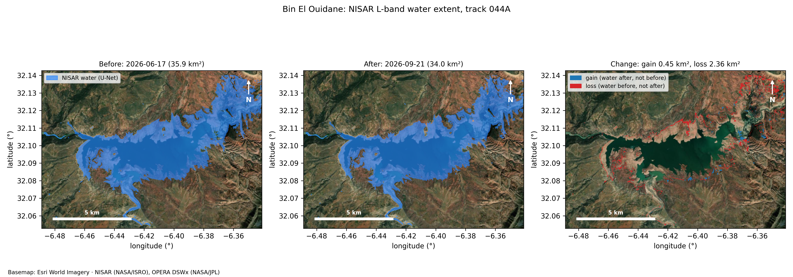
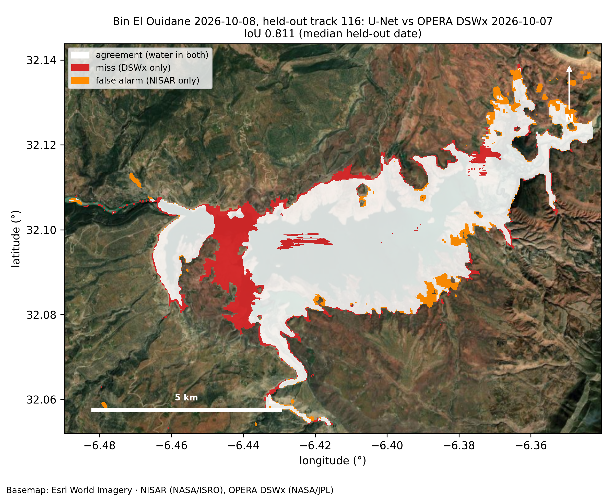
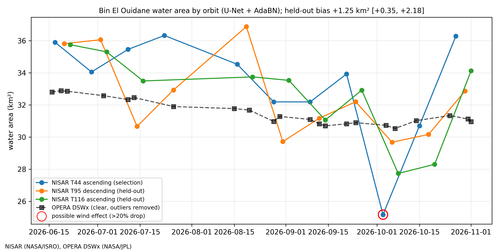
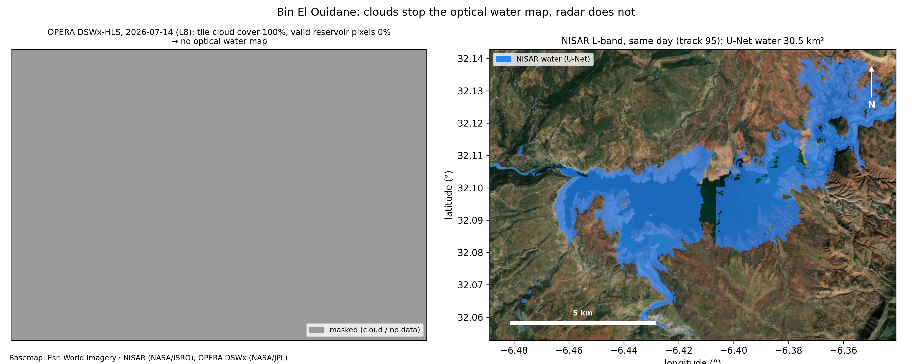
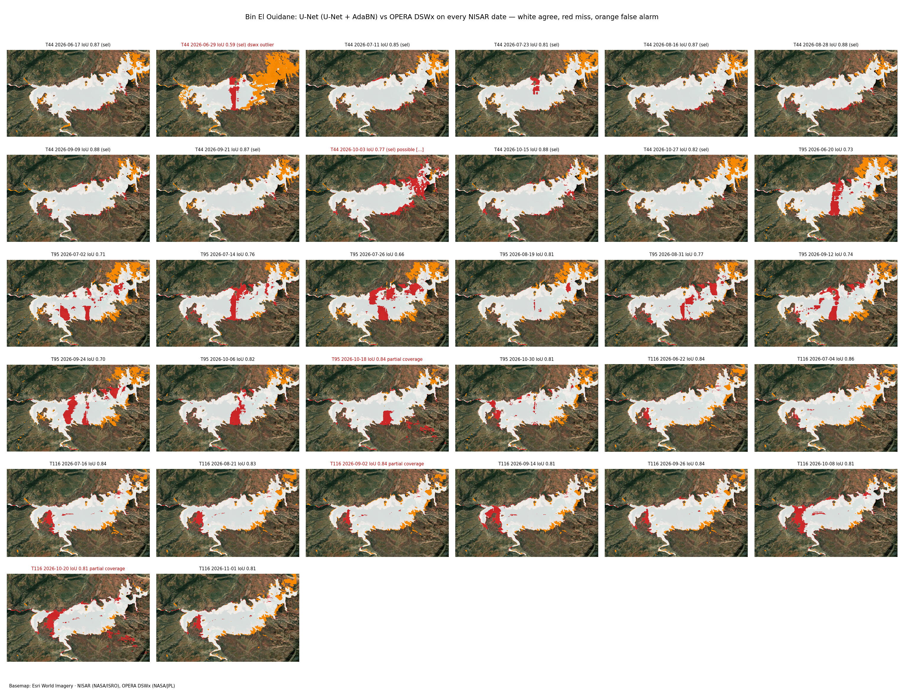

# Water U-Net: handoff for the NISAR Pulse app

_Generated by `backend/water/handoff_doc.py` from `backend/water/outputs/`; numbers are read from those files.
Rerun the script after any pipeline change. Details: [WATER_UNET.md](WATER_UNET.md)._

## 1. What we built

A water map from NISAR radar for every pass, cloud or no cloud: a per-pixel open-water probability from NISAR
GCOV HH/HV. It is used for (a) tracking the water area of a Moroccan reservoir (Bin El Ouidane) over time and (b) the
extra `open_water_change` finding of the existing `haouz-flood-2026` case (no flooded area claimed). Why it matters: optical water maps (OPERA DSWx)
fail under clouds, radar does not (`figures/clouds.png`).

## 2. Key results

| Result | Value (95% interval or 1σ) | Source file |
|---|---|---|
| S1 test IoU: U-Net vs global VH threshold | 0.674 [0.553, 0.768] vs 0.533 [0.422, 0.614]; paired difference +0.142 [0.101, 0.185] | `results.csv`, `s1_paired_diff.csv` |
| Bolivia hold-out (event never seen in training) IoU | 0.689 [0.486, 0.800] vs threshold 0.535; difference +0.155 [0.107, 0.177] | `results.csv`, `classifier_metrics.json` |
| **NISAR held-out tracks 95/116 vs DSWx (headline)** | IoU **0.763** [0.736, 0.793], precision 0.850 [0.828, 0.876], recall 0.882 [0.859, 0.908]; global threshold 0.146; 18 dates | `heldout_eval.json` |
| NISAR selection track 44 (used to choose the variant) | IoU 0.852 [0.831, 0.870] | `heldout_eval.json` |
| NISAR all tracks pooled, best variant (**selection set, not independent**) | IoU 0.811 | `results.csv` |
| Orbit consistency (ascending vs descending, ≤3 days apart) | 2.04 km² mean absolute difference (6.3%), 21 pairs | `results.csv`, `orbit_consistency.csv` |
| Area bias, model minus DSWx (held-out tracks) | +1.25 km² [0.35, 2.18] (+3.9%); after a correction fitted on track 44: -0.44 km² [-1.31, 0.46] | `heldout_eval.json` |
| Reservoir change 2026-06-17 → 2026-09-21 | NISAR -1.91 ± 2.04 km² vs DSWx -2.06 ± 1.78 km² (1σ); agreement `agree` | `reservoir_case.json` |
| Haouz `open_water_change` (extra finding) | 4.80 ± 7.36 km² (1σ): **no detectable persistent flood extent** | `haouz_open_water.json` |

"Selection" numbers used DSWx to choose the method variant; "held-out" numbers did not. Reservoir choice:
no reservoir changed by more than 10% after DSWx outlier removal (largest:
Bin El Ouidane, 6.2%), so Bin El Ouidane (most clear dates) is a
**monitoring** case: Water area 2026-06-17 → 2026-09-21: NISAR -1.91 ± 2.04 km², DSWx -2.06 ± 1.78 km² (agree).

### What it looks like

**Before / after / change** on the satellite basemap (2026-06-17 → 2026-09-21, track 44):



**Validation against OPERA DSWx** on a held-out track (median-IoU date; white agreement, red miss, orange false alarm):



**Water area over time**, all three tracks and DSWx (red circles: possible wind effect):



**Why radar:** same day, the optical map is blocked by clouds, NISAR is not:



**Every NISAR date** at a glance (titles in red = flagged date):



## 3. The model, briefly

U-Net with a ResNet-34 encoder; input HH and HV backscatter in dB (2 channels); output a per-pixel water
probability, thresholded at 0.4 (fixed on Sentinel-1 validation). Trained on Sentinel-1 hand-labelled
chips (Sen1Floods11), transferred to NISAR with per-scene normalization and AdaBN (BatchNorm statistics re-estimated
on unlabelled NISAR tiles); no NISAR labels used. Operational variant: **U-Net + AdaBN**, chosen on track 44 only.
Evaluated against OPERA DSWx-HLS (optical, weak reference). Details: [WATER_UNET.md](WATER_UNET.md).

## 4. What is ready to use

All paths are relative to `backend/water/outputs/`. Large GeoTIFFs and checkpoints stay in the data root
`NASA_DATA` (outside the repo) and are not needed by the app.

| File | Purpose | Validation |
|---|---|---|
| `haouz_open_water.json` | Haouz extra finding `open_water_change`, figure `clouds.png`, limits | the `findings[]` entries validate as `science.case_models.Finding`; `python -m science.cases --offline --dry-run` assembles `haouz-flood-2026` with it |
| `reservoir_case.json` | draft method case `bin-el-ouidane-2026` (unregistered) | nested `Finding` and `Figure` objects validate; the full `CaseStudy` does not validate yet (id; Input should be 'panama-2026', 'venezuela-2026', 'haouz-flood-2026' or 'ionosphere-gps' [type=literal_error, input_value='bin-el-ouidane-2026', input_type=str]) |
| `classifier_metrics.json` | `Answer.classifier` candidate | has every `ClassifierResult` field of `frontend/src/api/contract.ts` (label, beta: true, precision, recall, evaluated_on); extra keys are ignored by zod |
| `raster_index.json` + `rasters/*.png` | 3 RGBA PNG map layers, EPSG:4326, north-up, transparent = no data: water_before ×1, water_after ×1, water_change ×1 | follows the RasterLayer image rules; served as figure kind `image` today |
| `figures/` | slide/case images: clouds.png, diagnostic_2026-06-17.png, diagnostic_2026-09-21.png, diagnostic_2026-10-08.png, dswx_outlier_check.png, gallery_contact_sheet.png, hero.png, locator.png, timelapse.gif, timeseries.png, train_curves.png, validation.png | figure kind `image` |
| `figures/gallery/`, `figures/gallery_contact_sheet.png` | one validation map per NISAR date (internal QA) | — |
| `water_area_timeseries.csv` | km² per date and track, DSWx where clear, flags (wind / partial / outlier) | — |

Shapes (abbreviated, real keys):

```json
// haouz_open_water.json
{"date": "2026-10-10T00:00:00Z", "bbox": [...], "products": ["GCOV_T023_F073_..."],
 "findings": [{"id": "open_water_change", "label": {"fr","en","ar"},
   "nisar": {"value": 4.7968, "uncertainty": 7.364, "unit": "km2", "sigma": 1.0}, "reference": null, "reference_source": null, "agreement": "no_reference"}],
 "figures": [{"id": "haouz_backscatter_change", "raster": "...tif", "layer": {"kind": "backscatter_change", ...}}],
 "limits": [{"fr","en","ar"} × 4], "interpretation": "no detectable persistent flood extent"}

// reservoir_case.json  (CaseStudy shape + "framing", "selection_reason", "placeholders")
{"id": "bin-el-ouidane-2026", "kind": "method", "status": "final", "headline": {"template", "params", "text"},
 "findings": [{"id": "water_area_change", "nisar": {...}, "reference": {...}, "reference_source": {"name", "url"}, "agreement": "agree"}],
 "figures": [{"id": "reservoir_hero", "kind": "image", "url": "water/outputs/figures/hero.png", ...}], "timeline": [...], "limits": [...]}

// classifier_metrics.json
{"label": "flooded", "beta": true, "precision": 0.850, "recall": 0.785,
 "evaluated_on": "Sen1Floods11 Bolivia hold-out (15 chips; event excluded from training)", "precision_ci95": [...], "recall_ci95": [...], ...}

// raster_index.json
{"crs": "EPSG:4326", "bounds_order": "[west,south,east,north] pixel outer edges",
 "layers": [{"id": "water_before", "file": "rasters/water_before.png", "url": "water/outputs/rasters/water_before.png", "date": "2026-06-17", "legend": {"water": "#2684ff"}, "source": "NISAR GCOV, Water U-Net (U-Net + AdaBN)", "bounds": [w, s, e, n], ...}]}
```

## 5. What we need from the backend (Ayman)

- **Haouz:** read `backend/water/outputs/haouz_open_water.json` as an extra source of the case (see INTEGRATION_REQUESTS.md); `open_water_change` is added
  next to the existing findings; `results/` stays owned by Anass.
- **Reservoir case:** register `bin-el-ouidane-2026` under `/api/cases` only if you both accept a 5th case; the contract is
  frozen and `CaseId` does not list it. Proposal: [WATER_CONTRACT_PROPOSAL.md](WATER_CONTRACT_PROPOSAL.md).
- **Serve our PNGs from the same origin** (e.g. `/api/rasters/water/...`) so the offline service worker caches them.
- **Classifier slot:** `classifier_metrics.json` can fill `Answer.classifier` (beta: true, precision/recall on a
  held-out event) for water/flood answers, as a comparison with the existing XGBoost classifier, not a replacement.

## 6. What we need from the frontend (Houssam)

- Show our figures in the case pages: figure kind `image` works today with no contract change.
- Optional, needs a contract change: a water palette for map layers and a `water_area` series id for the time-series
  chart ([WATER_CONTRACT_PROPOSAL.md](WATER_CONTRACT_PROPOSAL.md)).
- Placement: the reservoir case card on the cases page (hero, timeseries, validation); the Haouz case shows our
  `open_water_change` finding and `clouds.png`.

## 7. Limits

- OPERA DSWx is optical and a weak reference (cloud, shadow, shoreline mixing, a different acquisition day).
- NISAR GCOV products are provisional; calibration may change.
- Sentinel-1 C-band VV/VH → NISAR L-band HH/HV is an assumed mapping (HH↔VV, HV↔VH), checked only against DSWx.
- A 12-day revisit misses short floods: Haouz measures persistent water 3-5 days after the event, not the peak.
- Area is biased high near shorelines; with AdaBN, strips of very dark, homogeneous water are sometimes missed.

## 8. How to check our work

From `backend/water/` (data root in the `NASA_DATA` environment variable; Earthdata login only for re-downloads):

```
python s1_eval.py          # S1 test + Bolivia metrics with bootstrap intervals
python heldout_eval.py     # NISAR held-out-track headline and area bias
python reservoir_case.py   # rebuild + validate the draft reservoir case
python handoff_doc.py      # regenerate this note
streamlit run preview_app.py   # internal preview of figures (not the demo)
```

From `backend/`: `python -m science.cases --results ../results --offline --dry-run` (case assembly) and
`python tests/test_science.py`.
