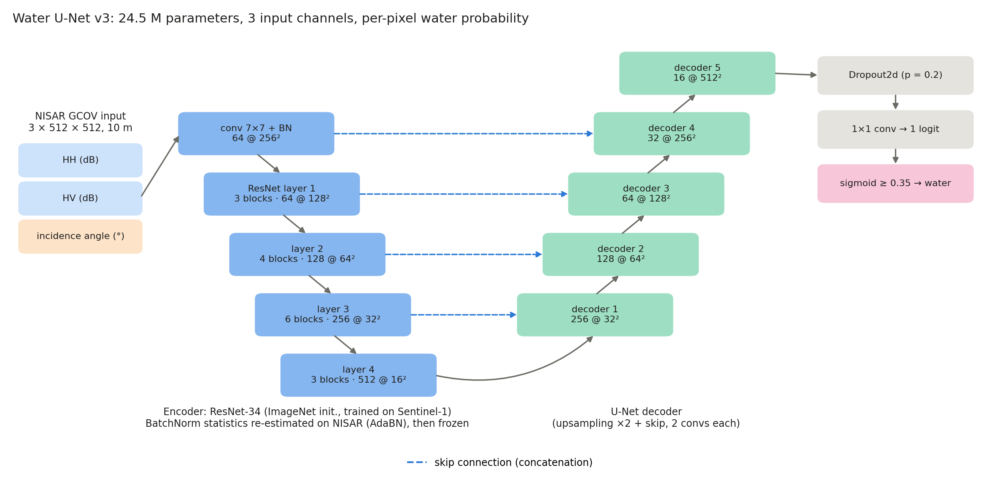
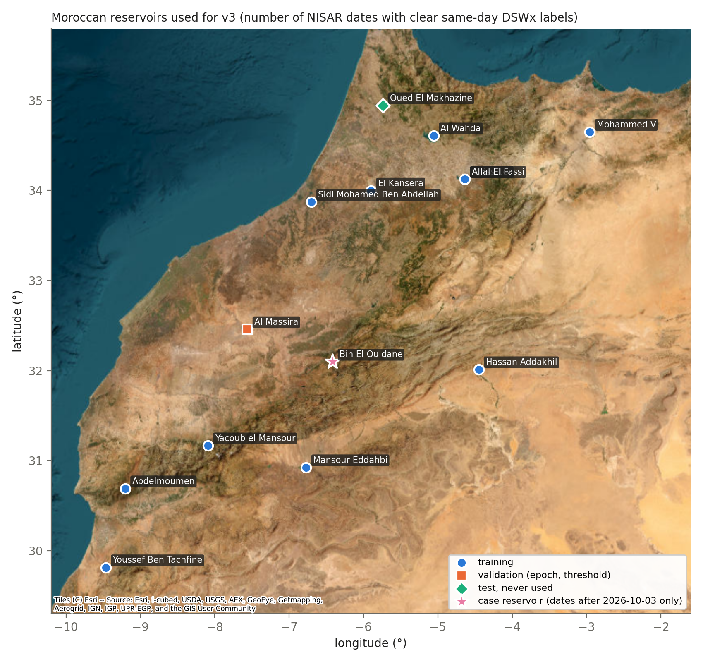
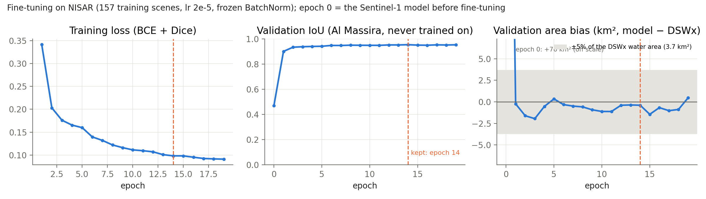
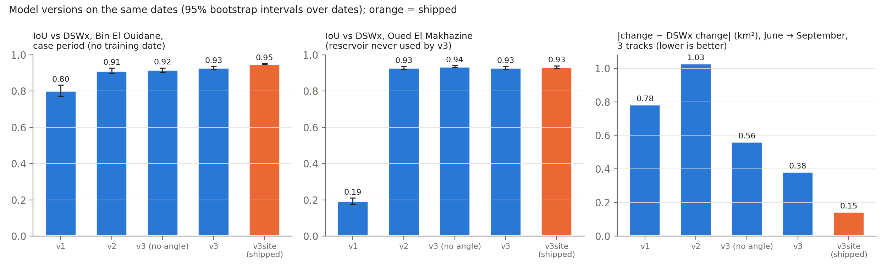
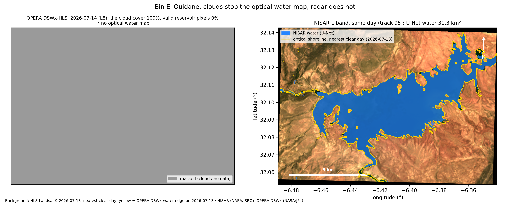
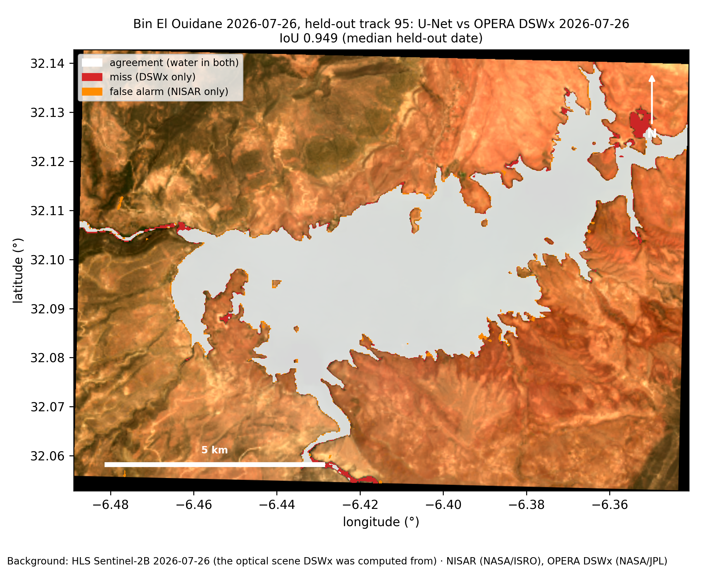
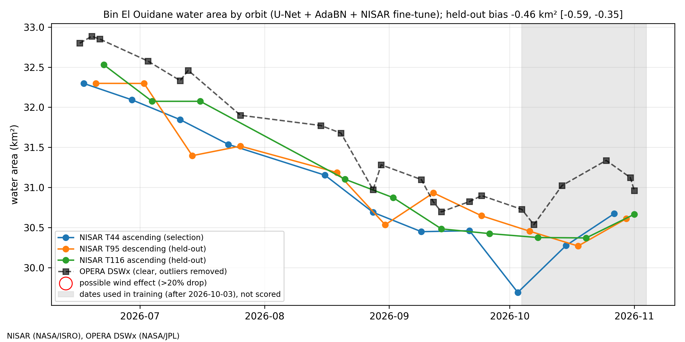

# Water U-Net v3: open-water mapping from NISAR L-band radar

A segmentation network that maps open water in every NISAR L2 GCOV scene, day or night and through clouds. It is
the model behind the Bin El Ouidane case of NISAR Pulse. The weights are in this folder.

| | |
|---|---|
| Weights | [`water_unet_v3.pt`](water_unet_v3.pt) (PyTorch, float32, 97.9 MB, 24,455,377 parameters) |
| Run it | [`predict.py`](predict.py): NISAR GCOV HDF5 (file or URL) + lon/lat box → water probability and water mask GeoTIFFs |
| Input | NISAR L2 GCOV, frequency A, HH and HV backscatter (5×5 Lee filter, dB) + radar incidence angle, 10 m grid |
| Output | per-pixel water probability; water = probability ≥ 0.35 |
| Code | `backend/water/` (data, training, evaluation); figures in this folder: `python model/model_figures.py` |



## 1. Architecture

- **U-Net with a ResNet-34 encoder** (segmentation_models_pytorch 0.6), 5 encoder stages (64 → 512 channels,
  512² → 16² pixels), 5 decoder stages with skip connections, `Dropout2d(p = 0.2)` before the 1×1 output
  convolution (used for Monte-Carlo-dropout uncertainty), sigmoid output.
- **3 input channels:**
  1. HH backscatter in dB, in the Sentinel-1 VV slot, normalised with the Sentinel-1 training statistics
     (mean −10.45 dB, std 4.04 dB);
  2. HV in dB, in the VH slot (mean −17.19 dB, std 4.31 dB);
  3. the radar incidence angle, (θ − 40°) / 5°, read from the GCOV `metadata/radarGrid/incidenceAngle` cube.
- **Why the incidence angle:** calm water reflects the radar away and looks dark; wind-roughened water and steep
  viewing make it brighter, and how much depends on the incidence angle. Without it, v2 under-mapped water seen at
  34° (Bin El Ouidane, track 44). The new channel starts with zero weights, so training begins from the 2-channel
  model's exact predictions.

## 2. Training, in three stages

| Stage | Data | What changes |
|---|---|---|
| 1. Sentinel-1 pre-training | Sen1Floods11 hand-labelled chips (C-band VV/VH, 10 m) | all weights; 60 epochs, batch 16, lr 3e-4, best epoch 46 (validation IoU 0.663) |
| 2. AdaBN | 32 NISAR scenes, **no labels** | BatchNorm statistics only, re-estimated on NISAR (C-band → L-band shift) |
| 3. NISAR fine-tuning | NISAR scenes with same-day OPERA DSWx water labels (below) | all weights except BatchNorm (frozen); + incidence channel |

**Fine-tuning data.** 14 Moroccan reservoirs (extents from OpenStreetMap); NISAR dates kept only when
a DSWx map exists within ±2 days, is ≥ 95% clear and is not an outlier (> 15% from its neighbours).



**Exactly what the fine-tuning used.** Every scene (reservoir, track, date, role) is listed in
[`fine_tuning_scenes.csv`](fine_tuning_scenes.csv) (188 scenes).

| Role | Reservoir | NISAR tracks | Scenes | Dates |
|---|---|---|---|---|
| Training | Abdelmoumen | 23, 145 | 10 | 2026-06-24 → 2026-10-25 |
| Training | Al Wahda | 15, 95 | 10 | 2026-06-20 → 2026-10-25 |
| Training | Allal El Fassi | 15, 95, 167 | 15 | 2026-06-20 → 2026-10-25 |
| Training | El Kansera | 95, 116 | 13 | 2026-06-20 → 2026-11-01 |
| Training | Hassan Addakhil | 15, 116, 167 | 16 | 2026-06-25 → 2026-11-01 |
| Training | Idriss 1er | 15, 95, 167 | 15 | 2026-06-20 → 2026-10-25 |
| Training | Yacoub el Mansour (searched as "Lalla Takerkoust") | 23, 44 | 11 | 2026-06-17 → 2026-09-21 |
| Training | Mansour Eddahbi | 44, 95 | 16 | 2026-06-20 → 2026-10-30 |
| Training | Mohammed V | 87, 167 | 13 | 2026-07-02 → 2026-10-30 |
| Training | Sidi Mohamed Ben Abdellah | 23, 95, 116 | 20 | 2026-06-27 → 2026-11-01 |
| Training | Youssef Ben Tachfine | 23, 145 | 12 | 2026-06-24 → 2026-11-06 |
| **Training (site adaptation)** | **Bin El Ouidane, the case reservoir** | 44, 95, 116 | **6** | **2026-10-06 (T95), 10-08 (T116), 10-15 (T44), 10-27 (T44), 10-30 (T95), 11-01 (T116) only** |
| Validation (epoch and threshold choice, never trained on) | Al Massira | 23, 44 | 14 | 2026-06-27 → 2026-10-25 |
| Test (never used for training or any choice) | Oued El Makhazine | 15, 95, 116 | 17 | 2026-06-20 → 2026-11-01 |

- **Bin El Ouidane is part of the fine-tuning data**, but only through its 6 passes after 2026-10-03, more than
  one 12-day revisit after the end of the June–September case period. Its passes up to 2026-10-03 are never
  trained on, and every reported Bin El Ouidane number uses only them. 2026-10-18 and 2026-10-20 are also after the
  cut but were not used (DSWx < 95% clear); all dates after 2026-10-03 are shaded in the figures.
- **OPERA DSWx is both the training label and the evaluation reference.** Agreement with DSWx therefore measures
  how well the model reproduces DSWx, not ground truth; DSWx's own errors (e.g. the 2026-06-29 snow-mask outlier)
  are removed with the outlier rule but cannot all be detected.

**Settings.** AdamW, lr 2×10⁻⁵, weight decay 10⁻⁴, batch 8 random 256² crops (half centred on water), flips and
90° rotations, loss = binary cross-entropy + soft Dice on DSWx-valid pixels, 25 epochs × 200 iterations,
mixed precision, one RTX 4060 (about 20 s per epoch).
**Choices made on the validation reservoir only:** the kept epoch is the best IoU among epochs whose water-area
bias is within 5% of the DSWx water area (epoch 14: IoU 0.953, bias −0.39 km²); the probability threshold (0.35)
is the one with the smallest area bias.



## 3. Results

DSWx (optical, Harmonized Landsat Sentinel-2) is the reference: it is a weak reference (clouds, shadows, a day up
to ±2–5 days apart), not ground truth. 95% intervals are bootstrap over dates.

| Test | v3 (shipped, site-adapted) |
|---|---|
| **Headline: Oued El Makhazine, a reservoir never used for training or any choice (17 dates)** | **IoU 0.933** |
| Bin El Ouidane, tracks 95/116 never used for choices, dates never used in training (14) | IoU 0.948 [0.944, 0.952], area bias −0.46 km² [−0.59, −0.35] |
| Bin El Ouidane water-area change, June → September, 3 tracks | **−1.83 ± 0.14 km²** vs DSWx −1.98 km² |
| Same day, ascending vs descending passes | 0.25 ± 0.05 km² mean difference |



**Versions.** v1 = stages 1–2 only (no NISAR labels). v2 = + fine-tuning on 6 reservoirs. v3 = + incidence
channel and 13 reservoirs. "v3site" (the shipped weights) = v3 + Bin El Ouidane's own passes after 2026-10-03,
more than one 12-day revisit after the June–September case period; those dates are shaded in the time series and
excluded from every number. The general v3 (never trained on Bin El Ouidane) gives −1.59 ± 0.20 km² for the
same change and IoU 0.929 on the test reservoir. A model that memorised the lake would report no change; v3site
reports −1.83 km² against −1.98 for DSWx.

| Clouds do not stop it | Held-out validation map |
|---|---|
|  |  |



## 4. Limits

- DSWx is the only reference; an error shared by DSWx and the model is invisible.
- Trained and tested on Moroccan reservoirs; rivers, wetlands, flooded
  vegetation and urban floods are outside what was checked.
- NISAR products are provisional (CRIDs P05023, P05036); a calibration change may need a new AdaBN pass.
- The site-adapted weights use Bin El Ouidane labels after 2026-10-03; for a new reservoir, the general v3 numbers
  (IoU 0.93 on a never-seen reservoir) are the honest expectation.

## 5. Reproduce

From `backend/water/`, Python 3.10, PyTorch 2.5, `requirements.txt`, an Earthdata token in `EARTHDATA_TOKEN`:

```
python finetune/ft_sites.py                       # reservoirs, NISAR dates, same-day DSWx labels (search only)
python finetune/ft_prep.py --workers 3            # windowed reads: HH/HV + DSWx label per date
python finetune/ft_incidence.py --workers 3       # incidence-angle rasters
python finetune/ft_train.py --run v3site --variants inc:0:inc --test-sites Oued_El_Makhazine \
       --case-after 2026-10-03 --epochs 25 --iters 200
python finetune/ft_eval_v3.py                     # comparison on the test reservoir and the case reservoir
python model/predict.py --h5 <GCOV .h5 or URL> --bbox W S E N --out water   # use the model
```

Credits and licences: [`../CREDITS.md`](../CREDITS.md). Full method and every number's provenance:
[`../WATER_UNET.md`](../WATER_UNET.md).
