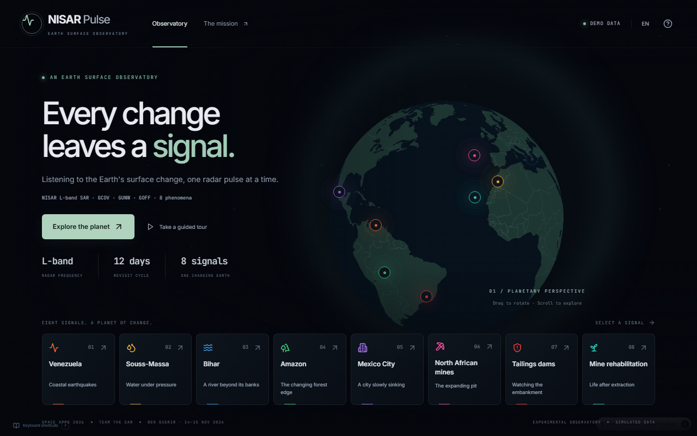
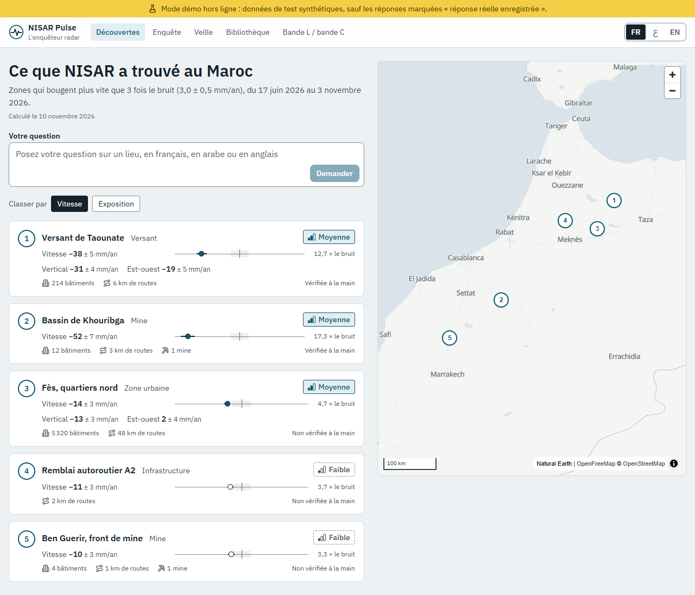
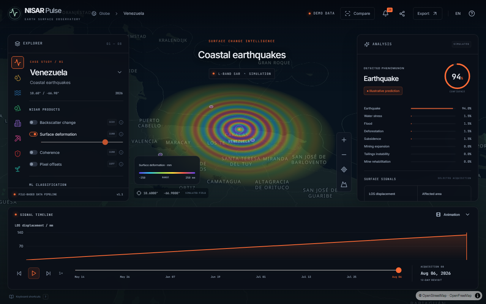
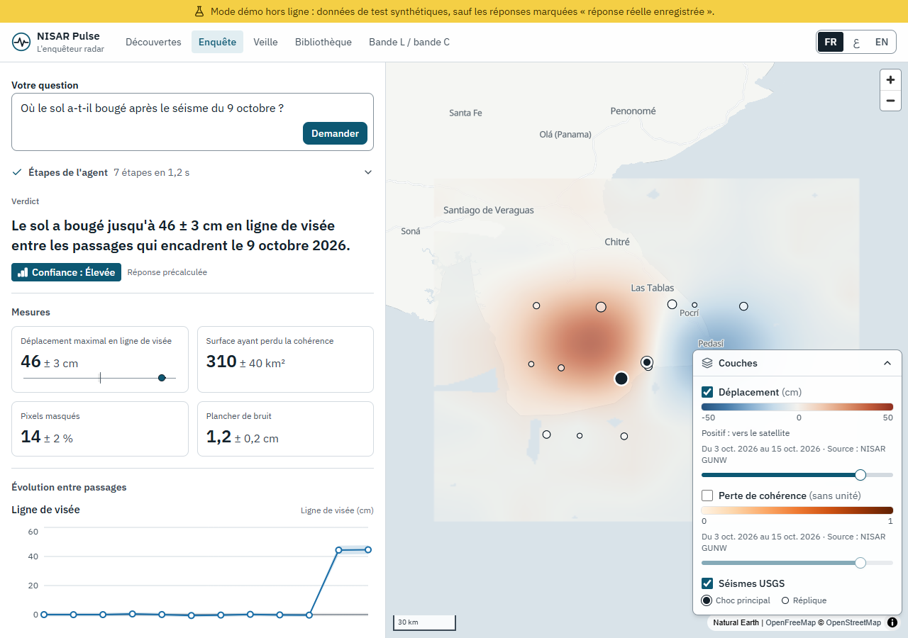

# NISAR Pulse frontend report

Branch `feat/frontend-impeccable` · 11 November 2026 · demo on 14 November.

## Summary

The v1 prototype (simulated globe with 8 cases) was replaced by the v2 **radar investigator** frontend: Ask, Prove, Watch. Following your decision, the v1 code was removed after a snapshot commit (`f3c26b3`). The frontend is **ready to connect**: the API contract is written (`src/api/contract.ts`, `docs/API_CONTRACT.md`). Until the backend exists, every screen runs on **synthetic fixtures** behind a permanent banner: "Test data: these values are not NISAR measurements".

| Before (v1) | After (v2) |
|---|---|
|  |  |
|  |  |

## Screen by screen

| Screen | Done | Captures |
|---|---|---|
| **Home "What NISAR found in Morocco"** | Zones above `threshold_factor × noise`, sortable by velocity (`rank`) or exposure (`exposure_score`, from the API). Each zone has its velocity ± σ, a **noise ruler** (centred number line: noise band, ±σ whisker, value), its × noise ratio, vertical / east-west when available, OSM exposure, confidence and "checked by hand". The whole row and the numbered map markers are clickable. Explicit "stable within noise" empty state. | `*-discover.png` |
| **Investigation (map + conversation)** | Free question (FR/AR/EN, `dir="auto"`), map click to pick a place, example questions taken from `/api/demo` in the reader's language. Agent steps stream in over SSE (name, tool, status, collapsible parameters, duration), then fold into one line ("7 steps in 1.2 s") when the verdict arrives. MapLibre map with displacement and coherence-loss rasters, USGS mainshock and aftershocks, a legend that always shows unit, scale, sign convention, period and source, opacity sliders, metric scale bar and attribution. | `*-investigate-panama.png` |
| **Answer** | One-sentence verdict (templated), confidence badge (bars + word, never colour alone), "stable within noise" given the same care as an alert. Measurements with ± and noise ruler, vertical / east-west as small multiples on a shared axis, curve with uncertainty band (±σ from the API), noise band and marked NISAR passes, accessible tooltip and **data table**. Then the 4 uncertainty checks, independent evidence, product / status / period / tracks, Fukuzono "indication" with its caveat, beta classifier (if provided). **"What the radar cannot tell here" comes last.** | `*-answer-alwahda.png`, `*-answer-zone1.png` |
| **Watch** | Watched places, level (Yellow eye / Orange triangle / Red octagon + word), next pass with "in N days", last pass. Notification history shown **in FR and AR** side by side. Stopping a watch asks for confirmation inside the page. "Watch this place" in an answer shows the next pass and the FR + AR message. | `*-watch.png` |
| **World library** | Events with an independent source, agreement status and NISAR vs reference comparison (both ±). | `*-library.png` |
| **L-band vs C-band proof** | Two maps on the **same scale** (NISAR vs Sentinel-1 coherence), coherence by forest cover with ±σ error bars and the usable threshold (from the API), table view, limits. | `*-proof.png` |

Cross-cutting work:
- **Design system:** light tokens, IBM Plex Sans + IBM Plex Sans Arabic (self-hosted), canonical raster palettes shared with the backend (`src/design/palettes.json`), chart series validated with the dataviz checker (chroma, CVD, contrast), see `PRODUCT.md`.
- **i18n:** i18next, FR default, AR full RTL (layout mirrored, logical properties), EN. Language switches without reloading. Six Arabic plural forms. Numbers in Western digits (ar-MA). Numeric runs isolated left to right inside Arabic sentences.
- **Data:** TanStack Query, query cache persisted to localStorage, demo bundle prefetch, offline replay of precomputed answers (staged, under 4 s; immediate with reduced motion).
- **Robustness:** a contract violation produces an explicit error, never a guessed value. Map and route error boundaries (a missing chunk offline no longer brings down the app).

## Phase 3 results

| Check | Result |
|---|---|
| `tsc --noEmit` | ✅ 0 errors |
| `eslint .` | ✅ 0 errors |
| Unit tests (vitest) | ✅ 27/27: rounding to the uncertainty, LTR isolation, contract vs fixtures, contract rules (no answer without limits, no measurement without uncertainty), FR/AR/EN question matching, SSE parser, FR/AR/EN key parity, Arabic plural forms, template coverage, no digits in templates |
| Hard-coded numbers (`check:numbers`) | ✅ none in `src/` (fixtures and shadcn primitives excluded) |
| WCAG AA contrast (`check:contrast`) | ✅ 21/21 pairs. Fixed: the control border was at 2.09:1 and is now ≥ 3:1 |
| axe-core (WCAG 2.2 AA), 8 routes × FR/AR/EN | ✅ 24/24, 0 serious or critical violations. Fixed: language buttons (accessible name ≠ visible text), unnamed slider thumbs. Moderate and minor violations are not blocking in the test |
| Keyboard | ✅ skip link → main, every control reachable with visible focus (answer, "Watch this place", opacity sliders), language switch without reload |
| `dir` / `lang` | ✅ `rtl`/`ar` and `ltr`/`fr|en` checked on every route |
| Network cut (production build + service worker) | ✅ full demo path offline, "Offline" indicator, simplified basemap, **0 console errors** |
| http adapter (production build, `/api` mocked from fixtures) | ✅ SSE ask, translated backend error, contract violation → explicit error, offline replay from the persisted cache, staged in < 4 s |
| Widths 375 / 768 / 1280 / 1920 × 3 languages | ✅ 84 captures in `docs/screenshots/`, **no horizontal overflow** |
| Timed demo (`npm run e2e:demo`) | ✅ 6.8 s automated, Panama 0.54 s, Al Wahda 0.89 s, live SME2 3.4 s (simulated pace), **0 console errors** |

Visual review: hierarchy, alignment, RTL mirroring, Arabic text without overflow, legend legibility. The fixes from that review are in the history: map container at zero height, map waiting for remote tiles (now `style.load`), legend covering the area (now a legend-aware fit), irregular axis ticks (now nice ticks), steps pushing the verdict down (now folded), Arabic minus sign isolation.

## Motion (14 November)

Every movement shows a real physical step; nothing animates through invented values. Canvas, SVG and CSS only, no dependency. `prefers-reduced-motion` removes all of it (end states, immediate answers; tested in `e2e/motion.spec.ts`).

- **Agent at work**: real elapsed time; steps arrive one by one (a pacer spaces precomputed answers so the reasoning can be followed); on the map, satellite passes sweep over the point, alternately ascending and descending, with the side-looking beam and its pulses.
- **Raster reveal**: each answer's rasters are drawn strip by strip behind the beam front, in the flight direction of the acquisition (`tracks[0].direction`). The PNG pixels are unchanged; only how much is shown varies.
- **Noise ruler**: the measurement settles from zero onto its value, the uncertainty opens around it, and a pulse marks it when it clears the noise.
- **Time series**: drawn left to right, pass after pass.
- **Home**: once per session, a pass crosses the map and every event answers with an echo as the beam reaches it.
- **L-band vs C-band**: to-scale wavelengths (from the instruments' frequencies): the C-band wave scatters from the foliage, the L-band wave reaches the ground and returns to the satellite.
- **Watch**: an orbit clock from the last pass to the next one (both from the API).

The whole staged answer stays under four seconds (`STAGE` in `src/motion/motion.ts`; measured: Panama 2.5 s, Al Wahda 2.4 s, Gharb live 3.5 s).

## Still imperfect, and why

1. **No backend: every value is synthetic.** Panama, Al Wahda, the zones, the library and the L/C figure are fixtures. The Al Wahda coordinates are approximate (the plan says its footprint "is still to be placed"). The Panama epicentre and aftershocks are invented for the UI. This is said by the banner and here. **Nothing must be shown to the jury as a measurement before the API is plugged in.**
2. **Library: 2 events (Panama, Venezuela) instead of 6–8.** I know no other verified event since June 2026, and I did not invent any. The backend will provide them (`/api/library`).
3. **Map labels in Latin script in Arabic.** Arabic shaping in MapLibre needs the RTL plugin, which is not bundled (one more dependency, ask first). UI text is fully Arabic.
4. **Offline basemap = land and borders (Natural Earth 1:50m).** Detailed OpenFreeMap tiles are cached only for areas already viewed online (CacheFirst). **Open the demo areas once online before going on stage.**
5. **Fixtures mode: watches are in memory** (reset on reload). In http mode, persistence is the backend's job.
6. **Zones without `answer_id`** start the question "What is happening here?". In fixtures mode this gives an explicit error ("no answer in the test data"). Only zone #1 has a precomputed answer.
7. **Advisories (`npm audit --omit=dev`):** `maplibre-gl` < 6.5 (critical, XSS in `DOM.sanitize`), `react-router` < 7.17 (moderate, open redirect), `zod` < 4.6.6 (high, memory). Actual exposure is low: fixed attributions, no HTML popups, internal routes built from encoded ids, payloads from our own backend. The fix needs **major upgrades**, which I did not make without your approval three days before the demo.
8. **Bundle size:** map chunk about 790 KB (it embeds the offline borders), MapLibre about 1 MB, charts about 570 KB. Fine locally and precached by the service worker. Not optimized for a slow first load.
9. **Tools:** `frontend-design` and `i18n-date-patterns` are installed (SKILL.md read, nothing doubtful). Not installed: **Impeccable** and **vercel-labs/agent-skills** (they go through `/plugin`, which only you can run), the two **jezweb** skills (no longer at the stated path in the repo), **agent-ui-design** and **geospatial** (not verified). `.mcp.json` is written, but the shadcn, Playwright and Context7 MCP servers only load after a restart: during this session I used the shadcn CLI and Playwright directly. `/impeccable audit|critique` was therefore not run; I applied the frontend-design and dataviz checklists instead.
10. **Incident:** the shadcn CLI resolved `@/lib/utils` to an npm package named `cn` and installed it. It was removed and the imports fixed.
11. Small cosmetic item: in `src/lib/format.ts` the LRI and PDI characters are written literally rather than as `⁦`/`⁩` (same behaviour, less readable).

## Run

```bash
npm install
npm run dev                                   # fixtures (synthetic), http://127.0.0.1:5173
npm run dev:api                               # real API: proxies /api → http://127.0.0.1:8000

# Offline demo mode
npm run build:demo && npm run preview:demo    # http://127.0.0.1:4173. Open once online, then cut the network

# Rehearse the demo (timed, fails on any console error)
npm run e2e:demo

# All checks
npm run typecheck && npm run lint && npm test && npm run check:numbers && npm run check:contrast && npm run e2e
SCREENSHOTS=1 npx playwright test e2e/screens.spec.ts --project=demo   # regenerate docs/screenshots
```

## Proposed API changes

Detailed in `docs/API_CONTRACT.md` § "API changes the UI needs". In short: templated prose (`TemplatedText`) instead of free LLM text, a `/api/demo` endpoint, `noise_floor` in the metric's own unit and `sigma` on series, place names in three languages, and a `lang` on each demo question.
