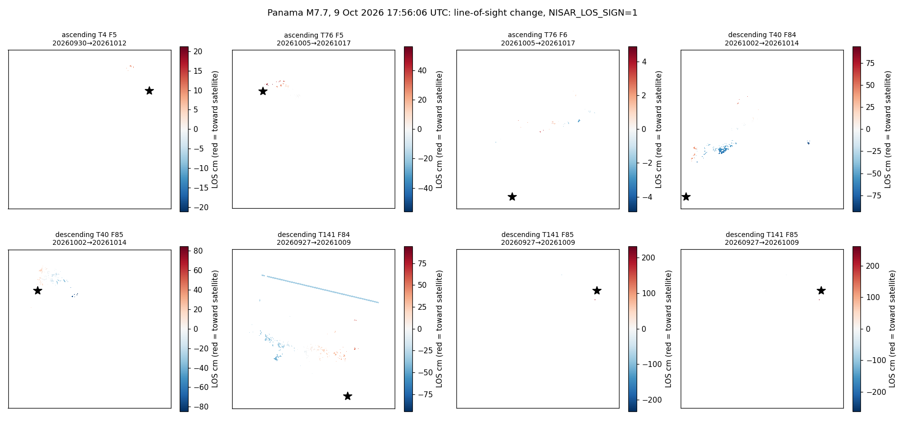

# Sign check: line-of-sight convention (STATUS H4)

Current: `NISAR_LOS_SIGN=1`, `NISAR_LOS_SIGN_VERIFIED=0`. This script changes nothing.

Basis: documented convention (ARIA-tools, MintPy prep_nisar): GUNW unwrapped phase positive = motion away from the sensor; displacement = -lambda/(4 pi) x phase, positive = toward the satellite.

## 1. Attributes in the raw file

From `NISAR_L2_PR_GUNW_032_004_A_005_033_4000_SH_20260930T110420_20260930T110435_20261012T110420_20261012T110436_P05023_N_P_J_001.h5`:

- `science/LSAR/GUNW/grids/frequencyA/unwrappedInterferogram/HH/unwrappedPhase`
  - DIMENSION_LIST: [array([<HDF5 object reference>], dtype=object), array([<HDF5 object reference>], dtype=object)]
  - _FillValue: nan
  - description: Unwrapped interferogram between HH layers
  - grid_mapping: projection
  - max_value: 20.888166427612305
  - mean_value: -1.0191541910171509
  - min_value: -27.74576187133789
  - sample_stddev: 4.594761848449707
  - units: radians
- `science/LSAR/GUNW/metadata/radarGrid/losUnitVectorX`
  - DIMENSION_LIST: [array([<HDF5 object reference>], dtype=object), array([<HDF5 object reference>], dtype=object), array([<HDF5 object reference>], dtype=object)]
  - _FillValue: nan
  - description: East component of the line-of-sight (LOS) unit vector, defined from the target to the sensor, expressed in the east-north-up (ENU) coordinate system with its origin at the target location
  - grid_mapping: projection
  - long_name: LOS unit vector X
  - units: 1
  - valid_max: 1.0
  - valid_min: -1.0
- `science/LSAR/GUNW/metadata/radarGrid/losUnitVectorY`
  - DIMENSION_LIST: [array([<HDF5 object reference>], dtype=object), array([<HDF5 object reference>], dtype=object), array([<HDF5 object reference>], dtype=object)]
  - _FillValue: nan
  - description: North component of the line-of-sight (LOS) unit vector, defined from the target to the sensor, expressed in the east-north-up (ENU) coordinate system with its origin at the target location
  - grid_mapping: projection
  - long_name: LOS unit vector Y
  - units: 1
  - valid_max: 1.0
  - valid_min: -1.0

## 2. Panama co-seismic maps



- ascending T4 F5: `GUNW_T004_F005_20260930_20261012` (98th percentile |LOS| 21.21 cm)
- ascending T76 F5: `GUNW_T076_F005_20261005_20261017` (98th percentile |LOS| 56.16 cm)
- ascending T76 F6: `GUNW_T076_F006_20261005_20261017` (98th percentile |LOS| 4.88 cm)
- descending T40 F84: `GUNW_T040_F084_20261002_20261014` (98th percentile |LOS| 93.42 cm)
- descending T40 F85: `GUNW_T040_F085_20261002_20261014` (98th percentile |LOS| 84.73 cm)
- descending T141 F84: `GUNW_T141_F084_20260927_20261009` (98th percentile |LOS| 94.6 cm)
- descending T141 F85: `GUNW_T141_F085_20260927_20261009` (98th percentile |LOS| 232.42 cm)
- descending T141 F85: `GUNW_T141_F085_20260927_20261009` (98th percentile |LOS| 262.1 cm)

## 3. What to compare with

- USGS event page: https://earthquake.usgs.gov/earthquakes/eventpage/us6000u18k
- Focal mechanism / moment tensor: https://earthquake.usgs.gov/earthquakes/eventpage/us6000u18k/moment-tensor
- Finite fault: https://earthquake.usgs.gov/earthquakes/eventpage/us6000u18k/finite-fault

The event is **strike-slip**: the line-of-sight map should show lobes of opposite sign on either side of the fault, and the ascending and descending maps differ (they look from opposite sides). Compare the sign of each lobe with the motion predicted by the finite-fault model projected on each look direction. Do NOT use the synthetic Panama of the tests (25 cm uplift) as sign evidence.

## 4. Record the decision (a human runs this)

```powershell
# If the maps match the USGS mechanism with the current sign (red = toward the satellite):
$env:NISAR_LOS_SIGN = "1"; $env:NISAR_LOS_SIGN_VERIFIED = "1"
# If every lobe has the opposite sign in both look directions:
$env:NISAR_LOS_SIGN = "-1"; $env:NISAR_LOS_SIGN_VERIFIED = "1"
# then, in the same PowerShell window:
python precompute.py
# (bash: export NISAR_LOS_SIGN=1 NISAR_LOS_SIGN_VERIFIED=1). Undecided: change nothing.
```
